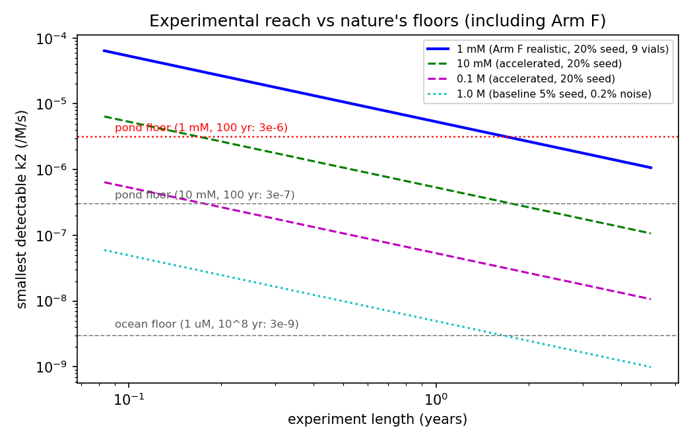

# The slow experiment: searching for self-amplifying handedness at nature's speed

## Aim
Test whether simple early-Earth chemistry in water can **amplify a small excess of one hand**
when given months to years instead of days. The spec sheet (README Part 6) shows that
speed is never the problem for nature, yet lab searches usually stop after days.

## Hypothesis (stated before any data)
At least one prebiotic, water-based peptide-forming system shows **seed-following growth of
enantiomeric excess** (ee) at meteoritic concentrations (≤ 1 mM), with an effective rate k2 ≥ 3×10⁻⁶ /M/s.
That rate is slow enough to be missed by short experiments but fast enough to matter in a 1 mM pond over
100 years (the "pond floor").

*Revised 2026-09-30 after expert feedback.* The first version ran at 0.1 M with
an assumed 0.2% ee precision. Meteoritic isovaline reaches about 20 nmol/g of rock where it carries an excess
(Murchison) and 244 nmol/g where it is racemic (EET 92042), about 0.2–2 mM in parent-body water at a
water-to-rock ratio of 0.1. Published ee uncertainties are ±0.01–1.5% (GC-MS) and 1.2–7.2% (LC-MS),
and 2.6% is the standard error of 20 measurements of Murchison isovaline (Glavin & Dworkin 2009;
their racemic standard read −2.3 ± 1.3%, n = 14).

## Why a *seeded* design
A reaction that only copies itself keeps ee constant, because both hands grow equally. ee *grows*
only if the hands also **suppress each other**. So watching ee grow from a small seed tests
self-copying and mutual suppression together (spec R1 + R2), which is exactly the missing
combination. Seeding is also far faster than waiting for symmetry to break from pure 50/50.
From 50/50, noise in a 50 µL, 1 M vial would need about 18 e-foldings of growth to become visible, versus
under 1 from a 5% seed.

## How long and how concentrated (`design.py`, `review.py` R5)
Smallest detectable rate (/M/s) with a **20% seed**, similar to the largest isovaline excesses in
Murchison. Each time point is measured 9 times, so the noise is σ/3:

| concentration | ee noise per measurement | 1 month | 6 months | 1 year | 3 years |
|---|---|---|---|---|---|
| **1 mM (realistic)** | 2.6% | 6×10⁻⁵ | 1×10⁻⁵ | 5×10⁻⁶ | **2×10⁻⁶** ✓ pond |
| 1 mM | 1% | 3×10⁻⁵ | 4×10⁻⁶ | 2×10⁻⁶ ✓ | 7×10⁻⁷ |
| 10 mM (accelerated) | 2.6% | 6×10⁻⁶ | 1×10⁻⁶ | 5×10⁻⁷ | 2×10⁻⁷ |
| 0.1 M (accelerated) | 2.6% | 6×10⁻⁷ | 1×10⁻⁷ | 5×10⁻⁸ | 2×10⁻⁸ |

Nature's floors at realistic concentrations: **pond 3×10⁻⁶** (1 mM, 100 yr); **ocean 3×10⁻⁹**
(1 µM, 10⁸ yr). No lab run can reach the ocean floor at natural concentration.

**Choice: two tiers.**
1. **Realistic arm:** 1 mM, 20% seed, 3 years, 9 independent vials per condition. Reaches
   1.8×10⁻⁶, below the pond floor (3 vials would reach 2.9×10⁻⁶, only 8% below it). This asks directly whether amplification happens at meteoritic
   concentrations.
2. **Accelerated arm:** 10 mM and 0.1 M for 1 year. These are **not natural conditions**. The arm exists
   to find any amplifier at all and to measure how the rate of ee growth scales with concentration
   (the rate law). The model needs that scaling to extrapolate to 1 µM. If ee grows faster at 0.1 M than
   at 10 mM by exactly 10×, k2 is a true second-order constant and the extrapolation is fair.

## Arms (chemistries to test)
Chosen from the scorecard for prebiotic inputs (R4) and biological products (R7); arm G (added 2026-10-17) also meets R8, many molecules decide (README Part 6):

| arm | system | why | source |
|---|---|---|---|
| A | amino acids + carbonyl sulfide (volcanic gas) → peptides, in water | prebiotic peptide formation; peptides can prefer same-hand partners | Leman, Orgel & Ghadiri 2004 |
| B | amino acids + hydroxy acids, **wet-dry cycling** (e.g. daily) | pond-like driving; makes polypeptides | Forsythe et al. 2015 |
| C | prebiotic cysteine peptides that **catalyse peptide joining** in neutral water | the closest known thing to self-copying in prebiotic water | Foden et al. 2020 |
| D | RNA precursor (RAO) on **magnetite**, then crystallization | non-autocatalytic route that already breaks symmetry | Ozturk et al. 2023 |
| E | peptide-catalysed **transamination** (pyruvate + pyridoxamine → alanine) coupled to **peptide ligation**, run **fed (slow flow)** | a proposed prebiotic network predicted (in a model) to break symmetry on its own, built from two reactions studied in the lab; the model says it must be fed, not closed (`review.py` R6) | Yu et al. 2024; Deng, Yu & Blackmond 2024; Higgs & Blackmond 2025 |
| F | prebiotic **DNA/RNA precursor synthesis** (glycolaldehyde + glyceraldehyde + 2-aminooxazole → ribo-aminooxazoline RAO) coupled with chiral dipeptide catalysis, run **fed** | directly tests whether the "hand of DNA" is selected and amplified by asymmetric cross-coupling with peptides (Ozturk & Sasselov 2025; `dna_network.py`), overcoming chiral cross-inhibition | Breslow & Cheng 2010; Hein, Tse & Blackmond 2011; Ozturk & Sasselov 2025 |
| G | prebiotic **nonenzymatic RNA copying** with 2-aminoimidazole-activated nucleotides, seeded L or D monomer excess, run **fed with temperature cycling** | copying and mutual suppression molecule by molecule in water: an L-nucleotide at the 3′ end of a D-RNA primer ends copying, and heterochiral bridged dinucleotides form slightly faster than homochiral ones; RNA can pass its hand to amino acids | Joyce et al. 1984; Essex et al. 2026 (preprint); Kim et al. 2025 |
| + | **Positive control:** Viedma grinding of a known conglomerate | proves the pipeline detects real amplification | Viedma 2005 |

Arms E and C are the priority. E is a prebiotic network with a published model prediction that it may break symmetry on its own (Higgs & Blackmond 2025). Its transamination step has been run in the lab but its rate is not yet pinned down: Yu et al. 2024 Table 2 reports % conversions for the *reverse* reaction (alanine + pyridoxal → pyruvate + pyridoxamine), which imply rough second-order rates of 6×10⁻⁶–1×10⁻⁴ /M/s depending on the peptide catalyst (our estimate, not a measured rate constant). That is a conversion rate, not the amplification rate k2 in the table above, so it does not show that E's amplification would be detectable; measuring k2 is the point of the arm. *(Corrected 2026-10-01: earlier text called E "the only" such network and said its step "has a measured rate near 10⁻⁴ /M/s … well above the 1-year detection floor"; the 10⁻⁴ came from the reverse reaction and the floor applies to k2, not to conversion.)* Run E in a slowly fed vessel; a closed vial is predicted to return to 50/50. C is the only other catalytic loop in prebiotic water.

Arm F (added 2026-10-10) is also a priority. It tests whether chiral amino acids / peptides stereoselectively drive D-ribose / D-RNA nucleotide precursor excess (RAO) and amplify it through non-equilibrium crystallization/oligomerization (Hein et al. 2011; Ozturk & Sasselov 2025), testing the asymmetric rescue prediction in `dna_network.py`.

**Which arms can carry a PVED-selected hand (R8, added 2026-10-17).** A bias of g ~ 10⁻¹⁷ can steer
only a decision made by a huge well-mixed pool. In crystallizations only about 1–300 units decide
(`crystal_check.py`, `blind_units.py`), so their hand is set by those units' own chance excess.
**Arm D and the crystallization step of arm F can amplify, but the PVED cannot steer them.** A positive
result there shows amplification only. The arms whose decision is made molecule by molecule in solution
are C, E and G (and A and B if their peptides stay dissolved). The Viedma positive control still
checks detection; it is not a candidate.

**Arm G (added 2026-10-17).** Template-directed copying of short RNA primers with 2-aminoimidazole-activated
nucleotides in water. It is the only arm in which mutual suppression (R2) has been measured molecule by
molecule (Essex et al. 2026, preprint), but self-sustaining copying (R1) has not been shown, so this arm
asks whether repeated copying cycles make a seeded excess grow. It is not a peptide system, so it tests
the hypothesis above only in its broader form ("a prebiotic, water-based system").
- Feed: activated D- and L-mononucleotides with a +20% L, +20% D or 0% excess, as in the other arms;
  short D- and L-primer–template pairs at equal amounts.
- Drive: temperature cycling to separate strands (R3), with fresh activated monomer fed each cycle.
- Readout: the excess of full-length D- over L-products per cycle (chiral LC-MS of the products, or
  mirror-image primers with distinct labels). Seed-following growth means the excess rises with cycle
  number in both the L- and D-seeded sets, by equal and opposite amounts.
- Stepped feed (R9): repeat the racemic set at three or more feed rates. If the 50/50 state is stable at
  low feed and lost above a threshold, the arm meets R9, the slow tip-over that Eq. 11 assumes.
  Arm E can be run the same way.

**Model predictions at measured rates (added 2026-10-17).** Both solution arms are expected to show
seed-following only, with no excess growing from 50/50, unless one number differs from what is known:
- **Arm E** (`arm_e_rates.py`, rates from Yu et al. 2024): at 1–5 mM alanine the network never passes the
  bifurcation, because uncatalysed breakdown outruns the catalysed path. The catalysed rate would have to
  be 735× (5 mM) to 3658× (1 mM) higher; catalyst saturation gives at most ~2×. k2 at measured rates is
  negative (an excess decays), so the 1.8×10⁻⁶ /M/s floor is not reached. Expected result: null. Still
  unmeasured: the ligation rates, K, and whether Ala-Ala catalyses like Pro-Pro.
- **Arm G** (`rna_copying.py`, rates from Walton & Szostak 2017): the 50/50 state is lost only if
  r = (wrong-hand addition rate)/(right-hand addition rate) exceeds 1, inside a window set by washout.
  Essex et al. 2026 point to r < 1, so the expected result is a seeded excess rising to a bounded
  plateau (about 0.35 for a +20% feed at r = 0.1) and the 0% set staying at 50/50 at every feed.
  **Measure r first:** primer extension by D- vs L-activated monomer on a D-template, in the arm's own
  buffer. r > 1 makes arm G a candidate for R9; r < 1 settles it as seed-following only.
- If either arm does cross, both models predict a slow tip-over (supercritical pitchfork, no
  hysteresis), so the stepped-feed runs above test R9 directly.

### Arm F wet-lab specifications: prebiotic nucleotide precursor synthesis with dipeptide catalysis

Arm F directly tests the network hypothesis developed in `dna_network.py`: namely, whether a small chiral seed in peptides/amino acids can direct the stereoselective synthesis of nucleic acid precursors (specifically ribo-aminooxazoline, RAO) and overcome opposing sugar PVED or chiral cross-inhibition through asymmetric cross-coupling ($\kappa_{as} / \kappa_{sa} > (|g_s| / g_a)^2$; Breslow & Cheng 2010; Hein et al. 2011; Ozturk & Sasselov 2025).

#### 1. Prebiotic Reaction Chemistry
- **Precursor Condensation:** Glycolaldehyde ($\text{HOCH}_2\text{CHO}$) and DL-glyceraldehyde ($\text{HOCH}_2\text{CH(OH)CHO}$) undergo aldol coupling in aqueous solution in the presence of 2-aminooxazole (formed prebiotically from cyanamide and glycolaldehyde; Powner et al. 2009). The resulting condensation and cyclization yields pentose aminooxazolines, predominantly ribo-aminooxazoline (RAO) and arabino-aminooxazoline (AAO).
- **Chiral Catalyst:** Chiral dipeptides (e.g., L,L- or D,D-stereoisomers of Val-Val, Pro-Pro, or Leu-Ala; 5–10 mol% relative to precursors). This is untested: Breslow & Cheng 2010 used L-amino-acid *monomers* (not dipeptides) with formaldehyde + glycolaldehyde and got D-glyceraldehyde excesses up to 60/40; no dipeptides were tested. Whether dipeptides direct this aldol step is part of what Arm F measures; an L-amino-acid monomer arm (as in Breslow & Cheng 2010) is the reference.

#### 2. Reactant Concentrations
- **Realistic Tier (1 mM, meteoritic pond floor):**
  - Glycolaldehyde: 1.0 mM
  - DL-Glyceraldehyde: 1.0 mM
  - 2-Aminooxazole: 1.0 mM
  - Chiral dipeptide catalyst (L,L or D,D seed): 0.10 mM (10 mol%, $100\ \mu\text{M}$)
  - Total volume per reactor: $V = 2.0\ \text{mL}$
  - Reflects pristine carbonaceous chondrite parent-body fluid concentrations ($\le 1\ \text{mM}$, Glavin & Dworkin 2009).
- **Accelerated Tiers (10 mM and 100 mM):**
  - **10 mM tier:** 10.0 mM glycolaldehyde, 10.0 mM DL-glyceraldehyde, 10.0 mM 2-aminooxazole, 1.0 mM dipeptide catalyst.
  - **100 mM (0.1 M) tier:** 100.0 mM glycolaldehyde, 100.0 mM DL-glyceraldehyde, 100.0 mM 2-aminooxazole, 10.0 mM dipeptide catalyst.
  - Used to establish the empirical kinetic order $n$ in the rate law $d(ee)/dt = k_n c^n ee$, validating whether $k_2$ is a true second-order rate constant for extrapolation down to natural $\mu\text{M}$ regimes.

#### 3. Buffers and pH Range
- **Target pH:** Neutral to slightly alkaline, **pH 7.0–8.5** (optimum pH 7.4–7.8).
- **Buffer Systems:**
  - *Primary Prebiotic Buffer:* 25 mM sodium bicarbonate / carbonate ($\text{NaHCO}_3/\text{Na}_2\text{CO}_3$, pH 7.8–8.2), simulating alkaline prebiotic lake environments and soda oceans.
  - *Secondary / Comparative Buffer:* 20–50 mM sodium phosphate ($\text{NaH}_2\text{PO}_4/\text{Na}_2\text{HPO}_4$, pH 7.2–7.5), optionally amended with 10 mM sodium borate ($\text{Na}_2\text{B}_4\text{O}_7$, pH 8.0–8.4). Borate forms reversible cyclic diesters with cis-1,2-diols; that it stabilizes the aminooxazolines here is an untested assumption (it is not shown in Powner et al. 2009).
  - pH monitored using calibrated micro-electrodes before assembly and post-run; acid/base drift constrained within $\pm 0.15$ pH units.

#### 4. Flow Dynamics for Fed Regime (Non-Equilibrium Driving)
Thermodynamics requires an open, driven system to sustain an enantiomeric excess in solution; closed systems inevitably decay to racemic equilibrium once driving runs down (Rule R3/R6; `review.py` R6; Higgs & Blackmond 2025). Arm F is therefore operated in a continuous fed-stirred tank reactor (CSTR) regime:
- **Feed Solution:** Fresh, deoxygenated aqueous stock containing 1.0 mM glycolaldehyde, 1.0 mM DL-glyceraldehyde, and 1.0 mM 2-aminooxazole in buffer at pH 7.6.
- **Pumping System:** Dual gas-tight Hamilton glass syringes driven by a high-precision microfluidic syringe pump (Harvard Apparatus / Chemyx).
- **Flow Rate:** $Q = 5.0\ \mu\text{L/h}$ ($0.12\ \text{mL/day}$, calibrated range $2.0–10.0\ \mu\text{L/h}$).
- **Reactor Working Volume:** $V = 2.0\ \text{mL}$.
- **Hydrodynamic Residence Time:** $\tau_{\text{res}} = V / Q = 400\ \text{hours}$ ($\approx 16.7\ \text{days}$, dilution rate $D = 1/\tau_{\text{res}} \approx 6.94 \times 10^{-7}\ \text{s}^{-1}$).
- **Washout Threshold:** For an excess to amplify in the fed reactor, the effective catalytic amplification rate must outpace dilution: $k_{\text{eff}} = k_2 c > D$. At $c = 1.0\ \text{mM}$, the washout floor is $k_2 > D/c = 6.94\times 10^{-4}\ \text{/M/s}$. For slower rates approaching nature's pond floor ($3\times 10^{-6}\ \text{/M/s}$), the system is operated in semi-continuous fed-batch mode with periodic micro-replenishment without effluent washout.

#### 5. Reaction Vessels and Environmental Control
- **Vessel Architecture:** Hermetically sealed 2.5 mL borosilicate glass micro-reactors (or PEEK/PTFE-lined continuous micro-vessels) with optical-grade quartz sampling ports.
- **Fluidic Connections:** Chemically inert $1/16''$ OD PEEK tubing with zero-dead-volume flangeless fittings and Kalrez/PTFE o-rings.
- **Headspace & Atmosphere:** Deoxygenated with ultra-high-purity Argon ($> 99.999\%$, $< 1\ \text{ppm}\ \text{O}_2$) maintained under 50 mbar positive pressure to prevent oxidative polymerization of aldehydes and aminothiols/peptides.
- **Agitation:** PTFE-encapsulated micro magnetic stirring fleas (8 mm × 1.5 mm) rotating at 200 rpm to ensure complete fluid mixing while preventing shear-induced mechanical degradation of crystallizing species.
- **Thermal Control:** Solid-state Peltier-thermostatted aluminum block maintaining $25.0 \pm 0.1\ ^\circ\text{C}$ (accelerated tier at $40.0 \pm 0.1\ ^\circ\text{C}$), shielded completely from ambient laboratory light to preclude photolytic side reactions.

## Conditions per arm
For each arm, three seeds × 9 independent vials (realistic arm; 3 suffice for the accelerated arm):
- **+20% L seed**
- **+20% D seed** (the mirror control, the most important control)
- **0% (racemic)**

Plus three negative controls (3 vials each): no activator / no cycling; sterile-filtered;
and the seed amino acid alone (to measure plain racemization).
At every time point, also run a procedural blank: no amino acid, carried through the same
sampling, workup and analysis as the real vials. It should show no amino acids; any L or D
it shows is contamination from handling or reagents and sets the floor for that time point.
That's 27 + 9 = 36 vials per realistic arm (9 + 9 = 18 per accelerated arm), plus the positive control. Temperature 25 °C, with an optional
40 °C set to speed things up. Racemization is then negligible over a year for most amino
acids, and the "seed alone" vials measure it directly.

## Sampling
Days 0, 3, 7, 14, 30, 60, 90, 120, 180, 270, 365, then every 6 months to 3 years for the realistic arm (roughly evenly spaced on a log scale). Each vial is injected in triplicate; injections are averaged, not counted as replicates.
Measure ee of the monomers (and of short peptides where possible) by **chiral GC-MS or HPLC**
on derivatized samples. Keep analysts **blind** to vial labels.

### Chiral Chromatography Methods for Arm F and Peptide Arms

To detect minute changes in enantiomeric excess with high accuracy and precision, Arm F deploys validated chiral chromatography coupled to tandem mass spectrometry (LC-MS/MS) and gas chromatography-mass spectrometry (GC-MS).

#### 1. Chiral Stationary Phases (CSPs)
- **Primary Phase: Chiralpak ZWIX(+) and ZWIX(-)** ($150 \times 4.6\ \text{mm}, 3\ \mu\text{m}$, Daicel):
  - *Mechanism:* Zwitterionic cinchona alkaloid-based selector combining anion- and cation-exchange sites.
  - *Operating Mode:* Polar organic / HILIC mode. Mobile phase: Methanol / Acetonitrile / Water (70:20:10 v/v/v) with 25 mM formic acid and 12.5 mM diethylamine additive, flow rate $0.5\ \text{mL/min}$.
  - *Performance:* Baseline enantiomeric resolution ($R_s > 2.2$) for underivatized amino acids, dipeptides, and polar aminooxazolines without requiring pre-column derivatization.
- **Secondary / Orthogonal Phase: Cyclobond I 2000** ($\beta$-cyclodextrin bonded silica, $250 \times 4.6\ \text{mm}, 5\ \mu\text{m}$, Astec/Sigma-Aldrich):
  - *Mechanism:* Chiral inclusion complexation in the cyclodextrin hydrophobic cavity, complemented by hydrogen bonding at the rim.
  - *Operating Mode:* Reversed-phase mode. Mobile phase: Acetonitrile / 20 mM ammonium acetate in water (pH 6.2) (12:88 v/v), flow rate $0.6\ \text{mL/min}$.
  - *Performance:* Resolves D-(+)-ribo-aminooxazoline and L-(-)-ribo-aminooxazoline ($R_s > 1.8$), cleanly separating RAO from its diastereomer arabino-aminooxazoline (AAO).
- **Tertiary Confirmatory Phase: Chiralcel OD-RH / Chiralpak AD-RH** ($150 \times 4.6\ \text{mm}, 5\ \mu\text{m}$, Daicel):
  - *Mechanism:* Cellulose tris-(3,5-dimethylphenylcarbamate) or amylose carbamate selectors in aqueous-organic reversed-phase mode.
  - *Mobile Phase:* Water / Acetonitrile (85:15 to 50:50 gradient over 20 min) with 0.1% formic acid. Used to verify enantiomeric ratios of derivatized RAO and dipeptide fragments.

#### 2. Derivatization Reagents
- **Mosher's Acid Chloride (MTPA-Cl):**
  - $(R)-(-)$- and $(S)-(+)$-$\alpha$-methoxy-$\alpha$-(trifluoromethyl)phenylacetyl chloride ($> 99.5\%$ optical purity).
  - *Protocol:* Sample dried under vacuum, reacted with 50 mM MTPA-Cl in anhydrous pyridine/dichloromethane (1:4 v/v) at $25\ ^\circ\text{C}$ for 2 hours, quenched with 10 mM aqueous $\text{NaHCO}_3$, and extracted into ethyl acetate.
  - *Utility:* Derivatizes free hydroxyl (C3', C5') and amino groups of RAO and peptides into diastereomeric esters/amides. Yields baseline separation on standard C18 LC-MS ($150 \times 2.1\ \text{mm}, 1.9\ \mu\text{m}$) and enables orthogonal verification by $^{19}\text{F}$ NMR spectroscopy (characteristic $\text{CF}_3$ singlet peaks separated by $\Delta \delta \approx 0.15\ \text{ppm}$).
- **Methyl Chloroformate (MCF) / Ethyl Chloroformate (ECF):**
  - *Protocol:* Rapid aqueous room-temperature derivatization: sample mixed with methanol/water/pyridine (50:40:10 v/v), treated with $100\ \mu\text{L}$ MCF in two aliquots, vortexed for 30 s, and extracted into chloroform.
  - *Utility:* Quantitative conversion of amino groups into methyl carbamates and carboxyls into methyl esters within seconds without heating or racemization. Analyzed by chiral GC-MS on a Chirasil-L-Val or Cyclosil-B capillary column ($25\ \text{m} \times 0.25\ \text{mm} \times 0.25\ \mu\text{m}$) using helium carrier gas and splitless injection.
- **Marfey's Reagent (FDAA):**
  - $N^\alpha$-(2,4-dinitro-5-fluorophenyl)-L-alaninamide used for hydrolysates of chiral dipeptide catalysts to monitor any background racemization of peptide residues into D-amino acids.

#### 3. Analytical Detection Limits and Instrumentation
- **Mass Spectrometry:** Triple-quadrupole tandem mass spectrometer (Agilent 6495C or Waters Xevo TQ-XS) in electrospray positive ionization mode ($\text{ESI}^+$).
  - Multiple Reaction Monitoring (MRM) transitions:
    - Ribo-aminooxazoline (native): $m/z\ 145.1 \to 127.1$ (quantifier, loss of $\text{H}_2\text{O}$), $m/z\ 145.1 \to 86.0$ (qualifier, oxazole cleavage).
    - MTPA-derivatized RAO: $m/z\ 578.1 \to 189.0$ and $m/z\ 578.1 \to 371.1$.
    - Dipeptide catalysts: $[M+H]^+ \to [b_1/y_1]^+$ transitions (e.g. Val-Val: $m/z\ 217.2 \to 72.1, 118.1$).
- **Detection Sensitivity:**
  - Limit of Detection (LOD): $\le 5 - 10\ \text{nM}$ on-column ($S/N \ge 3:1$).
  - Limit of Quantitation (LOQ): $\le 25 - 50\ \text{nM}$ ($S/N \ge 10:1$).
  - Precision / Dynamic Range: At the 1.0 mM realistic concentration, an LOQ of 50 nM yields an analytical dynamic range $> 20,000:1$, allowing precise quantification of enantiomeric excesses down to $|ee| \le 0.1\%$, well below the 2.6% per-sample noise floor (2.6% is ASSUMED per-vial noise: it is the Murchison isovaline uncertainty from Glavin & Dworkin 2009, not a measured per-vial spread).

#### 4. Enantiopure and Racemic Standards
- **Enantiopure Authentic Standards:**
  - $(+)$-(2R,3S)-ribo-aminooxazoline ($> 99.5\%$ enantiopurity, synthesized from D-glyceraldehyde and 2-aminooxazole).
  - $(-)$-(2S,3R)-ribo-aminooxazoline ($> 99.5\%$ enantiopurity, synthesized from L-glyceraldehyde and 2-aminooxazole).
- **Racemic Reference Standard:**
  - Synthetic $(\pm)$-RAO (1:1 molar mix), analyzed in triplicate every 10 injections to confirm equal instrumental response factors ($R_f \equiv 1.000 \pm 0.005$) and verify the absence of chiral bias in the electrospray ionization source.
- **Diastereomeric Standards:**
  - Authentic $(2R,3R)$- and $(2S,3S)$-arabino-aminooxazolines (AAO), as well as xylo- and lyxo-aminooxazoline standards, mapped to establish chromatographic retention times and confirm complete baseline separation ($R_s > 1.5$) from RAO.
- **Stable-Isotope Labeled Internal Standards:**
  - $^{13}\text{C}_3$-labeled DL-glyceraldehyde, $^{13}\text{C}_2$-glycolaldehyde, and $^{13}\text{C}_{10},^{15}\text{N}_2$-labeled L-Val-L-Val spiked into sample aliquots at $10\ \mu\text{M}$ prior to extraction and derivatization to correct for recovery, volume contraction, matrix suppression, and detector drift across all time points.

## Decision rule (fixed in advance)
Call an arm an **amplifier** only if **all four** hold:
1. |ee| rises by > 3.7% absolute over its start in both seeded sets (3√2 × 2.6%/√9, taking 2.6% per vial). Use a smaller threshold if the lab's measured precision is better.
2. The **L-seeded and D-seeded vials change by equal and opposite amounts** (within noise).
3. The racemic vials stay at 0 within noise.
4. Sterile and no-activator controls show no change, and the procedural blanks show no amino acids.

Then fit `ee(t) = e0·exp(k·t)` to get k, and k2 = k / c. Compare k2 with the floors
(3×10⁻⁶ pond at 1 mM, 3×10⁻⁹ ocean at 1 µM), using the accelerated arm's rate law to extrapolate.

## The eight tests for a credible excess (Dworkin et al. 2024)
Dworkin et al. (2024) list eight tests that a reported ee should pass, and say that any test not passed should be explained. How this plan handles each:

| test | what it asks | how this plan meets it |
|---|---|---|
| 1 Blanks | lab blanks shown | sterile-filtered and no-activator controls, plus a procedural blank (no amino acid) at every time point (Conditions) |
| 2 Isomers | all structural isomers accounted for | defined starting materials, so the possible isomers are known; run standards of every enantiomer the chemistry can make (including peptides measured as monomers) |
| 3 Co-elution | no unrelated compound under the peak | confirm each peak by mass spectrum, and on a second column or derivatization; the racemic vials show where a peak sits when nothing has changed |
| 4 Isotopes | δ¹³C of each enantiomer, separately | **does not apply in the usual form**: there is no terrestrial-vs-extraterrestrial question in a lab synthesis. Optional: a ¹³C-labelled seed in one replicate set would show whether new ee comes from the seed or from the feedstock |
| 5 Errors | statistics from separate replicates, not repeat integrations of one run | **resolved:** the realistic arm uses 9 independent vials per seed condition, so the noise is σ/3 and the arm reaches 1.8×10⁻⁶ (`review.py` R5). With 3 vials it would reach 2.9×10⁻⁶, only 8% below the pond floor. Repeat injections of one vial do not capture vial-to-vial scatter and are averaged, not counted. Report the number of vials and of injections separately |
| 6 History | contamination sources and sample history | biology adds L, so the D-seeded mirror arm is the key check; sealed vials, a chain-of-custody log, and blind analysts |
| 7 Context | ee consistent with the rest of the sample | an excess must come with matching chemistry: products form, the yield is sensible, and the excess appears only in the arms that make them; the racemic set staying at 0 is the internal positive and negative check |
| 8 Multiple examples | same result in several samples or labs | nine independent vials per seed condition, the mirror arm, and the Viedma positive control; any amplifier found should be re-run in a second lab before it is claimed |

### How Arm F specifically addresses the Dworkin et al. (2024) 8-criteria checklist

Dworkin et al. (2024) formulated eight criteria to establish the validity of chiral excesses in complex abiotic samples and eliminate false positives from terrestrial/biological contamination, peak co-elution, or analytical noise. Arm F is engineered to meet every criterion:

| Criterion | Dworkin et al. (2024) Requirement | Specific Implementation in Arm F | Verification Metric / Threshold |
|---|---|---|---|
| **1. Blanks** | Comprehensive laboratory and procedural blanks demonstrated | Four distinct blanks processed identically to real runs: (a) solvent/procedural blank (water/buffer through pumps, tubing, CSTR), (b) catalyst-free blank (glycolaldehyde + glyceraldehyde + 2-AO with no dipeptide), (c) precursor-free blank (chiral dipeptide alone in buffer), (d) derivatization blank (MTPA/MCF reagents alone). | Zero RAO detected above LOD ($< 10\ \text{nM}$); no detectable enantiomeric bias in background traces ($< 10^{-5}$ of analyte signal). |
| **2. Isomers** | All structural and stereochemical isomers accounted for | Aldol condensation of glycolaldehyde and glyceraldehyde yields four diastereomeric pentose aminooxazolines (ribo, arabino, xylo, lyxo), each with two enantiomers, plus aldol hexose side-products. Authentic standards for all 8 stereoisomers are mapped. | Baseline chromatographic resolution ($R_s > 1.5$) demonstrated between $(+)$/(-)-RAO and all AAO, XAO, LAO, and aldol isomers. |
| **3. Co-elution** | No unrelated compound hidden beneath the analyte peak | Dual-column orthogonality: enantiomeric ratios quantified on Chiralpak ZWIX(+) (HILIC) and confirmed on Cyclobond I 2000 (reversed-phase), or verified via GC-MS after MCF derivatization alongside LC-MS/MS. High-resolution mass spectrometry (HR-MS, $m/\Delta m > 60,000$) monitors isotopic purity and fragment ratios across peak profiles. | Peak purity index $> 0.999$; identical accurate mass ($m/z\ 145.0613 \pm 0.0005$) and MS/MS spectra across leading, apex, and trailing peak edges; racemic control shows exact 50:50 doublet. |
| **4. Isotopes** | Compound-specific isotopic analysis of individual enantiomers | Parallel reactors run with position-specifically labeled feedstocks: $[1,2-^{13}\text{C}_2]$-glycolaldehyde and $[1,2,3-^{13}\text{C}_3]$-glyceraldehyde. Compound-specific isotope ratio mass spectrometry (GC-C-IRMS) or HR-MS isotopologue tracing measures $\delta^{13}\text{C}$ and isotopologue distributions of separated $(+)$ and $(-)$ enantiomers. | Demonstrates that both $(+)$-RAO and $(-)$-RAO incorporate exactly the $+5$ mass shift from labeled feedstocks, ruling out biological contamination, laboratory dust, or plasticizer leaching. |
| **5. Errors** | Statistics derived from independent physical replicates, not repeat injections | 9 independent flow reactors run for each seeded condition ($N=9$ for $+20\%$ L-dipeptide seed, $N=9$ for $+20\%$ D-dipeptide seed, $N=9$ for racemic seed). Each reactor sample is injected in triplicate ($n=3$) and averaged to a single data point. Standard error of the mean is calculated over the 9 reactors ($N=9$, $\text{d.f.}=8$). | Vial-to-vial standard error $\sigma_{\bar{x}} = \sigma / \sqrt{9} = 2.6\% / 3 = 0.87\%$ (σ = 2.6% is ASSUMED per-vial noise, taken from the Glavin & Dworkin 2009 Murchison uncertainty); technical injection variance reported separately to document instrumental reproducibility. |
| **6. History** | Sample handling, storage, and contamination history tracked | Biological contamination is universally L-configured (proteins, L-amino acids; D-ribose). The primary safeguard is the **D-seed mirror control**: genuine physical catalysis must show equal and opposite amplification for D-dipeptide vs L-dipeptide seeds ($|ee_{\text{D-seed}}| = |ee_{\text{L-seed}}|$). All glassware pyrolyzed at $500\ ^\circ\text{C}$ for 8 h; solutions $0.22\ \mu\text{m}$ sterile-filtered; analysts completely blinded to vial identities. | Mirror symmetry ratio $|ee_{\text{L}}| / |ee_{\text{D}}| = 1.00 \pm 0.15$; any unidirectional L-shift across all vials is classified and reported as contamination, not amplification. |
| **7. Context** | Enantiomeric excess consistent with chemical reaction context | The measured ee must obey mass balance and kinetic rate laws: precursor consumption, RAO yield, and dipeptide turnover must balance within $\pm 5\%$. Racemic control reactors must maintain $ee = 0.0 \pm 0.87\%$. Chiral dipeptide catalyst racemization and peptide bond hydrolysis are tracked concurrently by LC-MS. | Dipeptide survival verified; induction direction checked against the expected L → D sense (Breslow & Cheng 2010 showed L-amino-acid monomers giving D-glyceraldehyde; the L-dipeptide → D-RAO direction is the `dna_network.py` hypothesis, untested). |
| **8. Multiple examples** | Reproducibility across multiple samples and independent laboratories | Statistical reproducibility confirmed across 9 independent reactors per arm; verified across two distinct analytical techniques (LC-MS/MS and GC-MS); and confirmed by sending blinded frozen aliquots from multiple timepoints to an independent laboratory (none yet agreed) for blind re-analysis before any claim is published. | Inter-laboratory concordance of measured ee within $1\sigma$ experimental uncertainty across all time points. |

## Contamination: the main way this goes wrong
Biology is left-handed, so any microbe, skin trace or reagent impurity adds **L**.
That would look like "amplification" in the L-seeded vials. Safeguards:
- **The D-seed mirror arm:** real amplification is symmetric; contamination pushes both sets toward L.
- Sterile filtration, sealed vials, and a vial with no amino acid (it should show zero amino acids).
- If only the L arm "amplifies", report it as contamination, not a result.

## What each outcome means
| result | meaning for the project |
|---|---|
| An arm amplifies at k2 ≥ pond floor | First prebiotic, water-based amplifier; pond seeding by meteorites becomes a complete story |
| An arm amplifies but slower than the floor | Real, but too slow to matter in a pond; ocean-scale only |
| Nothing amplifies at 1 mM in 3 years, or at 0.1 M in 1 year | Rules out these chemistries down to k2 ≈ 2×10⁻⁶ (realistic) or 5×10⁻⁸ (accelerated). That's still a publishable upper limit, and it tightens the spec |
| Only the positive control amplifies | Pipeline works; the gap in the scorecard is real |

## Limits and practical notes
- This needs a chemistry lab with chiral GC-MS or HPLC. It's a proposal for a mentor or a summer lab, not a home experiment.
  Local groups with chiral GC-MS: NASA Ames (G. Cooper, G. Chaban); San José State (A. Rios).
  Carbonyl sulfide is a toxic gas and needs fume-hood handling (arm A).
- The 2.6% noise figure is a published standard error (20 measurements), used here as an assumed per-vial error;
  a single measurement scatters more. The lab's own precision sets the
  real threshold; the smallest detectable k2 grows roughly in proportion to the noise.
- A null result limits only these specific chemistries, not all possible ones.
- The rate model is the single-exponential early phase from `sim.py`. Late saturation isn't used for the fit.

## References
- Leman, Orgel & Ghadiri 2004, *Science*, doi:10.1126/science.1102722
- Forsythe et al. 2015, *Angew. Chem.*, doi:10.1002/anie.201503792
- Foden et al. 2020, *Science*, doi:10.1126/science.abd5680
- Ozturk et al. 2023, *Sci. Adv.*, doi:10.1126/sciadv.adg8274
- Yu, Darù, Deng et al. 2024, *PNAS* 121:e2315447121, doi:10.1073/pnas.2315447121
- Deng, Yu & Blackmond 2024, *Nature* 626:1019, doi:10.1038/s41586-024-07059-y
- Higgs & Blackmond 2025, *PNAS* 122:e2423683122, doi:10.1073/pnas.2423683122
- Joyce, Visser, van Boeckel, van Boom, Orgel & van Westrenen 1984, "Chiral selection in poly(C)-directed synthesis of oligo(G)", *Nature* 310:602, doi:10.1038/310602a0
- Essex, Jia, Zhang & Szostak 2026, "Effects of chemically activated L-nucleotides on nonenzymatic RNA copying", ChemRxiv preprint, doi:10.26434/chemrxiv.15005970/v1
- Walton & Szostak 2017, "A kinetic model of nonenzymatic RNA polymerization by cytidine-5′-phosphoro-2-aminoimidazolide", *Biochemistry* 56:5739, doi:10.1021/acs.biochem.7b00792
- Kim, Todisco, Radakovic & Szostak 2025, "Stereoselectivity of aminoacyl-RNA loop-closing ligation", *J. Am. Chem. Soc.* 147:19539, doi:10.1021/jacs.4c16905
- Viedma 2005, *PRL* 94:065504, doi:10.1103/PhysRevLett.94.065504
- Dworkin, Elsila, Glavin, Aponte, McLain, Simkus, Graham & Parker 2024, "Verification of chiral asymmetry in meteoritic organics", 55th LPSC, Abstract #2645
- Frank 1953, *Biochim. Biophys. Acta* 11:459
- Glavin & Dworkin 2009, "Enrichment of the amino acid L-isovaline by aqueous alteration on CI and CM meteorite parent bodies", *PNAS* 106:5487–5492, doi:10.1073/pnas.0811618106
- Breslow & Cheng 2010, "L-amino acids catalyze the formation of an excess of D-glyceraldehyde, and thus of other D sugars, under credible prebiotic conditions", *PNAS* 107:5723–5725, doi:10.1073/pnas.1001639107
- Hein, Tse & Blackmond 2011, "A route to enantiopure RNA precursors from nearly racemic starting materials", *Nat. Chem.* 3:704–706, doi:10.1038/nchem.1108
- Ozturk & Sasselov 2025, "Life's homochirality: Across a prebiotic network", *PNAS* 122:e2505126122, doi:10.1073/pnas.2505126122 (perspective, not an experiment)
- Powner, Gerland & Sutherland 2009, "Synthesis of activated pyrimidine ribonucleotides in prebiotically plausible conditions", *Nature* 459:239–242, doi:10.1038/nature08013
