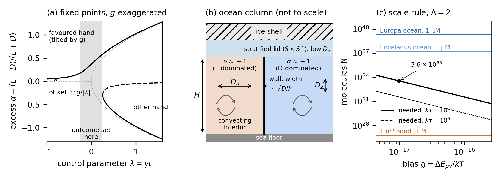
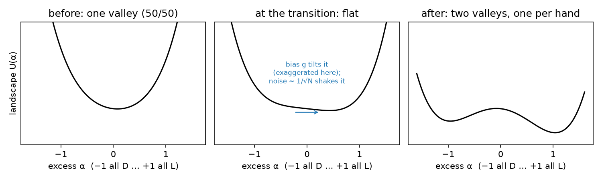
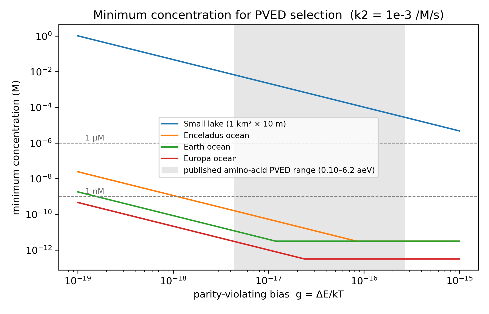
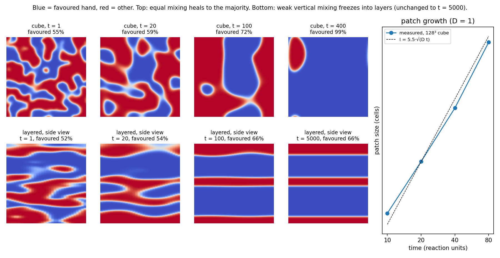
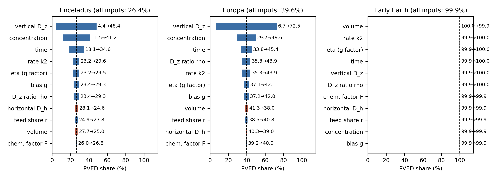
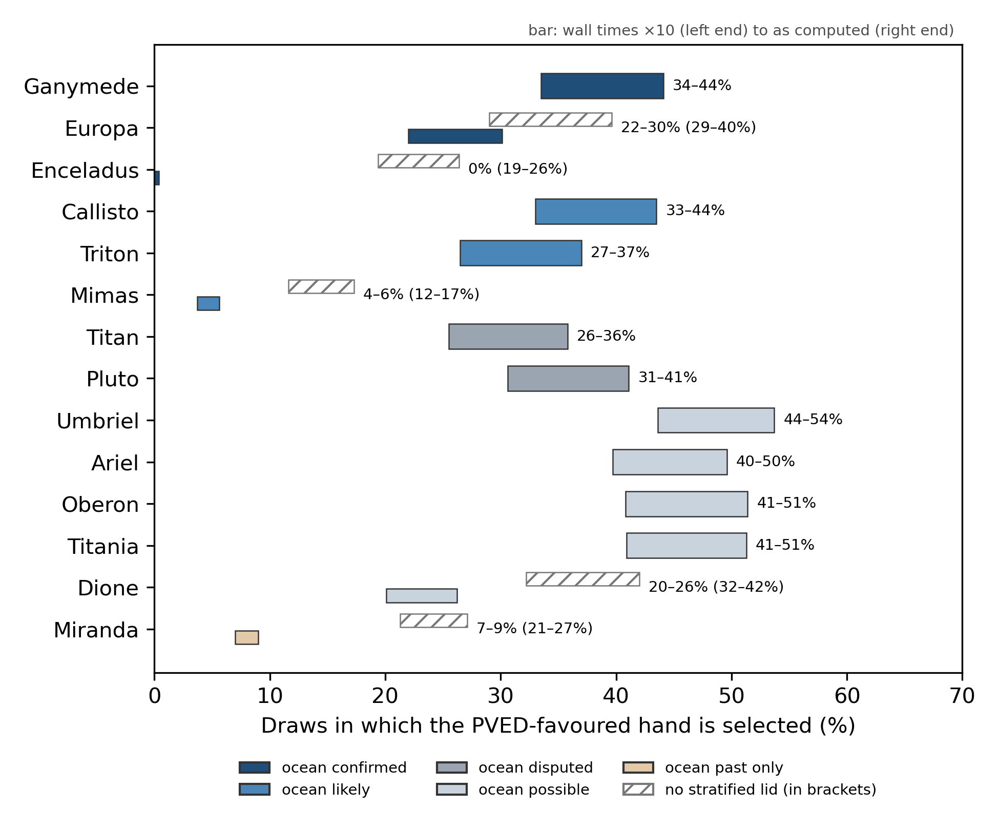

# SUBMISSION NOTES (remove before submitting)

This block is for the author only. Delete everything from this heading to the line "END OF SUBMISSION NOTES" before upload. Items marked **UNCONFIRMED** could not be checked.

## A. Target journal

- **International Journal of Astrobiology (IJA), Cambridge University Press.** ISSN 1473-5504 (print), 1475-3006 (online). It is a single-anonymous peer-reviewed, fully Gold Open Access journal.
- **Scope fits.** The Aims and Scope list includes "Cosmic prebiotic chemistry", "Origins, evolution and distribution of life" and "Life Detection in our solar system and beyond".
- **Sources.** I fetched every item below from the live Cambridge Core pages on 2026-10-11:
  - https://www.cambridge.org/core/journals/international-journal-of-astrobiology/information/author-instructions/preparing-your-materials
  - .../information/author-instructions/submitting-your-materials
  - .../information/author-instructions/fees-and-pricing
  - .../information/journal-policies/open-access-options
  - .../information/journal-policies/publishing-ethics
  - .../information/journal-policies/research-transparency
  - .../information/about-this-journal
- **Why not OLEB.** This draft replaces an earlier one aimed at *Origins of Life and Evolution of Biospheres*. That journal became Springer's *Discover Life* on 1 January 2024. Its scope is now broad life science, so it fits this paper poorly.

## B. Author guidelines and how this draft follows them

| Item | IJA guideline | This draft |
|---|---|---|
| Submission | ScholarOne, http://mc.manuscriptcentral.com/submit_ija , with a covering letter or email. Authors may suggest up to three referees. | Cover letter not written. |
| Article types | Research Articles and Review Articles. "There are no page charges or length restrictions." | **Research Article.** |
| Length | No limit. | The main text (Introduction to Conclusions, including the five figure captions, the tables and the display equations) is about 15,000 words (whitespace count, 2026-10-12 sweep pass; 12,067 before it). With back matter and references (this block excluded) it is about 18,400 words (15,280 before). |
| Title page | A concise title, author name(s), full institutional addresses, and the corresponding author's name, address, telephone number and e-mail. | Placeholders for address, phone and e-mail. **Fill these in.** |
| Abstract | One paragraph, at most 300 words, giving aims, results and conclusions for a wide audience. | One paragraph of 298 words (whitespace count, 2026-10-12 sweep pass). |
| Keywords | **Do not put keywords on the manuscript.** They are entered at submission. The two guideline pages disagree: "preparing your materials" says choose two from a list and optionally add a third; "submitting your materials" says a free-text box with at least three. **UNCONFIRMED which applies.** | None in the manuscript. Suggested: homochirality; parity violation; ocean worlds; icy moons; Frank model; prebiotic chemistry. |
| File format | Word (manuscript.doc, or manuscript.rtf on a Mac), or the IJA LaTeX template (manuscript.tex, figures fig1.eps ...). Equations in MathType or Equation Editor, not as images. | This is Markdown with LaTeX equations. **Convert it with the IJA LaTeX template, or to Word with live equations.** |
| Units, abbreviations | Metric and SI units. Define unfamiliar abbreviations at first use. | Done. |
| Equations and tables | Equations numbered (1), (2) ... Tables titled and numbered Table 1 ... | Done. |
| Figures | Embed figures in the manuscript for review. Each has one caption beneath it and is cited in the text in order. After acceptance, supply EPS or TIFF (1200 dpi line art, 300 dpi halftone or colour in CMYK, 600 dpi mixed; lines at least 0.5 pt). Colour is free. Refer to all illustrations as "Figures". | Six figures, each with a caption, numbered in order of first mention: journals/fig_schematic2.png, sketch.png, threshold2.png, coarsening.png, journals/fig_sensitivity3.png and shares3.png (scripts in the code table). Figures 1, 3, 5 and 6 are saved at 300 dpi, which meets the halftone and colour requirement but not the 600 dpi one for mixed art. **At acceptance all six must be re-exported as EPS or TIFF** from the same scripts, at 600 dpi if treated as mixed art. |
| Accessibility | WCAG 2.1 AA. Alt-text for every figure, sent on the Accessibility Descriptions Submission Form. Machine-generated alt-text is used if none is given. | **Write the alt-text at acceptance.** Check the colour contrast of Figure 5. |
| References | Harvard (Author, date) in the text. The list is alphabetical, includes article titles, and uses unabbreviated journal titles. Example format: "Burbidge, E.M., Burbidge, G. R., Fowler, W. A., Hoyle, F. 1957, Synthesis of the Elements in Stars, Rev. Mod. Phys., 29, 547-650". Unpublished work is cited in the text only ("private communication"), unless in press. | Harvard, alphabetical, with full titles and full journal names from Crossref. DOIs are added as https://doi.org/ links (the guideline neither asks for nor forbids them). Lists with more than 10 authors are cut to the first 10 plus "et al." **UNCONFIRMED whether IJA requires every author.** |
| Acknowledgements | At the end, before References. List all funding sources. | Present. States no funding. |
| Competing interests | Required in the main file. With none: "Competing interests: The author(s) declare none." | Present, in that wording. |
| Data | Data Availability Statements are encouraged. Use repositories with permanent identifiers. | Data and code statements present. **Consider archiving a tagged release on Zenodo for a DOI.** |
| Supplementary material | Allowed. At most 10 MB per file. | None. |
| ORCID | Encouraged. | **Add one if you have it.** |

### AI policy (preparing-your-materials page, "Use of Artificial Intelligence (AI) Tools")

- AI tools cannot be authors.
- Declare any use to generate text or to analyse data. Minimal uses, such as spelling checks, need no declaration.
- Where to declare it:
  - text generation goes "in a separate acknowledgments section or in a footnote";
  - use for data collection or analysis goes in Methods;
  - use for images goes in the figure caption.
- What to include:
  - the tool's name and version;
  - the dates of use;
  - how others can access it;
  - a full description of the use;
  - citations for any third-party material in the output.
- The draft declares the code and analysis use in Methods (Section 2.8) and the writing use in Acknowledgements.
- **To fill in:** the Claude model version(s) and the date range of use. The project files do not record them, so I left placeholders.
- No figure was generated by AI. The plotting scripts were written with AI help (see Section 2.8).

## C. Fees: no free route unless a waiver is granted (live fees page, 2026-10-11)

- IJA is "a wholly open access journal". Every article is Gold OA under a Creative Commons licence.
- **APC: GBP 2610 / USD 3655** (taxes may apply). There are no page charges and no colour charges.
- Funding routes:
  - institutional OA agreements (check whether Cupertino High School has one; probably not);
  - the Cambridge Open Equity Initiative, for over 100 low- and middle-income countries (the USA is not one);
  - Research4Life;
  - **discretionary waivers.** Authors "must request a waiver at or before submission", using the waiver request form.
- Editors and reviewers play no part in funding decisions.
- **This work has no funding. File the waiver request with the submission.** Without a waiver, there is no free subscription route.

## D. Prior publication

- Per advisor review (2026-10-11): not submitting to RNAAS or any preprint server; full paper to IJA only.

## E. Number conflicts between sources (not resolved silently)

1. **Ozturk et al. 2023: two different papers.** RNAAS_DRAFT.md and limits_lit.md cite *Nat. Commun.* 14:6351 (doi:10.1038/s41467-023-42130-8, avalanche magnetization of magnetite by an RNA precursor). PAPER_DRAFT.md cites *Sci. Adv.* 9:eadg8274 (doi:10.1126/sciadv.adg8274, crystallization of an RNA precursor on a magnetic surface). Both are real, and their Crossref titles match. I cite both:
   - (2023b) *Sci. Adv.*: the enantioselective crystallization on magnetite, used for planned-experiment arm D;
   - (2023a) *Nat. Commun.*: magnetization of magnetite, as in RNAAS.
   - **Check which paper reports the ~60% excess** that PAPER §3.13 quotes. The draft cites both for that sentence.
2. **Magnetite threshold.** RNAAS gives "less than about 2–4 × 10⁻¹⁵" for Europa and Enceladus. PAPER §3.13 gives "below 1.9×10⁻¹⁵" for early Earth. These are different worlds, and each value is used only for its own world.
3. **Allen–Cahn prefactor.** PAPER §3.3 gives A = 5.48 and 5.60 (corrected 2026-09-23 from a rounded "5.5 at both"). The PAPER Fig. 2 caption and the coarsening.png legend still say "l = 5.5·√(D t)", and the sampling code uses the rounded A = 5.5 (`coarsen3d.py`, `uncertainty.py`). The text uses 5.48 and 5.60, states that the sampling uses 5.5 (Section 2.4), and the Figure 4 caption calls the dashed line the rounded fit. **The legend in the image still reads 5.5.**
4. **Coarsening shares (not a conflict).** The 99% in the Figure 4 caption is the 96³ figure run (0.989 at t = 400, coarsen_fig.log). The 93.0% in Section 3.2 (Section 2.4 before the 2026-10-12 pass) is a separate 128³ run (coarsen3d.log). Each is now quoted with its grid size.
5. **Europa without a lid.** RNAAS and PAPER give 29%; ocean_worlds.log gives 28.6%. This is rounding. I use 29%, as RNAAS does.
6. **Bennu table.** PAPER §3.10 gives the step rule (15%/21%/57% and 17%/22%/55%) and the full quench curve (16%/21%/57% and 17%/23%/57%). These are two methods, not a conflict. I give the step rule and say that the quench method agrees within 2 points, as PAPER does.

7. **Vertical healing rule.** The `uncertainty.py` docstring states a vertical healing condition (H/A)²/D_z ≤ τ, but `sweep()` does not apply it. Section 2.6 explains why it is implied in case (i). No numerical effect.
8. **Column onset for Enceladus.** `aniso3d.log` gives D_z < D_h/333; the code asserts 334 within 5%. Section 2.3 uses 333.
9. **Europa S\*.** The draft and `strat_sweep.py` use 3.0 g/kg under 20 km of ice; VERIFICATION.md gives 3.2 g/kg at 24.2 MPa and 2.55 g/kg at about 25 MPa. The `strat_sweep.py` docstring says "~25 MPa, 20 km ice", while `verify_sstar.py` uses 24.2 MPa. The text keeps 3.0 and Table 2 reports the 3.2 recomputation.
10. **Ice density and gravity.** The draft uses ρ_ice = 920 kg/m³; `verify_sstar.py` uses 917 kg/m³ with g_s = 1.315 m/s². The text keeps 920 and does not state Europa's gravity. **State g_s in Section 2.5 or confirm it.**
11. **Lid cutoff.** Section 2.5 gives "about 28 MPa", `verify_sstar.py` finds no S\* above 28–29 MPa, and Section 3.5 gives "about 23 km of ice". These agree if g_s ≈ 1.3 m/s²; the text states both forms.
12. **Normal-form check tolerance.** The draft says the 4,000-run check agrees within ±0.005; `sim.py: main()` asserts agreement within 0.03. Table 2 now gives both.
13. **Bias range.** Table 1 gives g from 4×10⁻¹⁹ to 4×10⁻¹⁶; the `review.py: r1_scale` comment says "~1e-19..1e-16". The text uses Table 1.
14. **Scale-rule range.** "10³³–10³⁴ molecules" is not tied to a stated range of g and kτ. The values 3.6–6.7×10³³ come from T = 0–100 °C at g = 10⁻¹⁷ and kτ = 10 (Section 3.1; Section 2.2.4 before the 2026-10-12 trim).
15. **Equation renumbering (checked; no unmatched references).** The old Eqs. 1–4 were remapped to the new numbering 1–21: old Eq. 1 (normal form) → Eq. 6; old Eq. 2 (P = Φ(Δ)) → Eqs. 10 and 11 (Eq. 11 is the form in N); old Eq. 3 (field equation) → Eq. 14; old Eq. 4 (the display N ≥ … in Section 3.1) duplicated Eq. 13 and was removed, so Section 3.1 now cites Eq. 13. Old reference "Eq. 2" in the code table now reads "Eqs. 1 and 6–13".

**Factual corrections made in the 2026-10-12 referee pass** (old text → new text → source line). The pre-pass draft is kept as `ija_draft_prereferee.md`.

16. **Kramers flip size (Section 3.8).** "A droplet of about 600 molecules can flip; a pond or an ocean never does." → "At least one flip is expected within the reaction time only if (√2/2π)·e^(−N/2)·kτ ≥ 1, that is N ≤ 2 ln(0.225 kτ): N ≈ 2 at kτ = 10, 20 at kτ = 10⁵, and 57 at the largest kτ sampled (about 10¹³). Only pools of order tens of molecules can flip; a droplet, pond or ocean never does." → `review_pre_r4fix.log:42` ("1 um^3 at 1 uM holds ~600 molecules (flips possible)") was wrong and is fixed in `review.log:42–47` (H12); the Kramers rate it rests on is confirmed at `review.log:40–41` (measured 3.4e-03 vs Kramers 3.5e-03; 1.4e-03 vs 1.5e-03). With N = 600 and kτ ≈ 1.3×10¹³ the expected number of flips is about 10⁻¹¹⁸. See H12.
17. **Enceladus range (Section 3.5).** "Enceladus stays last among confirmed oceans under every estimate (0–18%)." → "… under every lid-forming estimate (0–18%). With no lid it scores 21.8% (`ocean_worlds.log`), level with Europa under 20 km of ice (21.7%) and below Ganymede (28%)." → `ocean_worlds.log:15` ("Enceladus    21.8%    100%    0.0%").
18. **Hsu et al. (2015) logic (Section 3.5).** "If so, its salinity is high and it scores near the upper end of this range." → "If so, then in this model its salinity must exceed S\*, and it scores the no-lid value of 21.8%." → `ocean_worlds.log:15` (a no-lid Enceladus is 21.8%, above the 0–18% lid-forming range, so "upper end of this range" was wrong).
19. **Enceladus in the abstract and Section 6.** "Enceladus lowest (0–18%)" → "Enceladus lowest (0–18% when a lid forms)" → as E17.
20. **Vent mound (Section 3.1).** "P = 0.73" → "P = 0.731 … (these values are from Eq. 10, not simulated)" → `review.log:32` ("flow-connected 100 m mound       P(physics) = 0.731").
21. **Time scaling of N (Section 3.1).** "Time helps only weakly, as (kτ)^¼" → "A longer reaction time lowers N only as (kτ)^(−½)" → Eq. 13 (N ∝ (kτ)^(−½); (kτ)^¼ is the scaling of Δ, Eq. 11). The example "10,000× slower lowers N by 100×" already used (−½) and is unchanged.
22. **Bennu "reconciles" (abstract, Sections 3.6 and 6).** "This reconciles the model with the racemic amino acids returned from asteroid Bennu." → "This is compatible with the racemic amino acids returned from asteroid Bennu if the parent body's drive stopped while its water remained." (Section 3.6 adds "only under these conditions …") → `quench.log` Q5 (`quench.log:25–29` for s = 1, `:42–46` for s = 0.01): the 64% racemic-freeze share moves from 25.8% to 82.0% (s = 0.01) and 67.2–100.0% (s = 1) with how c and the water lifetime are drawn.
23. **Anisotropic runs (Section 3.2; completeness, not an error).** "A cube healed to one hand in 4 of 4 runs from a 55% start." was correct but left out the 50% start and the slab. Now also reported: cube from 50%, one hand in 3 of 4 (one the unfavoured hand), stacked layers in 1; slab, one hand in 2 of 4 per start, the other 4 stopped at 0.53, 0.50, 0.59, 0.56 with two flat vertical walls → `aniso3d.log:5,10,15,20` and the per-seed lines below them (side = 512, up = 0, unchanged t = 200–1000).
24. **Lunine et al. (1999) (Section 1.1).** "Lunine et al. (1999) discussed the abiotic generation of homochirality on Titan; I cite this chapter only for its subject, because I have not read it." → a summary from the chapter PDF (Titan as a natural reactor larger and longer-lived than a laboratory; racemization rates at Titan's surface temperature unknown; a call for chiral analysis in situ) → chapter PDF, read as data only.
25. **Figure numbers.** Figure 5 (`rnaas_fig.png`) → Figure 6; new Figure 5 is `fig_sensitivity.png` (from `uncertainty.log` by `journals/make_fig_sensitivity.py`). All in-text references, the H11 note and the code table were updated.
26. **Pointer.** Section 2.1 "Section 2.2.4 gives the effect of temperature" → "Section 3.1 …" because the T² values (3.6/4.3/6.7×10³³) now appear only in Section 3.1. Only the cross-reference in that sentence changed.

**Numbers changed in the 2026-10-12 sweep pass** (old → new → source log:line). The pre-pass draft is kept as `ija_draft_presweep.md`. The new runs are `sweep2.py`, `pin_onset.py`, `sweep3.py`, `multiwall.py`, `kz_patches.py` and `gradient_ramp.py`; their pre-registered predictions and outcomes are in each script's docstring. "Cascade ×10" is the pre-registered low-end sensitivity of `multiwall.py`; the main multiwall value is the high end. Results not rerun keep their old values and are labelled "uniform-D_z base model" (list in H19).

27. **Early Earth headline (abstract, Sections 1.2, 3.3, 6).** "75%" → "at least 67%, and up to 99.9% under the deepest-hand rule" → 74.7 (`sweep2.log:5`, step 0, now the base model) → 67.0 (`sweep3.log:5`) to 99.9 (`multiwall.log:542`; cascade ×10 99.7, same line). The upper value rests on the deepest-hand rule, measured only in small radial domains: 336/336 (`multiwall.log:349`), 94/108 = 87.0 ± 3.2% (`multiwall.log:489`), 63/63 at ≥ 5 wall widths (`multiwall.log:502`, post hoc).
28. **Europa headline.** "22% (29% with no lid)" → "22–30% with a lid; 29–40% without" → `multiwall.log:552` (final 22.0 cascade ×10 to 30.1 main; no lid 29.0 to 39.6). Base model 21.7/28.6 (`sweep2.log:33,15`, step 0).
29. **Enceladus headline.** "0–18% when a lid forms" → "0% with a lid; 20–28% without" → `multiwall.log:556` (final 0.0; no lid 19.9 cascade ×10 to 28.3 main). The 0–18% range from the higher-salinity estimates (Kang et al., 2022) is kept in Section 3.5 as base model (H19).
30. **Ganymede.** "28%" → "34–44%" → `multiwall.log:547` (33.5 cascade ×10 to 44.1 main). Base model 28.3 (`sweep2.log:7`, step 0).
31. **Europa range (Sections 3.5, 6).** "22–26%" (lid in 24% or 9% of draws, Juno shell) → "22–30%" → E28. The Juno-shell 26% stays as base model (H19).
32. **Scale rule (abstract, Sections 1.2, 3.1, 6).** "10³³–10³⁴ molecules" → "5×10³⁰ to 2×10³⁴ molecules" → `sweep2.log:78–79` (N = 1.84×10³⁴ at g = 4.4×10⁻¹⁸; 5.12×10³⁰ at g = 2.64×10⁻¹⁶; kτ = 10). Section 3.1 adds the volume examples from the same lines (pond 1 m³ at 1 M short 3.06×10⁷ to 8.5×10³, written 3×10⁷ to 9×10³; 1 km³ at 1 mM short ×30.6 at the low end, ×0.0085 at the high end, i.e. ~100× margin; 10 km³ short ×3.06 / ×0.00085; cube sides at 1 µM / 1 mM / 0.1 M: 31 km / 3.1 km / 670 m at the low end, 2.0 km / 200 m / 44 m at the high end). This also resolves E14.
33. **Bias range (Table 1, Section 2.1, assumption 2).** g "4×10⁻¹⁹ – 4×10⁻¹⁶" (≈0.01–10 aeV) → "4.4×10⁻¹⁸ – 2.64×10⁻¹⁶" (0.10–6.2 aeV) → `sweep2.py:8–9` (step a; Mason & Tranter 1985 to the alanine value tabulated by Quack et al. 2022). The old range is kept, labelled, where it describes the base model. This resolves E13.
34. **New Table 1 rows** (no old value): η 0.1–10 (`sweep2.py:33–34`, assumed); p/a 0.01–1 (`sweep2.py:42–43`, assumed); k_rac 9.13×10⁻¹⁵ s⁻¹ (`sweep2.py:37–40`; Bada and Schroeder 1975 as tabulated by Steen et al. 2013, at 273 K); ρ 1–100 (`sweep2.py:44`, assumed). The row "concentration c" is renamed "feedstock concentration a"; its ranges are unchanged.
35. **D_z floor (Table 1, Sections 2.6, 4).** icy-moon D_z "10⁻¹⁰ – 10⁻³" → "10⁻⁹ – 10⁻³" (depth mean) → `sweep2.py:35–36` (step c). Section 4's "uncertain across 10⁻¹⁰–10⁻³" → "10⁻⁹–10⁻³ in this sampling". The §3.2 merge times at D_z = 10⁻¹⁰ are kept and labelled base model (H19).
36. **Section 1.1 Quack (2022) statement.** "Current calculations put it at about 10⁻¹¹ to 10⁻¹⁰ J mol⁻¹" → "… about 10⁻¹¹ to 10⁻¹⁰ J mol⁻¹ for heavier chiral molecules (Quack et al., 2022), but much less for the amino acids: about 10⁻¹⁴ J mol⁻¹ (0.1 aeV) … about ten times more … and 6×10⁻¹³ J mol⁻¹ (6.2 aeV) for alanine" → `sweep2.py:10–31` (rows 1, 3, 6, and the note that the 10⁻¹¹–10⁻¹⁰ range is for heavier molecules). Section 2.1 "of order aeV to feV" now applies the span to light-atom molecules and places the amino acids at its low end (same source).
37. **Section 1.2 "about 10⁻¹⁷ kT".** → "about 4×10⁻¹⁸ to 3×10⁻¹⁶ kT at 0 °C" → `sweep2.py:9`.
38. **Section 3.1 "in the middle of the modern PVED range".** → "near the low end of the published amino-acid range" → g = 10⁻¹⁷ (0.24 aeV) against 0.10–6.2 aeV (`sweep2.py:9`).
39. **Section 3.4 bias limit.** "g ≤ 4×10⁻¹⁶, 15 orders of magnitude too weak" → "g ≤ 2.64×10⁻¹⁶ (ηg ≤ 2.6×10⁻¹⁵), 14–15 orders of magnitude too weak" → `sweep2.py:9, 33–34` (g_max × η_max).
40. **Section 3.4 Enceladus/Europa lid effect.** Enceladus "21.8% to 0%" → "20–28% to 0%" (E29); Europa "29% to 22%" → "29–40% to 22–30%" (E28), base values kept beside them.
41. **Table 3** (Success share column; old → new, `multiwall.log` line, final value from cascade ×10 to main; no-lid in brackets for lid worlds): Ganymede 28 → 34–44 (:547); Europa 22 → 22–30 (29–40) (:552); Enceladus 0 → 0 (20–28) (:556); Callisto 28.5 → 33–44 (:548); Triton 28 → 27–37 (:550); Mimas 5 → 4–6 (12–17) (:555); Titan 24 → 26–36 (:551); Pluto 30 → 31–41 (:549); Umbriel/Ariel/Oberon/Titania 36–39 → 40–54 (:543–546; lowest Ariel 39.7, highest Umbriel 53.7); Dione 21 → 20–26 (32–42) (:553); Miranda 9 → 7–9 (21–27) (:554). The depth column is unchanged and headed "(base model)". **Order change:** Ganymede and Callisto now rank above Pluto (base: Pluto 30, Ganymede 28); the Uranian moons stay top and the confirmed-ocean order (Ganymede > Europa > Enceladus) is unchanged.
42. **Section 3.5 lid-free range.** "between 24% and 39%" → "between 26% and 54% (24–39% in the base model)" → `multiwall.log:543–551` (lowest Titan 25.5 cascade ×10; highest Umbriel 53.7 main).
43. **Section 3.5 / 6 confirmed-ocean ranking.** "Ganymede (28%) and Europa (22–26%) are the most favourable" → "Ganymede (34–44%) is the most favourable, then Europa (22–30%), then Enceladus (0%)" → E28–E30.
44. **Section 3.7.** "the 10³³-molecule threshold" → "the 10³¹–10³⁴-molecule threshold" → `sweep2.log:78–79` (E32).
45. **Assumption 2.** "the three orders of magnitude sampled" → "the range sampled (g over 1.8 orders of magnitude, times η over 2)" → `sweep2.py:9` (log₁₀(2.64e-16/4.4e-18) = 1.78), `sweep2.py:33–34` (η 0.1–10). This resolves H17.
46. **Three-way split (new; Sections 3.3, 4, 6).** Chance sets the hand in at most 14.9% of draws in any world (Umbriel, no lid; `multiwall.log:526`); Enceladus 8.8, Europa 4.9, Earth 0.0 (`multiwall.log:539, 535, 525`). The PVED's share of single-hand outcomes, P_pved/(P_pved + P_chance), is 100% for Earth, 89% Europa, 76% Enceladus and 74% at the minimum (Mimas), computed from `multiwall.log:525–539`.
47. **Step ladder (new, Section 3.3).** Enceladus/Europa/Earth no lid: 21.8/28.6/74.7 → 24.1/30.4 → 23.3/30.0 → 27.2/35.0 → 26.4/31.3 → 24.5/30.4 (Earth 74.7 throughout) → 3.9/9.3/39.9 (`sweep2.log:5,15,19`, steps 0, a–f) → 6.6/13.9/67.0 (`sweep3.log`, P_pved blocks; Earth `sweep3.log:5`) → 28.3/39.6/99.9 (`multiwall.log:556,552,542`; cascade ×10 19.9/29.0/99.7). Asp racemization moves any world by at most 0.7 points, at the depth step (Ganymede/Callisto 14.0 → 13.3; `sweep2.log:59,62`). Reversed (past-onset) draws: 55–77% of icy-moon draws, 60.1% for Earth (`sweep3.log:39–53`).
48. **Pinning onset and reversal (new, Sections 2.4, Table 2).** κ = 0.9999 ± 0.0001 (n = 8; band 0.9998–1.0124 across radii 2–64) → `pin_onset.log:30, 54`; 42/42 sank and 54/54 rose past the onset, none stalled → `pin_onset.py:60` (P3, summarizing `pin_onset.log:2–17`). Deepest-hand rule → E27. Rule "largest volume" 52.1%, "top layer" 41.7% → `multiwall.log:350–351`. Wrapper timing: simulated T_end/T_c median 1.196, max 5.054 → `multiwall.log:491`.
49. **Kibble–Zurek patch sums (new, Sections 2.3, 4, Table 2).** c = 0.88 ± 0.02 in 1D (plateau 0.879 ± 0.021, 128 and 512 ξ pooled) → `kz_patches.py:55–57` (from `kz_patches.log:17,20`); 4.0 SE above 0.80 when pooled (pooling not pre-registered), 2.9 SE at 512 ξ alone ((0.882 − 0.798)/0.029, `kz_patches.log:20`); 2D c = 0.98 ± 0.05 → `kz_patches.log:51`; 3D 0.98 from theory only (not simulated); majority hand kept in ≥ 99% of 1D runs → `kz_patches.log:6–21`; 2D P 0.844 vs 0.843 → `kz_patches.log:50–51`.
50. **Gradient ramp (new, Sections 2.3, 4, Table 2).** ℓ_A = 2.24(Dvτ/k)^(1/3)… → `gradient_ramp.py:70`; fits ℓ_eff/ℓ_A = 0.90–1.37 → `gradient_ramp.py:59` (from `gradient_ramp.log`); crossover u* in (1, 3], post hoc → `gradient_ramp.py:62–66`.
51. **Pre-registration tallies (Section 2.7).** sweep2 7/9 (`sweep2.py:71`), pin_onset 8/8 (`pin_onset.py:51`), sweep3 8/11 (`sweep3.py:56`), multiwall 5/16 (`multiwall.py:79`), kz_patches + gradient_ramp 9/17 (`kz_patches.py:53–73`: P1, P2, P5, P10 held, P9 ambiguous and counted as not held; `gradient_ramp.py:48–67`: P1, P2, P4, P5, P7 held). The body's earlier wording "mostly on timing" for multiwall was wrong (5 of its 11 failures are timing: P3, P4, P6, P7, P8; `multiwall.py:84–92`) and was corrected.
52. **Abstract word count.** 299 → 298 (whitespace count).
53. **Wording, not a number (Section 2.8, Acknowledgements).** "An AI assistant … helped write" → "… was used to write" (anthropomorphic verb on a tool removed). "I … chose the questions" (the author) is kept.
54. **New paragraph, Section 4: how a Europa lander could test this (2026-10-12).** No existing number changed. New numbers: no-excess 66% / 56% and 30.1 / 3.7 → `multiwall.log:535` (Europa, P_pved / P_chance / P_none, final 30.1 / 3.7 / 66.2, no lid 39.6 / 4.9 / 55.5); 95% = (p + c/2)/(p + c), chance-set hands counted as 50/50 (`multiwall.py:41`, `sweep2.py:49–51`); odds factor 0.945/0.5 = 1.89, squared 3.57. Radiation depths: Nordheim et al. 2018 abstract. Isovaline 18.5 ± 2.6% and parent-body amplification: Glavin and Dworkin 2009 abstract, which also finds the excess inconsistent with UV circularly polarized light as the primary mechanism. Mission concept: Hand et al. 2022 abstract. Update these shares with the multiwall column if the open runs (H24, H25) change it. Checked 2026-10-13 (step 9): E57 (H25) and E58 (H24) leave the multiwall main column unchanged, so the numbers stand. Added: energy-budget variant from `tidal_mix.log:63` (Europa interior band, no lid 79.5 / 3.2 / 17.3, final 60.4 / 2.4 / 37.1); no excess 37% / 17%; (p + c/2)/(p + c) = 98.1% both ways.
55. **Enceladus seed reuse fixed (2026-10-12; `seedfix.py`, `journals/new_analyses_seedfix.md`).** `np.random.default_rng([s, 0])` equals `default_rng(s)`, so Enceladus (world 0) drew its extra inputs (η, r, ρ) from the same stream as its base inputs (correlation 1.000000). `seedfix.py` gives world 0 the stream [s, 0, 1]; the other 14 worlds reproduce exactly. Body changes (old → new, `seedfix.log` line): abstract, Sections 3.3, 3.4, 3.5 (twice), Table 3 and Section 6: Enceladus no lid 20–28% → 19–26% (main 28.3 → 26.4, ×10 19.9 → 19.4; :125); with lid 0% unchanged. Ladder (Section 3.3): η 23.3 → 23.8, D_z floor 27.2 → 27.8, racemization 26.4 → 27.1, feedstock/product 24.5 → 24.7 (:72); D_z rising 3.9 → 6.7 (:72); reversed walls 6.6 → 9.0 (:96). Three-way split: Enceladus chance 8.8 → 9.8%; PVED share of single-hand outcomes 76% → 73%, so Enceladus replaces Mimas (74%) as the minimum (:122). Supersedes the Enceladus values in E29, E40, E41, E46 and E47, which are kept as history. The same seed pattern remains in `front2d.py:201`, `deephand_scale.py:299` and `pin_onset.py:254` (not rerun; their Enceladus rows carry the collision) and in `rerun_base.py` (H30).
56. **Older results rerun through the present sampling (2026-10-13; H19, H20, H27; `rerun_base.py`, `rerun_base.log`, `journals/new_analyses_rerun.md`; Enceladus rows from `seedfix.log` Section F, which corrects the seed reuse of E55).** The "uniform-D_z base model" labels are dropped where the value now comes from the present pipeline (main cascade / ×10). Old → new (rerun_base.log line):
   - Section 3.2 merge: at D_z 10⁻¹⁰ 1.5×10¹² / 2.8×10¹³ yr, 33% / 34% → at the 10⁻⁹ floor 1.5×10¹¹ / 2.8×10¹² yr, 39.1 / 39.3% (:246–251).
   - Section 3.3 one-at-a-time (main): D_z halves 0/0/52 → 43/57/97 became 4.4/6.7/99.9 → 48.4/72.5/100.0; concentration +21/+10 → +29.7/+19.9; time +15/+11 (+32 Earth) → +16.6/+11.6 (Earth +0.1); k₂ +5 → +6.4/+8.6; g +8/+4 → +5.9/+4.8; D_h −2 to −9 → −1.3 to −4.0 (incl. ×10); F and volume ≤ 2 → ≤ 3.3 (Europa volume −3.3) (:24–95; Enceladus seedfix :24–47). Figure 5 fig_sensitivity.png → fig_sensitivity3.png (`journals/make_fig_sensitivity3.py`: rerun_base.log section 1 with the 95 seedfix Section F lines swapped in after an exact old-line check; fig_sensitivity2.png is the unpatched version and is not used).
   - Breakeven: Enceladus D_z 2.7×10⁻⁵ → 2.6×10⁻⁵ (×10 8.9×10⁻⁵); Europa 6.1×10⁻⁶ → 1.7×10⁻⁶ (×10 1.0×10⁻⁵); other-input ceiling 38% → Enceladus 44%, Europa 50% at time ≥ 3.3×10⁹ yr; top D_z decile 66/86 → 63/80%; Earth crossing D_z 2.9×10⁻⁶ / time 1.4×10⁷ yr → none (lowest decile 99%, ×10 97%); Earth at Ledwell 87% → 100.0% (:101–186; Enceladus seedfix :102–129, :186).
   - Assumed rules: max moon move 2.2 → 3.0 (Enceladus share ×0.1, 26.4 → 23.4); whole ocean +4.0 / +2.8 now stated separately; bias range sentence now 0.10–6.2 aeV (`sweep2.py:9`); bias ×10/×100 Enceladus 25.7/27.8 → 31.6/34.8, Europa 30.7/31.2 → 43.2/44.3; unlimited 28.6/31.2 → 36.1/44.5; Earth 74.7 → 99.8–99.9 (:189–198; Enceladus seedfix).
   - Swings: 21/28/75, 20/26/75, 17/24/75 → 25.7/38.3/99.9, 23.6/35.8/99.8, 19.9/31.7/99.4; moon cost ≤ 5 → ≤ 7.9 points; Earth unchanged → ≤ 0.5 (:203–206).
   - Section 3.4: Enceladus alternatives 0–8% → 0–21%; Europa 28.6 → 21.7 and 10–29% → 10–40%; Europa stratified share 23.9% confirmed (:3, :240–242).
   - Table 3 depth column (×10 at deepest to main at shallowest; final for lid worlds): Ganymede 22–33 → 21–52; Callisto 22–38 → 21–61; Triton 26–36 → 24–54; Mimas 4–5 → 3–6; Titan 20–33 → 18–52; Pluto 27–33 → 23–49; Uranian 34–44 → 36–63; Dione 20–23 → 18–31; Miranda 8–9 → 7–9; depth moves a value by up to 30 points (Callisto 60.9 / 30.6), was "about ten" (:253–266).
   - Section 3.5: Juno Europa 26% → 26–36% (pinned 9.1%); Kang 4–6% → 4–7% and 15–18% → 13–21%; Enceladus lid range 0–18% → 0–21% (also Section 6); "last among confirmed oceans" → "below Europa's 22–30%", since a Europa alternative-salinity value (10–14%) is lower (:229–239; seedfix :231–239).
   - Section 3.6: P(win | Bennu racemic) 2/4/15% → 1–2/3–5/14%; fade shares original range 22/29/75, 23/30/75 → 20–27/29–40/99.7–99.9, 21–29/31–43/99.7–99.9; extended 15/21/57, 17/22/55 → 14–19/21–29/74, 15–21/23–31/73; frozen vs step within 2 → 3 points (max 2.7); "neither has been rerun" sentence replaced (:271–284; seedfix :271–284). Q1 frozen-racemic 97/73/64/43% unchanged.
   - Section 4 magnetite: L/D/none 35/35/31% → 47/46/7%; Earth threshold 1.9×10⁻¹⁵ (old L < 50% crossing) → lead halved at 1.6×10⁻¹⁵ and coin flip from 3×10⁻¹³ (the new L < 50% crossing, 5.05×10⁻⁶, sits at the end of a 50% plateau and is not quoted); moons 2–4×10⁻¹⁵ → 2.6–3.3×10⁻¹⁵ (field f*, :287–301; Enceladus seedfix :296, :301).
   - Section 4 limitations: club sandwich 14% → 17–22% (:243); H20 c = 0.88 moves any share ≤ 0.6 points (:210–226, P9); H27 early-Earth temperature 273–343 K: 99.9 → 97.5 (Ala) / 94.5 (Asp), 93.9 / 86.4 with the racemization test on every draw (:307–326); three references added (Blake et al. 2010; Knauth and Lowe 2003; Robert and Chaussidon 2006).
   - Section 4 "74–100%" → "73–100%" (missed in E55; Enceladus 26.4/(26.4 + 9.8)).
   - Pre-registered outcomes, with the seed fix (rerun_base.log:328 as corrected in seedfix.log Section F): P1, P2, P7, P8, P10, P12, P13 failed; P3–P6, P9, P11, P14, P15 held. P1 and P7 fail against reference values that were the seed-collided Enceladus numbers (P7: unlimited 36.1 vs reference 37.1); P10 fails because two Enceladus lid values (21.3, 17.7) sit more than 1 point from expected values (22.9, 19.0) taken from the seed-collided run.
57. **Mixing direction (2026-10-13; H25, assumption 7; `rho2side.py`, `rho2side.log`, `journals/new_analyses_rho2side.md`, `journals/new_analyses_dz_direction.md`; Enceladus from `seedfix.log` Section E).** Assumption 7 said that if mixing is strongest near the top "the uniform-D_z base model is the better guide". The code gives sweep2 step e for ρ ≤ 1 (all additions on, uniform D_z), not the step-0 base model; the sentence now says so and adds the literature: rising with depth is measured for Earth (Ledwell et al., 2000; Waterhouse et al., 2014) and unconstrained for the moons (Zeng and Jansen, 2021; Bire et al., 2022; Jansen et al., 2023; Soderlund et al., 2024). New Section 3.3 paragraph "Mixing that weakens with depth" from the two-sided rerun (ρ on 0.01–100, moons only): ×10 to main, Ganymede 31.7–37.1, Titan 25.5–30.7, Europa 29.8–35.0 / 22.6–26.6 (`rho2side.log:7–40`), Enceladus 22.1–25.6 / 0.0 (`seedfix.log` Section E, rho2side.log:22, :40; the logged 26.5 / 20.8 were seed-collided); max P_chance 10.3 (Umbriel, :8); Early Earth two-sided 87.3 (:7). Real-profile sink time for ρ < 1 is an upper side (at most +5.2 for the moons, Ganymede; `rho2side.log:60–76`), not a correction. Section 4 "Mixing is the key unknown" and Section 6 conclusion each gain one clause quoting these ranges. The main model is unchanged (ρ = 1–100 for every world): switching the moons' prior to two-sided would also need Table 3, Figure 5 and the breakeven runs redone, so the one-sided values stay the headline and the two-sided values are reported as the alternative. That choice is the author's (see H25). Five references added (Bire et al. 2022; Jansen et al. 2023; Ledwell et al. 2000; Soderlund et al. 2024; Waterhouse et al. 2014), all Crossref-checked.
58. **Deepest-hand rule at ocean scale and handoff (2026-10-13; H23, H24; `deephand_scale.py`, `deephand_scale.log`, `handoff.py`, `handoff.log`, `journals/new_analyses_deephand.md`, `journals/new_analyses_handoff.md`; `handoff.py` applies the seed fix for Enceladus; `deephand_scale.log`'s Enceladus rows are regenerated with it in `seedfix2.log`, E66).** Abstract "(up to 99.9% under this deepest-layer rule, measured only in small test domains)" → "(89–99.9% … tested with walls down to 1/400 of the ocean depth)"; Section 6 likewise, adding "about 98%" for the handoff. Section 2.4 "the rule has not been tested at ocean scale" → the 600-run result: 365/365 at ≥ 3 wall widths; 8.0 ± 2.9% below one width, 60.8 ± 5.5% at one to two (`deephand_scale.log:711–712`); handoff below one width 93.3 ± 1.0% vs plain rule 81.0 ± 1.6% vs three-width cut 76.8 ± 1.7% (`handoff.log:4–8`); closed-form time about 2.2× too fast (`deephand_scale.log:861–862`), fitted time ≤ 1.4 points. Section 3.3 Earth: "this upper value rests on that deepest-hand rule…" → floor 89.0 (`handoff.log:33`), one-width handoff 97.6 (same line, last column); moons: handoff Enceladus 23.7, Europa 34.9 / 26.5 (`handoff.log:46, 42, 60`). Section 4 "Mixing is the key unknown" and the validation table updated to match. Not quoted: the three-width handoff (Earth 94.3), which was the cut specified before the run but failed validation (P2 of handoff.py held as predicted: 'THR 3 not validated'). Earth's two-sided ρ value (87.3, E57) and the 89.0 floor are separate checks and are not combined.
59. **Fronts in 2D and 3D; drive uniformity (2026-10-13; H21, H22; `front2d.py`, `front2d.log`, `journals/new_analyses_front.md`; predictions committed first in 6d5bd4b, 11 of 15 held).** Section 2.3 "the test is 1D only" → 2D/3D result: ℓ_eff/ℓ_A 0.70–1.30 (2D, u ≤ 1; `front2d.log:4–57`), 0.86 and 1.16 (3D, u = 0.3, 1; `front2d.log:86, 97`); size scan at u = 0.3 8.8 → 11.1 cells vs ℓ_A 9.5, at u = 3 21.9 → 49.0 (+4.1 SE; `front2d.log:58–70`); dx/2 +2.12 SE (`front2d.log:71–80`, P8 failed narrowly). Failed predictions P5 and P9 (u = 3 ratio > 1.5) were sized wrongly (ℓ_A(u = 3) is already 0.4 L at 8ξ); P7 failed (one-hand fraction fell 0.045–0.07, not ≥ 0.1). Section 4 "tested in 1D only … not known" → per-world test: u < 3 in 2.0–17.2% of draws, early Earth 2.8%, t_mix > τ in 0.0% (`front2d.log:110–125`); P_pved change ≤ 0.01 points, ≤ 0.08 with v/A (`front2d.log:145–160`); front rule off equals multiwall main exactly (`front2d.log:108`). The factor 5,000–400,000 (F·Δ/2 = 10^3.7–10^5.6) is a post-hoc diagnostic recorded in the `front2d.py` RESULTS block (P13), not in the log. Enceladus rows in `front2d.log` carry the seed collision (H30); `seedfix2.log` regenerates them on the fixed stream (E66) and none of the quoted changes moves. Validation table and assumption 8 updated to match.
60. **Larger Kibble–Zurek system; Kramers message (2026-10-13; H12, H28; `kz_large.py`, `kz_large.log`, `review.py`, `review.log`, `journals/new_analyses_small.md`; kz_large predictions committed first in a8def72, results 9de3aef; review fix 17afeb6).** Section 2.3 "c = 0.88 ± 0.02 in 1D (10–40 patches) … 4.0 standard errors when the two largest systems are pooled (2.9 at the largest alone; the pooling was not pre-registered)" → "c = 0.92 ± 0.02 in 1D for a single system of about 80 patches … 5.7 standard errors above 0.80 … pool 0.90 ± 0.015, 6.8 standard errors" (`kz_large.log:6` c_end = 0.918 ± 0.021; `:9` P3 5.65; `:16` P8 0.898 ± 0.015, 6.77); f = c² in 1D 0.77 → 0.84 (0.918²). The 2D and 3D values and the sampling's f = 1 are unchanged, so no share changes (H20's rerun used c = 0.88, the larger correction, E56). E49's 1D figures remain the kz_patches results and are kept as they were. Table 2 patch-sum row updated. Section 2.7 tallies: added rerun_base 9/15, seedfix 14/16, rho2side 5/9, deephand_scale 11/14 (P9, P13, P14 failed in half, counted as not held), handoff 7/13, front2d 11/15, kz_large 9/9 (each script's RESULTS block). E16's source `review.log:42` → `review_pre_r4fix.log:42` (old message) and `review.log:42–47` (fixed); the Section 3.8 text already used the corrected criterion. The rerun's only other difference is cosmetic (R6 prints final −0.000 for +0.000, `review.log:65`, old `:60`).
61. **Figures 1, 3 and 6 redrawn (2026-10-13; H26; `journals/make_fig_schematic2.py`, `make_fig_threshold2.py`, `make_fig_shares3.py`, `journals/new_analyses_small.md`).** Figure 1 `fig_schematic.png` → `fig_schematic2.png`, panel (c) g range 4×10⁻¹⁹–4×10⁻¹⁶ → 4.4×10⁻¹⁸–2.64×10⁻¹⁶ (`sweep2.log` g_min/g_max; N at the ends 1.84×10³⁴ and 5.12×10³⁰ asserted). Figure 3 `threshold.png` → `threshold2.png`, same band change; image title now "Minimum concentration for PVED selection". Figure 6 `rnaas_fig.png` (uniform-D_z base model) → `shares3.png` (Table 3 values from `multiwall.log` Section 4, ranges ×10 to as computed). `shares2.png` (from `make_fig_shares2.py`) is not used: its Enceladus no-lid bar is the seed-collided 19.9–28.3%; `make_fig_shares3.py` is a copy that takes Enceladus from `seedfix.log:125` (19.4–26.4%, matching Table 3's 19–26%) and asserts it. The old PNGs and scripts are left untouched. The requirements row (Section B) said "Five figures"; there are six since E25, now corrected.
62. **Mixing from the tidal energy budget (2026-10-13; `tidal_mix.py`, `tidal_mix.log`, `journals/new_analyses_tidalmix.md`; predictions committed first in d6854b1, results 370fda7).** New text, no old value replaced. Section 2.6: K_z mid estimates from `tidal_mix.log:24–36` (Enceladus 1.74×10⁻⁸, Miranda 4.71×10⁻⁴; Europa 1.78×10⁻², Ganymede 2.24×10⁻³, Titan 1.06×10⁻², Callisto 4.20×10⁻³, Triton 0.716, Mimas 8.34×10⁻²); lid check `tidal_mix.log:47`. Section 3.3: shares from `tidal_mix.log:54–68` (interior band, P_pved no lid | final): Europa 79.5 | 60.4 (from 39.6 | 30.1), Ganymede 80.8, Titan 80.8, Callisto 79.8, Triton 78.9, Oberon 75.5, Titania 73.1, Miranda 68.8 | 22.7, Umbriel 63.7, Mimas 63.4 | 20.4, Dione 51.6 | 32.2, Enceladus 41.3 | 0.0 (from 26.4), Ariel 44.3 (from 49.6); seed range `:71–85` (max 0.37, Umbriel); Ariel merge time `:33` (2.22×10⁹ yr). The full-prior column equals `multiwall.log` Section 4 main with `seedfix.log`'s Enceladus (`:50`, EXACT). Predictions 10 of 11 held; P10 (Umbriel, Dione lower) failed. Munk and Wunsch (1998) was read in full on 2026-10-13: their Eq. 3.15, D = gγ⁻¹κAΔρ, is the K_z formula above solved for the dissipation; they adopt γ = 0.2 as Osborn's (1980) upper bound (p. 1986), so the Γ = 0.3 end of the range lies above that bound; their Question 8 (p. 2001) cites γ = 0.05 in a salt-stabilized fjord (Stigebrandt and Aure, 1989), four times below the mid value and not covered by the 0.1–0.3 range. Section 2.6 now says Γ = 0.2 is Osborn's bound as adopted by Munk and Wunsch and that lower values would lower K_z in proportion. Osborn (1980) itself was not read (closed access; the publisher site refused the in-app browser): it is cited at second hand through Munk and Wunsch. See H31.
63. **Patch-sum leftovers from E60 (2026-10-13, final check).** Section 4 "c = 0.88 in 1D" → "c = 0.92 in 1D at about 80 patches" (`kz_large.log`, as Section 2.3 since E60); its "using c = 0.88 instead" now names 0.88 as the 10–40-patch value (the `rerun_base.log` run used 0.88, unchanged). Section 2.3 "10–40 patches gave 0.88 ± 0.03" → "0.88 ± 0.02 pooled, ± 0.03 each" to match Table 2 and E49 (`kz_patches.log:16–20`: 0.880 ± 0.029, 0.887 ± 0.029 per system).
64. **Mixing efficiency Γ = 0.05 (2026-10-13; H31; `tidal_mix_g005.py`, `tidal_mix_g005.log`; predictions committed first in 5b64e98, results a626855).** New text, no old value replaced. Section 3.3: Γ = 0.05 sentences, shares from `tidal_mix_g005.log:27–41` (interior band, P_pved no lid | final): Europa 79.8 | 60.7, Ganymede 81.4, Titan 81.6, Callisto 80.5, Triton 79.0, Titania 70.7, Oberon 75.0, Miranda 67.2 | 22.1, Mimas 62.7 | 20.2, Enceladus 36.7 | 0.0, Umbriel 55.6, Ariel 24.1, Dione 31.4 | 19.6; bands from lines 5–17 (Ariel 3.10–3.44×10⁻⁸, Dione 1.83–3.64×10⁻⁷). "At most 2.3 points" is Titania's −2.3 (line 30). The control column (Γ = 0.2 over the same power range) is exploratory and was not pre-registered. Section 2.6: pointer to Section 3.3 added. Section 2.7 tally: 6 of 10; P1 failed only because the script's check skipped the early Earth row (`tidal_mix_g005.log:23`), recorded in the script's RESULTS block; the bug is left in place. Tables: verification and data rows added. Γ = 0.05 is cited at second hand through Munk and Wunsch (1998), so no reference was added.
65. **Full-text checks, H7 (2026-10-13; `journals/fulltext_check_a.md`, `journals/fulltext_check_b.md`).** No model number changed. Section 1.1: the [CHECK FULL TEXT] intro sentence removed. Vester et al. (1959) and Ulbricht and Vester (1962): mechanism (polarized beta electrons → circularly polarized bremsstrahlung) and null result (no optical activity above 0.02% in about ten reactions) from Bonner (1974, NASA NTRS preprint read in full), added to the references. Yamagata (1966): the "tiny bias that accumulates through repeated steps or amplification" summary, which Wesendrup et al.'s abstract does not support, replaced by Rein's (1974, p. 16) description as an accumulation mechanism over geological time. Rein (1974): from his own Summary (p. 15, free preview). Letokhov (1975): the infrared-line proposal, as described by Quack et al. (2022, §4) and Darquié et al. (2010). Kondepudi and Nelson: "already estimated the volume and time" (Sections 1.1 and 4) → "already argued that such a bias needs a large system and a long time"; the lake-sized body over 10⁴–10⁵ years is credited to Quack et al. (2022); the 15,000 years is from the 1985 abstract. Bonner (1991): scope only, from its table of contents. Avalos et al. (2000): sentence and reference cut (closed, no abstract, cited nowhere else). Wesendrup et al. (2003): abstract result. Cowan and Furnstahl (2022): reworded from the arXiv full text (formose step, alkaline-earth ions, no fluctuations). Section 4 Viedma bullet: "always set the outcome" → "went to 100% of the same hand within 8 h" (the paper reports averages of more than 20 runs; arXiv cond-mat/0407479v5, Fig. 5). Reference list: +Bonner 1974, −Avalos 2000, net 0. Every DOI checked on Crossref.
66. **Seed fix carried to front2d, deephand_scale and pin_onset (2026-10-13; H30; `seedfix2.py`, `seedfix2.log`, `journals/new_analyses_seedfix2.md`; predictions committed first in d9cf389, 12 of 13 held).** The `seedfix.py` wrapper (world 0's extra draws from `[s, 0, 1]`) was rerun over `front2d.py` Part B, `deephand_scale.py` Section 3 and `pin_onset.py` Section 4, with no script edited; `rerun_base.py` was already covered by `seedfix.log` Section F. Every other world reproduces to the printed digit (0 violations in 327 compared lines; `seedfix2.log:6, 20, 31`). Enceladus no lid: front rule off/on 28.3 → 26.4; fitted h 27.1 → 26.0 (shift −1.2 → −0.4); ocean-scale 16.9 → 17.4; thin deciding layers 68.6 → 69.2%; pin_onset step f at κ 3.9 → 6.7, pinned at κ 84.7 → 84.9% (`seedfix2.log:12, 23, 26, 34`). With a lid it stays 0.0. No quoted number changes: ≤ 0.01 and ≤ 0.08 points (fronts), 2–17%, ≤ 1.4 points (fitted time) and 52–74% all reproduce (`seedfix2.log:53`). The failed prediction (P8): the fitted-time shift was smaller than registered (−0.4, not −0.5 to −1.4). H30 resolved; E58's and E59's Enceladus caveats updated.
67. **Fresh-clone check, H6 (2026-10-13; `journals/fresh_clone_check.md`).** A fresh clone of the public repository at ff06793, run with /opt/anaconda3 (Python 3.13.5, numpy 2.1.3): `./run_all.sh` exit 0, 132 s, all 35 scripts' checks passed; the 12 `--full` scripts run one at a time, all exit 0, 3,024 s in total. Every regenerated PNG is byte-identical. The 15 committed fast-script logs are identical apart from a sign flip of zero in `quench.log` ("final +0.000" vs "-0.000"). `multiwall.py` imports numba at the top level and `verify_sstar.py` needs gsw, but the Code availability statement listed only numpy, scipy and matplotlib: `requirements.txt` was added (tested versions) and the statement now names numba, the file and the measured times ("4–7 minutes" → "about 2 minutes"; "about 50 minutes" added for `--full`). Not covered: the roughly 30 scripts behind the headline numbers, which `run_all.sh` does not call (H6a).
68. **Paper tier in run_all.sh, H6 (a)–(c) (2026-10-13).** No number in the paper changed. `run_all.sh` gained `--paper` (32 commands: sweep2, sweep3, multiwall sections 1–4, seedfix, seedfix2, rerun_base, tidal_mix, tidal_mix_g005, handoff, deephand_scale 3, rho2side and its posthoc, front2d worlds, pin_onset, two_zone, polar_gap, currents, realistic, earth, field_walls, field_flips, wobble, wobble_sweep, verify_seeds, kz_large and the 4 figure scripts). Each was run in a fresh clone of 4be9289 (nice -n 10, 2 threads): all exit 0, 3,101 s in total (kz_large 861 s). Every output line appears in the committed log apart from timing lines and seedfix.py's own call-site line numbers (shifted by its appended RESULTS block); rerun_base rewrote its log and `journals/new_analyses_rerun.md` byte-identical. The run_all.sh loop itself was checked with a dry run (PYTHON=echo), not a second 52-minute run. `run_all.sh:28` now uses `{ grep -v Warning || true; }` (H6 c). README.md: `--full` time 22 → 50 minutes, fast time 4–7 → 2 minutes, numba and gsw added (H6 b). Code availability: `--paper` sentence and the by-hand sweeps added. H6 (d), `refcheck.py`, is still open.

## F. References: checks, drops and exclusions

- Every DOI in the list was checked on Crossref (`curl -s https://api.crossref.org/works/<doi>`, no mailto), and its title matches. The reference titles below are taken from Crossref. **60 DOIs checked: 60 OK, 0 dropped for a failed check.**
- The 37 references added with Section 1.1 were checked on Crossref on 2026-10-11 (DOI, title, volume and pages; see ija_history_section.md, verification table). The merged list had 98 entries after that pass.
- **2026-10-12 sweep pass.** Six references were added: Bada and Schroeder 1975; Dziarmaga, Laguna and Zurek 1999; Kibble and Volovik 1997; MacDermott et al. 2009; Steen, Jørgensen and Lomstein 2013; Zurek 1985. Each DOI was checked the same way on 2026-10-12, and the title, volume and pages match: 6 OK, 0 dropped. The list now has 104 entries, 103 with DOIs (all 103 checked). Lander paragraph (2026-10-12): Hand et al. 2022 and Nordheim et al. 2018 added; Crossref title, volume and pages match: 2 OK. The list now has 106 entries, 105 with DOIs. Step 2 (2026-10-13): Blake, Chang and Lepland 2010; Knauth and Lowe 2003; Robert and Chaussidon 2006 added for the early-Earth temperature range (E56); Crossref title, volume and pages match: 3 OK. The list now has 109 entries, 108 with DOIs. Step 3 (2026-10-13): Bire et al. 2022; Jansen et al. 2023; Ledwell et al. 2000; Soderlund et al. 2024; Waterhouse et al. 2014 added for the mixing-direction text (E57); Crossref title, volume and pages match: 5 OK. The list now has 114 entries, 113 with DOIs. Step 8 (2026-10-13): Ashkenazy and Tziperman 2021; Chen, Nimmo and Glatzmaier 2014; Hay and Matsuyama 2019; Munk and Wunsch 1998; Osborn 1980 added for the energy-budget check (E62); Crossref title, volume and pages match: 5 OK. The list now has 119 entries, 118 with DOIs. A script check (`refcheck.py`, scratch) found every in-text citation in the list and every entry cited. Its only two flags, "Rein and Sandars (1980)" and "Wesendrup and Schwerdtfeger (2000)", are parsing artefacts of the three-author citations Hegstrom, Rein and Sandars (1980) and Laerdahl, Wesendrup and Schwerdtfeger (2000), which are listed.
- McDougall & Barker 2011 (TEOS-10 manual) has no DOI. It is written by hand, as in RNAAS.
- Buhse et al. 2021 (*Chem. Rev.*) was checked but is not cited, because the text no longer uses it.
- Nothing was taken from FRANK_1953_REVIEW.md or test_against_actual_findings.py.
- Left out on purpose:
  - **Preprints:** Kang & Zhang 2026; Higgins et al. 2026; Öberg, Magnabosco & Tosca 2026; Jannat, Shakeri & Shahbazi 2026. IJA lists only published or in-press work.
  - **Personal communications:** K. Soderlund, W. Kang and A. Brandenburg. These may be cited in the text as "private communication" if they agree. They are not used here.
  - **For length:** Cowan 2023 (*Life*), conference abstracts, and references that support only content I cut (see G).
- Dr. Chris McKay is a co-author of Steel, Dávila & McKay 2017, which is cited. Mention this when you ask him about the acknowledgement.

## G. PAPER_DRAFT.md content deliberately left out

- The novelty claim ("No one had applied this…", the 435-paper scan). No "first" claims are made.
- The candidate amplifiers RAO and Pro-Val-Val; the "three model breaking points"; and the stress-test results (129 s, 10⁻²⁰², quiescent micro-environments). PAPER labels all of these untested.
- The "Multi-Plume Handedness" prediction. It relies on SUDA, which PAPER §3.10 says cannot measure handedness.
- §3.6 (amino-acid/sugar coupling); Parts 1–2, 4 and 4b; the scorecard detail; the beta-decay bias; and the R7 run. All were cut for length.
- Script names and "Part" labels. They appear only in the code table.
- objections.log. Its results are not in PAPER or RNAAS.

## H. To do before submission

1. **[CONFIRM WITH DR. MCKAY BEFORE SUBMISSION]** Get his agreement to the acknowledgement wording.
2. Fill in the address, phone, e-mail and ORCID. Add the AI model version(s) and dates.
3. File the APC waiver request at or before submission (section C).
4. Convert to the IJA LaTeX template or to Word, and embed the figures.
5. Write the cover letter and suggest up to three referees.
6. **[Partly resolved by E67 and E68; (a)–(c) done, (d) open.]** The repository is public, and `./run_all.sh` (35 scripts) and the 12 `--full` scripts run from a fresh clone with every check passing (`journals/fresh_clone_check.md`). Still open: (a) the scripts behind the headline numbers (`multiwall.py`, `sweep2.py`, `sweep3.py`, `seedfix.py`, `rerun_base.py`, `tidal_mix.py` and about 24 others in the Code availability table) are not in `run_all.sh`, so the fresh-clone check does not cover them; add a tier for them or say so in the Code availability statement; (b) README.md still lists only numpy, scipy and matplotlib and says `--full` takes about 22 minutes; (c) `run_all.sh:28` pipes through `grep -v Warning` under pipefail, so a script that prints only warnings would stop the run; (d) note 171 cites `refcheck.py`, which is not in the repository.
7. **[Resolved by E65.]** **[CHECK FULL TEXT] items in Section 1.1.** All nine markers are gone. Full text was read for Cowan and Furnstahl (2022) and Viedma (2005) (arXiv preprints); every other paper is closed, so its sentence now says only what an abstract, a free first-page preview or a full-text secondary source supports (`journals/fulltext_check_a.md`, `journals/fulltext_check_b.md`). Still unread in full: Yamagata (1966), Kondepudi and Nelson (1983–1985), Ulbricht and Vester (1962), Vester et al. (1959), Letokhov (1975), Bonner (1991) pp. 77–89, Wesendrup et al. (2003). Read them through a library if possible.
8. **Title changed.** Old: "How many molecules must decide together? Parity-violation selection of homochirality tested in Solar System ocean worlds". New: "How large a mixed volume does the weak force need? Parity violation and homochirality in Solar System ocean worlds" (anthropomorphic "decide" removed, per Dr. McKay).
9. **Equation remap** (see E15): old Eqs. 1, 2, 3 → Eqs. 6, 10/11, 14; old Eq. 4 removed as a duplicate of Eq. 13. Confirm the numbering survives conversion to LaTeX or Word (Eqs. 2a–2c are one numbered group).
10. The reaction-network table in Section 2.2.1 is unnumbered. Number it (it would become Table 1 and shift the others) or leave it as an inline table.
11. **Text inside images that needs a re-render** (captions in this file are already fixed; the PNGs were not edited): ~~threshold.png title (Figure 3)~~ and ~~rnaas_fig.png x-axis (Figure 6)~~: replaced by threshold2.png and shares3.png (E61); still open: coarsening.png legend "l = 5.5·√(D t)" (Figure 4, see E3).
12. **[Resolved by E60.]** **`review.log:42` message wrong** (E16). `review.py` R4 prints that a 1 µm³ droplet at 1 µM (~600 molecules) can flip; Kramers' rate gives about 10⁻¹¹⁸ flips. `review.py` was not edited in this pass; fix the printed message and rerun R4. Resolution: R4 now prints the criterion and the bounds (N ≤ 1.6, 20.0, 57.4) and "2e-118 expected flips … (never flips)" (`review.log:42–47`); the old log is kept as `review_pre_r4fix.log`.
13. **Case (i) coarsening.** The shallow-slab runs (`aniso3d.log:5,10`) reached one hand in only 4 of 8; two flat vertical walls persisted in the rest. Case (i) (f = 1) is therefore only partly supported and untested on a sphere (Sections 2.3, 3.2, 4). Decide whether case (i) needs f < 1.
14. **Eddy scale separation not shown.** Treating eddies as diffusion needs wall width √(D/k) > eddy size; this is stated as a limitation (Sections 2.3, 4), not checked.
15. **[Resolved by E65.]** **Kondepudi and Nelson (1985) volume estimate.** The original papers are not openly available. Sections 1.1 and 4 now credit them only with the abstract's ~15,000-year time scale and argue no volume; the lake-sized body over ~10⁴–10⁵ years is attributed to Quack et al. (2022). No volume is quoted.
16. **Standard errors: gaps.** Every simulated proportion now has n and ± SE (Sections 2.7, 3.1). Not given, on purpose: the analytic Eq. 10 values (0.724 one pool, 0.559 one compartment, vent 0.500/0.731/1.000), which have no n; the single-run coarsening shares (93.0% of 128³, 99% of 96³), sphere sink ratios and `two_zone.py` depths; the `aniso3d.py` outcomes, given as counts out of 4; and the published Soai and crystal counts (data). The success shares (200,000 draws) have SE ≤ 0.11 points and are quoted to whole or tenth points without SE.
17. **Assumption 2 wording.** The sentence "a factor of order 1 in this identification is small against the three orders of magnitude sampled" was kept unchanged (no edits to g-range sentences in this pass) and now sits beside the new order-of-magnitude caveat. Reconcile the two.
18. **Word count (2026-10-12 pass).** Body 15,113 → 15,279 words; Sections 1–6: 11,941 → 12,067 words (1,786 removed as redundancy or rewording, 1,912 added for the referee fixes). Abstract 272 → 299.
   - *Sweep pass (2026-10-12):* abstract 299 → 298; Sections 1–6 12,067 → 15,031; body 15,280 → 18,393 (E52). H17 is resolved by E45.
19. **[Resolved by E56.]** **Needs rerun under the depth-dependent model.** These results are still from the uniform-D_z base model (`uncertainty.py`, `ocean_worlds.py`, `strat_sweep.py` and related) and are labelled so in the text: the Section 3.2 merge times at D_z = 10⁻¹⁰ m² s⁻¹ and the 33%/34% merge example; the Section 3.3 one-at-a-time sensitivities, "What would the unknowns", the assumed-rule variants (Δ ≥ 1 or 3), the bias ×10/×100 tests and the drive swings; Figure 5 (`fig_sensitivity.png`); the k₂-extension sentence in Section 3.6; Table 3's depth column; the Juno-shell Europa value (26%, lid in 9% of draws) and the Kang et al. (2022) Enceladus values (4–6%, 15–18%, 0–18%); Bennu (Section 3.6, `quench.py`); magnetite (Section 4, coin flip); the club-sandwich Ganymede 14%; the strat_sweep alternatives; the Europa stratified share (23.9%). Each needs a `sweep3`/`multiwall`-style rerun before the base-model label can be dropped.
20. **[Resolved by E56.]** **Propagate c² into the sweep.** `kz_patches.py` gives c = 0.88 ± 0.02 (1D), 0.98 ± 0.05 (2D), ~0.98 (3D theory). The sweep still uses f = 1 for a uniform transition (assumption 8); it does not multiply Δ by c. A rerun with Δ → cΔ would bound the effect.
21. **[Resolved by E59.]** **Front in 3D.** The gradient-ramp result (N set by ℓ_A = 2.24(Dvτ/k)^(1/3), independent of L; `gradient_ramp.py:70`) is 1D only, and the crossover u* in (1, 3] is post hoc. Test a front in 2D/3D before using ℓ_A in the sweep.
22. **[Resolved by E59.]** **Drive uniformity.** Sections 2.6 and 4 assume the transition is crossed everywhere at once (f = 1). Whether the real drive is uniform or arrives as a front (then ℓ_A, not the ocean, sets N) is not known for any world; state a criterion per world or rerun with the front rule. Resolution: `front2d.py` gives the criterion u = A²ξ/L per world and reruns the sweep with the front rule; no share moves by more than 0.01 points. It rests on the drive being spread by horizontal mixing (Section 4).
23. **[Resolved by E58.]** **Multiwall timing.** The wrapper times layers with a constant-D_z closed form; the simulated time was up to 5.1 times this (median 1.2; `multiwall.log:491`), and 5 of the 11 failed multiwall predictions are on timing. The cascade ×10 column is the low end; a time model fitted to the radial runs would narrow the range. Resolution: fitted on 486 ocean-scale runs (`deephand_scale.log:856–862`); the closed form is about 2.2 times too fast at w ≤ 0.005, and the fitted time moves no share by more than 1.4 points (Earth stays 99.9). The ×10 column sits below both handoff estimates on every moon (`handoff.log:33–64`), so it is kept as a pessimistic end, not a central value.
24. **[Narrowed by E58.]** **Deepest-hand rule tested only in small domains.** 336/336 and 94/108 (87.0 ± 3.2%) in radial domains of shell radius 2 or 16 depths with walls 0.035–0.07 wide; 63/63 at ≥ 5 wall widths is post hoc (`multiwall.log:349, 489, 502`). Earth's 99.9% and every main multiwall value rest on it. Test it at ocean-like ratios of wall width to depth. Narrowed: holds at ≥ 3 wall widths in 365/365 runs down to walls 1/400 of the depth (`deephand_scale.log:711–716`). Still open: 52–74% of decided draws have a deciding layer under five wall widths (`deephand_scale.log:885–900`), and the best handoff cut (one wall width) predicts the filling hand in 93.3 ± 1.0% of runs, short of the pre-registered 95% (`handoff.log:8`). Earth is quoted as 89.0% (floor) to 99.9%, with 97.6% from the one-width handoff.
25. **[Resolved by E57.]** **D_z direction is assumed.** All reversal results assume D_z rises with depth (ρ = 1–100, exponential). If D_z is strongest near the top, the base model applies (assumption 7). Find an observational or modelling constraint for at least Europa and Enceladus. Resolution: no observation constrains the direction for any moon; the two-sided rerun is reported in Section 3.3 as the alternative, and the one-sided prior stays the main model. Making two-sided the main model for the moons is an open author decision.
26. **[Resolved by E61.]** **Re-render figures for the new g range.** Figure 6 (`rnaas_fig.png`, success shares), Figure 3 (`threshold.png`, grey band 4×10⁻¹⁹–4×10⁻¹⁶) and Figure 1 (`fig_schematic.png`, g range in the caption) still show the base model; the captions say so. Redraw from `multiwall.log` and the new g range.
27. **[Resolved by E56.]** **273 K for all worlds.** The racemization rate and g use 273 K for every world (`sweep2.py:41`); no ocean temperatures are in the scripts. Check whether warmer early-Earth water changes k_rac or g enough to matter.
28. **[Resolved by E60.]** **Kibble–Zurek pooling.** The 4.0 SE separation of c(1D) from 0.80 uses a pooling that was not pre-registered; the largest system alone gives 2.9 SE. Keep both in the text, or run a larger 1D system. Resolution: `kz_large.py` (1024ξ, pre-registered, 9 of 9 held) gives c = 0.918 ± 0.021, 5.65 SE above 0.80 with no pooling. The three sizes (0.876, 0.882, 0.918) cannot separate a flat plateau from a slow rise toward the theory value 0.914.
29. **Enceladus "racemic plume" sentence (Section 3.6).** "A racemic plume would count against the idea" conflicts with the model's own output: with a lid, Enceladus ends with no single hand in 100% of draws (`multiwall.log:556`), so a racemic plume is the expected result. Suggest "A racemic plume would be consistent with the model; an excess of the hand opposite the calculated PVED would count against it." Not changed; author decision.
30. **[Resolved by E66.]** **Seed reuse in older scripts.** `rerun_base.py`, `front2d.py`, `deephand_scale.py` and `pin_onset.py` still build Enceladus's extra-input stream with `default_rng([s, 0])` (E55). Their Enceladus rows were regenerated on the fixed stream without editing the scripts: `rerun_base.py` in `seedfix.log` Section F (E55, E56), the other three in `seedfix2.log` (E66). No quoted number changed. The scripts themselves still contain `default_rng([s, 0])`; making the fix permanent in their source is an author decision.
31. **Tidal energy budget: author decisions (E62).** (a) Section 4 cites "F. Nimmo, pers. comm."; ask Prof. Nimmo's permission before submission (the reply drafted in `journals/new_analyses_tidalmix.md` has not been sent), and decide whether to thank him in the Acknowledgements. (b) Munk and Wunsch (1998) has been read (E62). Osborn (1980) has not: read it through a library before submission, or keep the second-hand citation as worded. The Γ = 0.05 case has been run and is reported in Section 3.3 (E64). (c) The energy budget is reported as a sensitivity test; decide whether any of it belongs in the abstract or Section 6 (it raises Europa with a lid from 30% to 60% but extrapolates above 10⁻³ m² s⁻¹ for six moons).

### Referee items needing new runs or author decision (2026-10-12)

Status after the sweep pass (2026-10-12): each item now has a run; what remains is listed in H19–H28.

- **PVED magnitude / g range:** addressed by `sweep2.py` step a (g 4.4×10⁻¹⁸–2.64×10⁻¹⁶; E33). The base-model results in H19 still use the old range.
- **Feedstock vs product concentration:** addressed by `sweep2.py` step e (a sets k, p sets N, p/a 0.01–1; E34).
- **D_z floor:** addressed by `sweep2.py` step c (floor 10⁻⁹ m² s⁻¹; E35).
- **Racemization in the sweep:** addressed by `sweep2.py` step d (k > 2k_rac, alanine; Asp as a sensitivity; E34, E47).
- **Three-way split:** addressed by `sweep2.py` step g, `sweep3.py` and `multiwall.py` (E46).
- **Depth-dependent D_z:** addressed by `sweep2.py` step f, `pin_onset.py`, `sweep3.py` and `multiwall.py` (E27, E48). Open: H24 (narrowed by E58); H25 resolved by E57.
- **Kibble–Zurek patch-sum run:** addressed by `kz_patches.py` (E49) and `kz_large.py` (E60); H20 resolved by E56.
- **Spatial-gradient ramp:** addressed by `gradient_ramp.py` (E50); 2D, 3D and per-world drive test by `front2d.py` (E59).

**Last step:** delete this notes block.

END OF SUBMISSION NOTES

---

# How large a mixed volume does the weak force need? Parity violation and homochirality in Solar System ocean worlds

**Saptarshi Ghosh**
Cupertino High School, [ADD FULL POSTAL ADDRESS], Cupertino, California, USA

**Corresponding author:** Saptarshi Ghosh, [ADD POSTAL ADDRESS], [ADD TELEPHONE], [ADD E-MAIL]. ORCID: [ADD IF AVAILABLE]

## Abstract

Life uses left-handed amino acids and right-handed sugars. The weak nuclear force makes mirror-image molecules differ slightly in energy (the parity-violating energy difference, PVED). Building on the Kondepudi–Nelson model, in which this bias acts on a slow self-amplifying reaction, I ask when it, rather than chance, controls the outcome. I use a stochastic normal form of Frank-type self-amplification, checked against simulations and a reaction network. Over the published amino-acid PVEDs (0.1–6.2 aeV), 5×10³⁰ to 2×10³⁴ molecules must react together as one well-mixed pool. Ponds fall short across this range; a mixed lake suffices only near its top. I therefore test Solar System ocean worlds, varying all uncertain inputs, including racemization and vertical mixing that strengthens with depth. Weak vertical mixing freezes an ocean into stacked layers of opposite hand; the walls then rise to the ice, and the deepest layer's hand fills the ocean. The PVED-favoured hand fills it in at least 67% of plausible input sets for early Earth (89–99.9% under this deepest-layer rule, tested with walls down to 1/400 of the ocean depth), 34–44% for Ganymede, 22–30% for Europa and 0% for Enceladus, where a stratified layer under thin ice traps the wall (19–26% without it). In every ocean, chance sets the hand in at most 15% of input sets; most single-hand outcomes follow the PVED. A closed reversible network amplifies an excess and then loses it, while a driven network holds it; this is compatible with the racemic amino acids from asteroid Bennu if the parent body's drive stopped while its water remained. A lasting excess in a driven ocean, such as Enceladus's, would test amplification; only a consistent sign across independent oceans or molecule classes would test the PVED. No known prebiotic reaction amplifies this way; I outline a planned wet-lab search. All code is public.

## 1 Introduction

Life uses left-handed (L) amino acids in proteins and right-handed (D) sugars in DNA and RNA. Each mirror-image form is chemically identical to the other when alone. Why life uses one hand, and why this one, is still open.

### 1.1 Previous proposals that the weak force selected biological handedness

The idea that the weak force set the hand of life is almost as old as the discovery of parity violation (1956–1957; Quack et al., 2022).

**An amplifier before a bias (1953).** Frank (1953) proposed that autocatalysis plus mutual inhibition lets small random fluctuations tip a racemic mixture almost entirely into one enantiomer (as summarised in the abstract of Soai et al., 1995). The outcome is set by chance; a systematic push was missing.

**Parity violation as the push (1959–1968).** Ulbricht (1959) reviewed parity non-conservation together with optical activity. Vester, Ulbricht and Krauch (1959) and Ulbricht and Vester (1962) proposed and tested a beta-decay route: longitudinally polarized beta electrons slow down in matter and emit circularly polarized bremsstrahlung, which could act asymmetrically on organic molecules. Across about ten reactions with several beta emitters they found no optical activity above 0.02% (Bonner, 1974). Yamagata (1966) put forward a hypothesis for the asymmetric appearance of biomolecules on Earth; later work calls the link between electroweak energy differences and homochirality "the Yamagata hypothesis" (Wesendrup et al., 2003), and Rein (1974) described it as an accumulation mechanism acting over geological time. Garay (1968) bombarded D- and L-tyrosine with beta-particles and found that the D isomer decomposed more quickly.

**Two separate weak-force routes (1974–1982).** The field then split: chiral radiation from beta-decay acts at a particular place and time, while the parity-violating energy difference (PVED) between enantiomers comes from weak neutral currents inside each molecule. Rein (1974) showed that the weak interaction does distinguish mirror-image molecules, but concluded that within the weak-interaction theory of the time the energy difference would be tiny. Letokhov (1975) proposed measuring it as a small shift between the infrared vibration–rotation lines of the two enantiomers (Quack et al., 2022). Hegstrom, Rein and Sandars (1980) developed the theory of these energy shifts. Their calculations for twisted ethylene and A-nor-2-thiacholestane gave shifts appreciably smaller than earlier estimates. On the beta-decay route, Hegstrom (1982) found a mechanism by which longitudinally polarized electrons ionize a chiral molecule and its mirror image at different rates. In companion experiments, Gidley et al. (1982) used a spin-polarized positron beam and found no asymmetry in cystine or tryptophan at the 7 × 10⁻⁴ level, but a possible effect of (31 ± 7) × 10⁻⁴ in leucine.

**Ab initio PVEDs for biomolecules (1983–1985).** Ab initio PVED calculations (Mason and Tranter, 1983, 1984) gave L-alanine in its aqueous conformation, and L-peptides in the alpha-helix and beta-sheet, a lower ground-state energy than the D forms. The difference was of order 10⁻¹⁴ J mol⁻¹. That corresponds to an excess of about 10⁶ L molecules per mole of racemate at equilibrium at ambient temperature (Mason and Tranter, 1985). Tranter (1985a) extended the calculations to alpha-amino acids. Mason (1987) contrasted this constant, uniform bias, which lowers the energy of L-amino acids and of the parent aldotriose of the D-sugar series, with chiral fields and beta-decay agents that need a particular time or place, and named two ways it could matter: as a trigger that guides an autocatalytic racemic process into one channel, or through cumulative amplification in a large homochiral aggregate. Tranter (1985b) stated the cost of the first: the differences are so small that propagating homochirality would need an amplifier with both large quantities of reactants and a long reaction time.

**Bias at a bifurcation: Kondepudi and Nelson (1983–1987).** This is the work my model builds on most directly. Kondepudi and Nelson (1983, 1984a) analysed chiral symmetry breaking in nonequilibrium chemical systems and the sensitivity of the symmetry-breaking states, and Kondepudi and Nelson (1984b) derived time scales for chiral selection. In systems that evolve to an L- or D-dominated state, a systematic chiral interaction no stronger than the weak-neutral-current energy in amino acids can determine which enantiomer dominates over about 15,000 years (Kondepudi and Nelson, 1985), in line with Mason and Tranter's finding for L-amino acids. Kondepudi (1987) gave the general form: slow passage through the transition point makes the system sensitive to very weak but systematic chiral influences. Later accounts place their estimate in a lake-sized body of water over about 10⁴–10⁵ years (Quack et al., 2022).

**Doubts about the size and the sign (1991–2007).** Bonner (1991) reviewed the origin and amplification of biomolecular chirality, including the beta-decay and PVED proposals. For sugars the lower-energy enantiomer depends on conformation: D with a C2-endo furanose pucker, L with a C3-endo pucker (Tranter et al., 1992). MacDermott (1995) reported PVEDs for a range of important biomolecules, with the natural enantiomer the more stable in nearly all cases. Bonner (1996) found no experimental evidence that beta-decay electrons or other spin-polarized particles generate chiral molecules, only theoretical support for a causal link between PVEDs and homochirality, and no bias in his own crystallization tests with very efficient stereoselective autocatalysis. Bonner (2000) went further and concluded that nuclear-level and biopolymer-level parity violation are entirely independent. Improved electroweak quantum chemistry changed the numbers: Berger and Quack (2000) concluded that numerous earlier claims of L-alanine stabilization were unjustified. Laerdahl, Wesendrup and Schwerdtfeger (2000) found L-alanine lower in energy for only seven of 13 gas-phase conformers, which allowed no definite conclusion. Wesendrup et al. (2003) tested the Yamagata hypothesis with relativistic calculations of the parity-violating energy for amino acids and found no clear evidence that parity violation stabilizes the natural L-amino acids. Quack (2002) reviewed the field and noted that the newer methods give PVEDs one to two orders of magnitude larger than previously accepted, but still very small (femtojoule to picojoule per mole). Treating the problem stochastically (Lente, 2004), Lente found that the chance of the more stable isomer being in excess is not significantly above 50% under normal conditions (Lente, 2006), and that enantioselective autocatalysis cannot amplify the PVED under conditions reasonable for the origin of biological chirality (Lente, 2007). The PVED has still not been detected experimentally. Current calculations give about 10⁻¹¹ to 10⁻¹⁰ J mol⁻¹ for heavier chiral molecules (Quack et al., 2022), but much less for the amino acids: about 10⁻¹⁴ J mol⁻¹ (0.1 aeV) in the first ab initio work (Mason and Tranter, 1985), about ten times more in second-generation calculations (MacDermott et al., 2009), and 6×10⁻¹³ J mol⁻¹ (6.2 aeV) for alanine as tabulated by Quack et al. (2022).

**Amplifiers that work in the laboratory (1995–2007).** Soai et al. (1995) showed that an autocatalytic organozinc reaction raises a 2% enantiomeric excess of a pyrimidyl alkanol. Blackmond (2004) explained this: the product catalyses its own formation and suppresses that of its enantiomer, as in Frank's model. Viedma (2005) showed that grinding-driven crystallization with recycling turns a symmetric population of D and L crystals into one of complete chiral purity. Plasson et al. (2007) classified these far-from-equilibrium mechanisms and stressed recycling and network autocatalysis. They supply the amplifier the Kondepudi–Nelson argument assumes, but none is the aqueous prebiotic reaction it needs (Section 4).

**Space, planets and noise (1999–2023).** Lunine et al. (1999) proposed Titan, with its large area, great age, organic-rich chemistry and no life, as a natural reactor far larger and longer-lived than any laboratory, in which to ask whether abiotic chemistry evolves toward enantiomeric purity. They noted that racemization rates at Titan's surface temperatures are unknown and called for chiral analysis in situ. Brandenburg and Multamäki (2004) solved reaction-diffusion equations for left- and right-handed populations on Earth's surface. They found that global homochirality is set by the long global diffusion time, which turbulence and large-scale flows can shorten, and suggested that a quiescent deep ocean could have let opposite hands coexist. Gleiser (2007) used a biased model with cross-inhibition to follow the growth of left- and right-handed domains in space. He bounded the chiral bias from constraints on the emergence of life on early Earth and discussed weak neutral currents and circularly polarized light as sources; he noted that the approach applies to any planetary setting. Gleiser and Walker (2012) argued that environmental disturbances may have set life's hand and predicted that a representative sample of extraterrestrial stereochemistry will be racemic on average. Hochberg et al. (2022) reported that parity-violation-induced chiral selectivity is resilient to nonequilibrium temperature fluctuations in open systems. Hochberg et al. (2023) framed this as an imperfect bifurcation in which chiral selectivity holds when the bias exceeds the noise.

**Competing deterministic sources.** Circularly polarized infrared light is strong in the Orion OMC-1 star-forming region. Polarized light at shorter wavelengths could bias interstellar organics that were later delivered to Earth (Bailey et al., 1998). Spin-polarized electrons from UV-irradiated magnetite could drive enantioselective reductions through the chiral-induced spin selectivity (CISS) effect (Ozturk and Sasselov, 2022). Crystallizing an RNA precursor on magnetite gave about 60% ee, and 100% after recrystallization (Ozturk et al., 2023b). Enantiopure crystals can in turn magnetize the surface (Ozturk et al., 2023a). Both are local agents of the kind Mason (1987) contrasted with the uniform weak force. Section 4 shows how the magnetite route enters my early-Earth and icy-moon results.

**What this work adds.** I keep the structure of the Kondepudi–Nelson model: a Frank-type amplifier crosses a symmetry-breaking bifurcation, and the PVED acts as a small systematic bias against random fluctuations. Kondepudi and Nelson (1985) already argued that such a bias needs a large system and a long time (a lake-sized body over about 10⁴–10⁵ years in later accounts; Quack et al., 2022), and the "large quantities of reactants and a long reaction time" of Tranter (1985b) make the same point. I restate that balance as a count of molecules in one connected, well-mixed volume, about 5×10³⁰ to 2×10³⁴ over the published amino-acid PVEDs (Section 3.1), consistent with Lente's (2006, 2007) conclusion that the bias is lost in ordinary settings. Brandenburg and Multamäki (2004) and Gleiser (2007) studied domain growth on a single planet. What is new here is narrower: how anisotropic mixing stretches the mixed volume (Eq. 15), how stratification pins the wall between hands, and how a wall past the pinning onset reverses instead (Eq. 20), and a Monte Carlo over planetary inputs that turns these into a ranking of named worlds. This does not settle the earlier objections: if the PVED is smaller than assumed, or has the opposite sign for the relevant prebiotic molecules (Berger and Quack, 2000; Laerdahl et al., 2000; Tranter et al., 1992), the scale rule and the ranking change with it.

### 1.2 This work

For the amino acids the published PVEDs are about 4×10⁻¹⁸ to 3×10⁻¹⁶ kT at 0 °C (Section 2.1). Whether the PVED or chance set life's hand remains open (Quack et al., 2022). Unlike the few-molecule start of Lente (2007), my model assumes an open, fed reaction in which the whole population passes through the transition together. Cowan and Furnstahl (2022) computed the PVED for an alkaline-earth-ion-catalysed autocatalytic sugar (formose) step and compounded it over turnovers at an early-ocean temperature, without fluctuations. Unlike Lunine et al. (1999), I consider liquid-water oceans only.

Here I ask two linked questions. First, how many molecules must react together for the PVED, rather than chance, to control the outcome? Second, does any real body of water meet that requirement? I use the Solar System's ocean worlds as test beds. The sampling includes racemization, separate feedstock and product concentrations, and vertical mixing that strengthens with depth, and I test in simulations which layer's hand fills a stratified ocean, whether independent patches add up to one pool, and what happens when the transition sweeps across the water as a front. All life on Earth shares one ancestor, so Earth's single hand cannot tell a physical bias from luck. A second, independent ocean could.

## 2 Methods

Figure 1 summarises the model.

**Figure 1.** Schematic of the model. Nothing in this figure is simulated or measured data. (a) Fixed points of the noise-free normal form, λα − α³ + g = 0 (Eq. 6), against the control parameter λ. Solid lines are stable states and dashed lines unstable ones. The dotted grey lines are the symmetric pitchfork (g = 0). The bias is drawn as g = 0.05 so that it is visible; the real bias is about 10⁻¹⁷. Before the transition (λ < 0) the only stable state is offset from racemic by about g/|λ|. After it (λ > 0) the branch connected to that state leads to the PVED-favoured hand. The grey band marks, schematically, the window |λ| ≲ γ^½ in which the outcome is set (Eq. 9). (b) Cartoon of an ice-covered ocean, not to scale: ice shell, a stratified lid that forms when the salinity S is below the threshold S* (Section 2.5), and a convecting interior of depth H with horizontal and vertical eddy diffusivities D_h and D_z. A wall separates a region dominated by L (α ≈ +1) from one dominated by D (α ≈ −1); its width is of order √(D/k). (c) The scale rule, Eq. 13: the number of molecules N needed for Δ = 2 (a 97.7% probability that the PVED-favoured hand is selected) over the published amino-acid range of Table 1 (4.4×10⁻¹⁸ to 2.64×10⁻¹⁶), for kτ = 10 (solid) and kτ = 10⁵ (dashed). The dot is the reference case, g = 10⁻¹⁷ and kτ = 10, which needs 3.6×10³³ molecules. Horizontal lines are N = c·V·1000·N_A for a 1 m³ pond at 1 M and for the Enceladus (2.7×10¹⁶ m³) and Europa (3.3×10¹⁸ m³) ocean volumes of Table 1 at 1 µM, each treated as fully mixed. Drawn by `journals/make_fig_schematic2.py`, which uses `review.py: n_needed()` and asserts the 3.6×10³³ and 6×10²⁶ values and the g range and N values of `sweep2.log`.

### 2.1 The bias: the parity-violating energy difference

The weak nuclear force does not conserve parity. As a result, the two mirror-image forms (enantiomers) of a chiral molecule are not exactly equal in energy. The difference is the parity-violating energy difference, ΔE_pv. It is set by the weak interaction between electrons and nuclei, and it grows steeply with nuclear charge. Across molecules made of light atoms (H, C, N, O) it spans attoelectronvolts (aeV) to femtoelectronvolts (feV), and with sulfur, chlorine or bromine it can reach about 200 aeV (Quack et al., 2022). For the amino acids, the molecules this paper is about, the published magnitudes sit at the low end of that span: from about 0.1 aeV (10⁻¹⁴ J mol⁻¹; Mason and Tranter, 1983, 1985), through second-generation values about ten times larger (MacDermott et al., 2009), to 6.2 aeV (6.0×10⁻¹³ J mol⁻¹) for alanine (as tabulated by Quack et al., 2022). It has never been measured directly, and its sign for the amino acids in water is not settled (Quack et al., 2022).

I express the bias as the dimensionless ratio of this energy to the thermal energy:

$$ g = \frac{\Delta E_{pv}}{k_B T}. \tag{1}$$

Here k_B is Boltzmann's constant and T is the temperature. In the chemistry of Section 2.2, g enters as a fractional difference between the copying rate constants of the two hands: the L hand copies at k(1 + g) and the D hand at k(1 − g). This follows Kondepudi and Nelson (1985), who proposed that the PVED acts as a small bias on the rates of a self-amplifying reaction.

Strictly, a rate depends on the energy of the transition state relative to the reactant, so k_L/k_D = exp(−[ΔE_pv(TS) − ΔE_pv(R)]/k_BT), where ΔE_pv(TS) and ΔE_pv(R) are the PVEDs of the transition state and of the reactant. Setting g ≈ ΔE_pv/k_BT is therefore an order-of-magnitude assumption: the transition-state difference may be smaller or larger than ΔE_pv, and since N ∝ g⁻² (Eq. 13), a factor r in g changes the required N by r⁻². For flexible molecules the relevant PVED is also a Boltzmann average over conformers, whose individual values can differ in sign (Tranter et al., 1992), so the average can be much smaller than any single value. In the sampling I therefore multiply g by a rate-bias factor η drawn log-uniformly from 0.1 to 10 (an assumed range; I found no published transition-state PVED for an amino acid). The sampled range of ηg (Table 1) covers a smaller or larger magnitude, but not a sign flip or a near-cancellation.

The reference value is g = 10⁻¹⁷, taken at 0 °C (T = 273 K) in `review.py: r1_scale()`, which sets ΔE_pv = 10⁻¹⁷ × R × 273 J/mol. In the uncertainty sampling (Section 2.6), g is drawn log-uniformly from 4.4×10⁻¹⁸ to 2.64×10⁻¹⁶ (`sweep2.py`, step a), which is the published amino-acid range of 0.10 to 6.2 aeV per molecule at 273 K (1 aeV = 9.65×10⁻¹⁴ J mol⁻¹). The lower end is the smallest published magnitude, not a physical floor: averaging over conformers in water can give less, and the sign is not settled. The reference value g = 10⁻¹⁷ (0.24 aeV) lies near the low end of this range. The base model of the earlier sampling (`uncertainty.py: sweep()`) drew g from 4×10⁻¹⁹ to 4×10⁻¹⁶ and had D_z uniform with depth; results that were not recomputed with the additions of Section 2.6 are labelled "uniform-D_z base model". Because ΔE_pv is a fixed energy, g falls as 1/T; Section 3.1 gives the effect of temperature on the result.

### 2.2 The chemistry and the equation it reduces to

#### 2.2.1 A Frank-type network

A bias of 10⁻¹⁷ has no effect on a single reaction. It can matter only in a reaction that copies its own product, so that a small excess grows, and in which the two hands remove each other, so that only one hand can become dominant (Frank, 1953). I use the following network in a flow reactor (`frank.py: run()`). A is an achiral feedstock (for example an amino-acid precursor), and L and D are the two hands of the product.

| Reaction | Rate (M s⁻¹) | Physical role |
|---|---|---|
| feed → A | f (a₀(t) − a) | supply of achiral feedstock A; a₀ is raised slowly |
| A → L, A → D | k₀ a each | slow, unbiased, uncatalysed production |
| A + L → 2L | k (1 + g) a L | self-copying of L, with the weak-force bias |
| A + D → 2D | k (1 − g) a D | self-copying of D |
| L + D → inactive product | k_i L D | mutual removal (cross-inhibition) |
| L → out, D → out | k_d L, k_d D | outflow |

Symbols and units: a, L and D are the concentrations of A and of the two hands (M = mol/L); a₀ is the feed concentration (M); f is the flow rate (s⁻¹); k₀ is the uncatalysed rate constant (s⁻¹); k is the self-copying rate constant (M⁻¹ s⁻¹; this is k₂ in the ocean model); k_i is the cross-inhibition rate constant (M⁻¹ s⁻¹); k_d is the outflow rate (s⁻¹); g is dimensionless (Eq. 1). The rate equations are

$$\frac{da}{dt} = f\,(a_0 - a) - 2k_0 a - k a\left[(1+g)L + (1-g)D\right], \tag{2a}$$
$$\frac{dL}{dt} = k_0 a + k(1+g)\,aL - k_i LD - k_d L, \tag{2b}$$
$$\frac{dD}{dt} = k_0 a + k(1-g)\,aD - k_i LD - k_d D. \tag{2c}$$

In the simulations each reaction also carries its own counting noise (the chemical Langevin equation): a reaction with rate r adds a random change of standard deviation √(r dt/Ω) to the concentrations it changes in a time step dt, where Ω is the number of molecules per unit concentration in the reactor (molecules per M; Ω = 1000·N_A·V for a volume V in m³). This is the term `n = sqrt(r*dt/omega)*...` in `frank.py: run()`. The simulations use dimensionless constants k = k_d = k_i = 1, k₀ = 10⁻³ and f = 1, with a₀ ramped from 0.8 to 1.6 over a time τ.

A second network (`frank2.py: run()`) adds the reverse reactions L → A, D → A (rate constant 0.2) and L + L → A + L, D + D → A + D (rate constant 0.5). I use it only as a check (Section 2.7).

#### 2.2.2 Reduction near the symmetry-breaking point

Write the sum and the difference of the two hands as s = L + D and u = L − D. Subtracting Eq. 2c from Eq. 2b gives, exactly,

$$\frac{du}{dt} = (ka - k_d)\,u + g\,k a\, s. \tag{3}$$

Cross-inhibition removes one L and one D together, so it does not appear in Eq. 3. The first term says that a difference between the hands grows when copying outpaces outflow (ka > k_d) and decays otherwise. The second term is the bias.

On the racemic branch (u = 0, g = 0), adding Eqs. 2b and 2c and setting the result to zero gives 2k₀a + (ka − k_d)s − (k_i/2)s² = 0. At the crossing point, where ka = k_d, each hand has concentration x = s/2 = √(k₀a/k_i). With the constants above this is x = √(10⁻³) ≈ 0.032, as used in `frank.py: main()`.

Because a₀ is raised slowly, a rises and the growth rate of u, λ_u = ka − k_d, passes through zero at a time t_c. Near t_c it is linear in time:

$$\lambda_u(t) \approx \gamma\,(t - t_c), \qquad \gamma = k\,\frac{da}{dt} \quad (\text{s}^{-2}). \tag{4}$$

The noise on u comes from every reaction that changes L − D by one molecule: the two uncatalysed productions, the two copying steps and the two outflows. Cross-inhibition changes L − D by zero and contributes nothing. At L = D = x the variance of u grows at the rate

$$\varepsilon_u = \frac{2k_0 a + 2x\,(ka + k_d)}{\Omega} \quad (\text{M}^2\,\text{s}^{-1}). \tag{5}$$

Near t_c, therefore, du = [γ(t − t_c)u + g_eff] dt + √ε_u dW, with g_eff = 2g·x·ka. These are the three quantities computed in `frank.py: predicted()`. For frank2.py the same bookkeeping gives λ = ka − k₀r − k_d − 2k_r x and ε = (2k₀a + 2k₀r x + 2kax + 2k_r x² + 2k_d x)/Ω (`frank2.py: mapped()`).

Once |u| is no longer small, feedstock depletion and cross-inhibition limit its growth. Because the equations are unchanged when L and D are exchanged together with g → −g, the leading saturating term in the excess is cubic. Writing α = (L − D)/(L + D), measuring time in units of 1/k and rescaling α so that the cubic coefficient is 1 gives the normal form

$$d\alpha = \left(\lambda(t)\,\alpha - \alpha^3 + g\right)dt + \sqrt{\varepsilon}\,dW, \qquad \lambda = \gamma t. \tag{6}$$

This is implemented in `sim.py: simulate()`. Its symbols are dimensionless: λ measures how far the system is past the transition; g is the bias; ε is the noise strength; γ = 1/(kτ) is the sweep rate, with k = k₂c the copying rate (k₂ in M⁻¹ s⁻¹ times the reactant concentration c in M) and τ the time over which conditions pass through the transition; W is a Wiener process. For λ < 0 the only stable state is near α = 0; for λ > 0 there are two stable states near α = +1 and α = −1 (Figure 1a). I did not derive the cubic coefficient for the network; the result below depends only on the linear stage, and Section 2.7 tests it against the full network directly.

#### 2.2.3 Which state is selected

The outcome is set while α is still small, so the cubic term can be dropped. Equation 6 becomes linear,

$$d\alpha = (\gamma t\,\alpha + g)\,dt + \sqrt{\varepsilon}\,dW, \tag{7}$$

and its solution is

$$\alpha(t) = e^{\gamma t^2/2}\left[\alpha(t_0)\,e^{-\gamma t_0^2/2} + \int_{t_0}^{t} e^{-\gamma s^2/2}\left(g\,ds + \sqrt{\varepsilon}\,dW_s\right)\right]. \tag{8}$$

The first term in the bracket vanishes when the sweep starts well before the transition (t₀ ≪ −γ^(−½)). For t ≫ γ^(−½), the prefactor grows without bound and the bracket tends to a fixed random number Z. The sign of Z sets the final state, because the cubic term only stops α at ±1 and cannot change its sign. Z is Gaussian, with

$$\langle Z\rangle = g\int_{-\infty}^{\infty} e^{-\gamma s^2/2}\,ds = g\sqrt{2\pi/\gamma}, \qquad \operatorname{Var} Z = \varepsilon\int_{-\infty}^{\infty} e^{-\gamma s^2}\,ds = \varepsilon\sqrt{\pi/\gamma}. \tag{9}$$

Both integrals are dominated by |t| ≲ γ^(−½), that is |λ| ≲ γ^½: this is the window in which the outcome is set (grey band in Figure 1a). The probability that the PVED-favoured state is selected is P = Pr(Z > 0):

$$P = \Phi(\Delta), \qquad \Delta = \frac{\langle Z\rangle}{\sqrt{\operatorname{Var} Z}} = \sqrt{2}\,\pi^{1/4}\,g\,\gamma^{-1/4}\,\varepsilon^{-1/2}, \tag{10}$$

where Φ is the standard normal cumulative distribution (`sim.py: delta()`). Δ = 2 gives P = 97.7%. Physically, Δ compares the excess that the bias builds up during the window with the excess that counting noise builds up in the same window. A slower sweep (smaller γ) widens the window, and both grow, but the bias grows faster, which is why Δ rises as γ^(−¼). Figure 2 shows the same picture as a tilted landscape.

**Figure 2.** Sketch of the landscape that the excess α moves in (Eq. 6). The weak force tilts the landscape very slightly, and molecular counting noise shakes it. Which valley α ends in is set in a short window around the transition (Eqs. 9 and 10).

#### 2.2.4 The scale rule

For a pool of N molecules that react together, the counting noise in α is ε ≈ 1/N, and with time in units of 1/k the sweep rate is γ = 1/(kτ). Equation 10 becomes

$$\Delta = \sqrt{2}\,\pi^{1/4}\,g\,(k\tau)^{1/4}\sqrt{N}, \qquad k = k_2 c. \tag{11}$$

For a body of water of volume V (m³), of which a fraction f is mixed together during the window,

$$N = c\,V f \cdot 1000 \cdot N_A, \tag{12}$$

where N_A is Avogadro's number and the factor 1000 converts m³ to litres. Equations 11 and 12 together are `ocean.py: delta_at()`.

The bias controls the outcome when Δ ≥ 2: the bias accumulated over the window exceeds twice the standard deviation of the noise accumulated over it, the balance that underlies the proposal of Kondepudi and Nelson (1985). Squaring Eq. 11 (Δ² = 2π^½ g² (kτ)^½ N) and setting Δ = 2 gives

$$N \ge \left(\frac{2}{\sqrt{2}\,\pi^{1/4}\,g\,(k\tau)^{1/4}}\right)^2 = \frac{2}{\sqrt{\pi}\;g^2\,(k\tau)^{1/2}}. \tag{13}$$

This is `review.py: n_needed()`. The reaction must also run to completion within the available time, which I require as kτ = k₂cτ ≥ 10 (`ocean.py: c_time()`). With g = 10⁻¹⁷ and kτ = 10, Eq. 13 gives N ≥ 3.6×10³³ molecules, or 6×10⁹ mol (`review.py: r1_scale()`). N scales as g⁻² and as (kτ)^(−½) (results in Section 3.1). In the sampling, k is set by the feedstock concentration a and N by the product concentration p (Section 2.6).

The full network adds noise that the simple count ε = 1/N leaves out: uncatalysed production and outflow change L − D as much as copying does (Eq. 5). Dividing Eq. 10 for the network by Eq. 11 for the same molecules gives Δ_network = F·Δ, with F = √(x/(k₀ + 2x)) = 0.70 at the constants of `frank.py` (`frank.py: main()`); the reversible network gives F = 0.71 (`frank2.py: mapped()`). Since Δ ∝ c^(3/4) at fixed V (Eqs. 11, 12), the required concentration rises by F^(−4/3) = 1.60. The uncertainty sampling draws F from U(0.3, 0.7) (Table 1), whose upper end matches these values and whose lower end allows for chemistry with more wasted turnover.

### 2.3 Why mixing sets the number of molecules

N in Eq. 11 is not the number of molecules in a body of water. It is the number whose counting noise is averaged together while the outcome is set. Two regions that do not exchange molecules during the window each have their own noise, their own Z in Eq. 9, and so they can end in opposite states. The relevant N is therefore the number of molecules in a volume that is connected and mixed on the time scale of the reaction.

To describe this I let α vary in space. Mixing by ocean eddies acts on large scales like diffusion, with a horizontal eddy diffusivity D_h and a vertical one D_z (both m² s⁻¹). Equation 6 becomes the field equation

$$\partial_t \alpha = \lambda\alpha - \alpha^3 + g + D_h\nabla_h^2\alpha + D_z\,\partial_z^2\alpha + \text{noise}, \tag{14}$$

implemented in 1D in `domains.py: sweep()`, in 3D with one D in `domains3d.py: sweep3d()` and `coarsen3d.py: step()`, with separate D_h and D_z in `aniso3d.py: run()`, and on a spherical shell in `sphere_layers.py`.

Ocean mixing is strongly anisotropic: D_z is many orders of magnitude smaller than D_h (Table 1). Changing the vertical coordinate to z' = z·√(D_h/D_z) turns D_z ∂_z² into D_h ∂_{z'}², so Eq. 14 becomes the equal-mixing equation in a box whose depth is stretched from H to

$$H' = H\sqrt{D_h/D_z}. \tag{15}$$

Weak vertical mixing therefore acts like a deep, narrow ocean. I take the ocean depth as H = V/(4πR²) with R = L/π, and the horizontal size as half the circumference, L = πR (`uncertainty.py: depth()`). Comparing H' with L sorts every input set into one of two cases:

- H' ≤ L (the stretched ocean is wider than it is deep). After the transition the ocean forms a patchwork of regions of each hand that coarsens to a single domain (Section 2.4). The whole volume counts: f = 1 in Eq. 12. This is an assumption; Section 3.2 reports a shallow-slab test that does not fully support it. Patches that form independently and then coarsen do not add up to exactly one pool. In runs of Eq. 14 through the transition (`kz_patches.py`), the patchwork behaves as one pool with Δ reduced by a factor c: c = 0.92 ± 0.02 in 1D for a single system of about 80 patches (theory 0.91; `kz_large.py`, pre-registered), 5.7 standard errors above the value 0.80 for independent box patches (smaller systems of 10–40 patches gave 0.88 ± 0.02 pooled, ± 0.03 each; the pre-registered pool of all three sizes gives 0.90 ± 0.015, 6.8 standard errors above 0.80), and c = 0.98 ± 0.05 in 2D (theory 0.96). In 3D the theory gives c = 0.98; this is not simulated. The majority hand at the end of the sweep was kept through later coarsening in at least 99% of 1D runs, and in 2D coarsening left P unchanged (0.844 against 0.843). Patch formation of this kind is the Kibble–Zurek picture (Zurek, 1985). The sampling uses f = 1, not f = c² (0.84 in 1D, about 0.96 in 2D and 3D), so in 3D it overstates Δ by about 2%.
- H' > L (the stretched ocean is a tall column). The patchwork freezes into stacked horizontal layers of opposite hand (Section 2.4). On a sphere the top layer later expands to fill the whole depth, so the outcome is set by the molecules of the top layer alone. I assume that this layer has a thickness of about L in stretched units, so it holds a share f = L/H' of the molecules. This share is an assumption, based on the 3–5 layers seen in `aniso3d.py`; two `sphere_layers.py` runs gave top-layer shares of 0.52 and 0.07 against L/H' = 0.25, which neither supports nor rules it out (`uncertainty.py` docstring). This top-layer rule holds when D_z is uniform with depth (the base model). When D_z rises with depth fast enough to pass the onset of Eq. 20, the walls rise to the ice instead of sinking, and a deeper layer's hand fills the ocean (Section 2.4); the sampling then counts that layer's molecules (Section 2.6).

The column case begins when D_z < D_h·(H/L)², which is D_z < D_h/333 for Enceladus and D_z < D_h/1386 for Europa (`aniso3d.log`).

**A transition that sweeps as a front.** Everything above assumes that the whole volume passes through the transition together. If the drive instead crosses the water as a slow front, the hand is set in a thin zone at the front and copied as the front advances. In 1D runs (`gradient_ramp.py`) with a front speed v below about one to three times V₀ = √(Dk)(kτ)^(−¼), the volume that counts is a layer of thickness ℓ_A = 2.24(Dvτ/k)^(1/3), independent of the size of the water body (fits within 0.90–1.37 times the measured values); faster fronts act as a uniform transition. This follows the inhomogeneous-quench picture of Kibble and Volovik (1997) and Dziarmaga et al. (1999). The crossover u = v/V₀ between 1 and 3 was found after the runs (the pre-registered value was 3.5). A flat front in 2D and 3D behaves the same way (`front2d.py`, pre-registered): for u ≤ 1 the deciding volume is ℓ_A times the whole width of the front (measured over predicted 0.70–1.30 in 2D and 0.86–1.16 in 3D), and at u = 0.3 it does not grow when the strip is made four times longer, while at u = 3 it does, so in 2D the crossover lies between 0.3 and 3. Wide fronts seldom split into side-by-side regions of opposite hand (5–7% of runs at a width of 8ξ). Halving the grid spacing raised the measured layer by up to 30%, still inside the predicted range. Section 4 tests whether the oceans cross the transition as a front; the ocean results assume a uniform transition.

**Eddy diffusion.** D_h and D_z are eddy, not molecular, diffusivities: above the eddy size, eddies move α as diffusion would. Stirring therefore raises the number of molecules that share one outcome (N in Eq. 12), so faster stirring raises Δ rather than tearing walls apart, and walls move by the eddy diffusivity (Eq. 16). This needs the wall width √(D/k) to exceed the eddy size. I have not shown that it does for every sampled input; larger eddies could fold and stretch walls in ways Eq. 14 does not include.

### 2.4 Walls, coarsening and why walls stop

**What a wall is.** After the transition (λ > 0), each region of the ocean sits near α = +1 or α = −1. Where two such regions meet, α passes from one value to the other across a thin layer: a wall, or domain boundary. Its width is set by the balance between the reaction, which pushes α towards ±1, and mixing, which smooths it; it is of order √(D/k). Because Eq. 14 (with g = 0) is a gradient flow, a wall carries an energy per unit area σ, which scales as σ ∝ √D (`two_zone.py` docstring).

**Why walls move.** In this kind of gradient flow, a wall moves along its normal at a speed equal to the diffusivity times its mean curvature (Allen and Cahn, 1979):

$$v_n = D\,\kappa, \tag{16}$$

where κ is the sum of the two principal curvatures. A closed patch therefore shrinks and disappears, and the typical patch size grows as

$$l = A\sqrt{D\,t}. \tag{17}$$

The sampling uses A = 5.5, a rounded fit to 3D runs (`coarsen3d.py: coarsen()`; results in Section 3.2). Because the dynamics do not conserve the amount of either hand, the hand that fills more of the volume expands to fill it, so a patchwork of horizontal size L coarsens to a single domain in a time (L/A)²/D_h. In the 1D runs, the patch size just after the transition follows l ∝ √D·γ^(−¼) (`domains.py: main()`, check A), but in 3D this law fails (31% spread, `domains3d.log`) because curved walls keep moving after the transition; I therefore use Eq. 17 instead.

The bias also moves a flat wall: in 1D the region of the PVED-favoured hand advances at

$$v = \frac{3}{\sqrt{2}}\,g\sqrt{D} \tag{18}$$

(`domains.py: wall_speed()`, matched within 10% in two runs). Eq. 18 is used only here, to show that bias-driven wall motion can be neglected: for g ≈ 10⁻¹⁷ this speed is negligible against curvature-driven motion, so I neglect it in the ocean model.

**Why walls stop.** Equation 16 gives zero speed for a flat wall. In a box that is periodic sideways, flat walls therefore do not move, whether they are horizontal (between stacked layers) or vertical, and the layers persist (`aniso3d.py`; results in Section 3.2). On a sphere, a wall at constant depth is itself a sphere of radius r, with κ = 2/r, and its normal is vertical, so only vertical mixing moves it:

$$v = \frac{2D_z}{r}. \tag{19}$$

Each layer wall sinks, the top layer grows, and it expands to fill the full depth in about H·R/(2D_z), with R = L/π (`sphere_layers.py: wall_speed()`; results in Section 3.2).

A wall also stops where the mixing changes with depth. Its energy E = 4πr² σ(r) must fall as it moves. Sinking shrinks its area, which lowers E, but sinking into faster-mixing water raises σ, which raises E. The wall can pass only if

$$\left|\frac{d\ln\sigma}{dr}\right| < \frac{2}{r}. \tag{20}$$

I test Eq. 20 in radial gradient-flow runs (`two_zone.py: run()`) with a slow-mixing layer at the top, middle or bottom, a sharp or gradual joint between the layers, and a bias pushing the wall (`polar_gap.py`); results are in Section 3.4.

**Past the onset, walls reverse.** In a second set of radial runs (`pin_onset.py`), D_z rises smoothly with depth as D(r) = D_top·exp(2G(R − r)), so that |d ln σ/dr| = G everywhere and Eq. 20 predicts the onset at x = Gr/2 = 1. The measured onset is x = 0.9999 ± 0.0001 (n = 8; 0.9998–1.0124 across shell radii of 2–64 depths and two wall widths). Below the onset (x ≤ 0.9) the wall sank to the floor in 42 of 42 runs; past it (x ≥ 1.1) the wall rose to the ice in 54 of 54 runs, and none stalled. A wall past the onset therefore does not stop; it reverses, and the deeper hand fills the ocean. A wall stops only where the mixing jumps over a distance shorter than the wall width (Section 3.4).

With several stacked walls (`multiwall.py`), the walls never crossed. In 336 runs with 2–5 walls all past the onset, the deepest layer's hand filled the shell in every run, against 52.1% for the largest layer's hand and 41.7% for the top layer's. With mixing that rises at a constant rate G, the onset sits at the radius r* = 4H/ln ρ, where ρ is the bottom-to-top ratio of D_z: walls above r* rose to the ice, walls below it sank to the floor, and the layer containing r* filled the shell in 94 of 108 runs (87.0 ± 3.2%). In a check made after these runs, it did so in all 63 runs in which that layer was at least five wall widths thick. These were small radial test domains (shell radius 2 or 16 depths, walls 0.035–0.07 depths wide). In 600 further runs with walls down to 1/400 of the depth (`deephand_scale.py`, pre-registered), the layer containing r* filled the shell in all 365 runs in which it was at least three wall widths thick, at every wall width; thinner layers usually lost to the layer above (8.0 ± 2.9% filled below one wall width, 60.8 ± 5.5% at one to two). Handing the decision to the next layer up whenever the deciding layer is thinner than one wall width predicts the filling hand in 93.3 ± 1.0% of these runs, against 81.0 ± 1.6% for the plain rule; a three-width cut does worse (76.8 ± 1.7%; `handoff.py`). Neither reaches the pre-registered 95%. The constant-D_z closed form for the rise and sink times is about 2.2 times too fast at the thinnest walls; a correction fitted to these runs changes no share by more than 1.4 points (`deephand_scale.log`).

### 2.5 The stratified-lid test

Seawater near its freezing point normally becomes denser as it cools, so cooling at the top drives convection. Below a threshold salinity S*, the thermal expansion coefficient at the freezing point changes sign: cooled water becomes lighter, and the ocean stacks a stratified upper layer on a convecting interior (Zeng and Jansen, 2021, 2024). Such a layer has a much smaller D_z than the water below it, so by Eq. 20 it traps the wall between the top layer and the interior, and the ocean keeps two hands.

I define S* as the salinity at which the thermal expansion coefficient at the freezing temperature is zero,

$$\alpha_T\!\left(S^*,\; T_f(S^*, p),\; p\right) = 0, \qquad p = \rho_{ice}\, g_s\, h_{ice}, \tag{21}$$

computed from the TEOS-10 equation of state (McDougall and Barker, 2011) at the pressure p at the top of the ocean, where h_ice is the ice thickness, g_s the surface gravity and ρ_ice = 920 kg/m³ (`verify_sstar.py: sstar()` recomputes it independently). S* is 22.5 g/kg at the top of the Enceladus ocean (18.0 at its floor), and 3.0 g/kg under 20 km of ice on Europa (19.5 under 4 km). The sampling uses S* = 20 g/kg for Enceladus and 3.0 g/kg for Europa (`strat_sweep.py: SALT`).

There is a pressure cutoff. Under more than about 28 MPa of ice, water at its freezing point sinks as it cools at any salinity, so no lid can form (`verify_sstar.py` finds no S* above 28–29 MPa). On Europa this corresponds to an ice shell of about 23 km.

Each input set is given a salinity drawn log-uniformly (Enceladus 5–20 g/kg, the measured range of Postberg et al. (2009); Europa 1–100 g/kg, an assumed prior). A set with S < S* is counted as pinned, and pinned sets are not counted as successes (`strat_sweep.py: main()`). Worlds other than Enceladus and Europa that have no measured salinity get the same log-uniform prior of 1–100 g/kg. I report the lid results beside the lid-free results, not in place of them.

Whether such a lid traps a wall is tested with the radial runs of Section 2.4 and with axisymmetric hemisphere runs in which the lid cuts vertical mixing only, with a polar gap or a single overturning current added in separate runs (Section 3.4). I wrote a prediction before every run and kept the wrong ones.

### 2.6 From the equations to the reported percentages

Every input to Eqs. 11–21 is uncertain, most by orders of magnitude (Table 1). For each world I draw 200,000 input sets, log-uniformly over each range unless noted, with a fixed random seed of 0 (`uncertainty.py: logu()`, `sweep()`).

**Table 1.** Input ranges for the three reference oceans.

| Input | Enceladus | Europa | Early Earth ocean |
|---|---|---|---|
| bias g = PVED/kT | 4.4×10⁻¹⁸ – 2.64×10⁻¹⁶ (0.10–6.2 aeV) | same | same |
| rate-bias factor η (assumed) | 0.1 – 10 | same | same |
| rate k₂ (M⁻¹ s⁻¹) | 10⁻⁶ – 1 | same | same |
| feedstock concentration a (M) | 10⁻¹² – 10⁻⁴ | 10⁻¹² – 10⁻⁴ | 10⁻⁷ – 3×10⁻⁴ |
| product/feedstock ratio p/a (assumed) | 0.01 – 1 | same | same |
| racemization rate k_rac (s⁻¹) | 9.13×10⁻¹⁵ (alanine, 273 K) | same | same |
| horizontal D_h (m² s⁻¹) | 10⁻² – 10² | 10⁻² – 10² | 10² – 10⁴ |
| vertical D_z (m² s⁻¹), depth mean | 10⁻⁹ – 10⁻³ | 10⁻⁹ – 10⁻³ | 10⁻⁶ – 10⁻⁴ |
| bottom/top D_z ratio ρ (assumed) | 1 – 100 | same | same |
| time τ (yr) | 10⁶ – 10⁹ | 10⁸ – 4×10⁹ | 10⁷ – 5×10⁸ |
| volume V (m³) | 2.7×10¹⁶, ×U(0.7, 1.3) | 3.3×10¹⁸, ×U(0.7, 1.3) | 1.332×10¹⁸, ×U(0.7, 1.3) |
| length L = π·R (R in km) | R = 232 | R = 1460 | R = 6371 |
| chemistry factor F | U(0.3, 0.7) | same | same |
| salinity (g/kg), S\* | 5–20, S\* = 20 | 1–100, S\* = 3.0 | no lid |

The vertical range is the one modelled for icy-moon oceans by Zeng and Jansen (2021), with its lower end raised from 10⁻¹⁰ to 10⁻⁹ m² s⁻¹, about the molecular diffusivity of small solutes. An energy budget gives a physical check on this range (`tidal_mix.py`, pre-registered), following the argument of Munk and Wunsch (1998). Mixing a stratified ocean lifts dense water, and the work comes from tidal power. For a linear density profile the stored potential energy per unit area is ρN²H³/12, with N² = Δb/H and Δb the top-to-bottom buoyancy difference. If a fraction Γ of the ocean tidal power P goes into mixing, K_z = ΓP/(ρAΔb), with A the ocean area (Munk and Wunsch's Eq. 3.15 solved for the diffusivity), and the mixing time is H²/(12K_z). I take P from Chen et al. (2014) and Hay and Matsuyama (2019), Γ = 0.2 (0.1–0.3), the upper bound of Osborn (1980) adopted by Munk and Wunsch (1998) and the value used for icy moons by Zeng and Jansen (2021) and Jansen et al. (2023) (Munk and Wunsch note that lower values have been measured in salt-stratified water, which would lower K_z in proportion; Section 3.3 tests Γ = 0.05), and for every world the interior density contrast Δρ/ρ = 2×10⁻⁶ modelled for Europa (Ashkenazy and Tziperman, 2021). The mid estimates of K_z are above 10⁻³ m² s⁻¹ for Europa, Ganymede, Titan, Callisto, Triton and Mimas, and between 1.7×10⁻⁸ (Enceladus) and 4.7×10⁻⁴ m² s⁻¹ (Miranda) for the other seven moons with a published tidal power (`tidal_mix.log`, Section 2). The same budget reproduces Zeng and Jansen's (2021) range for the Enceladus lid (3.4×10⁻¹⁰ to 3.4×10⁻³ m² s⁻¹ against their 3×10⁻¹⁰ to 3×10⁻³). The main results keep the range of Table 1; the energy-budget range is a sensitivity test (Section 3.3). The Enceladus volume is derived from ice-shell and core geometry (Čadek et al., 2016). The feedstock concentration a sets the copying rate k = k₂a, and the product concentration p sets N (Eq. 12). An input set is counted as a success, meaning that the PVED-favoured hand is selected across the whole ocean with probability of at least 97.7%, only if all the conditions below hold:

1. the reaction finishes and outpaces racemization: k₂aτ ≥ 10 and k₂a > 2k_rac;
2. either (i) H' ≤ L, the patchwork coarsens horizontally in time, (L/5.5)²/D_h ≤ τ, and F·Δ(f = 1) ≥ 2;
   or (ii) H' > L, (L/5.5)²/D_h ≤ τ, and the layers merge in time. If the top wall is below the Eq. 20 onset, the layers merge by sinking, H·(L/π)/(2D_z) ≤ τ, and F·Δ(f = min(1, L/H')) ≥ 2 for the top layer. If it is past the onset, the walls above r* rise and those below sink (Section 2.4); the rise and the sinking must finish within τ, and F·Δ ≥ 2 for the molecules of the layer containing r*;
3. for the lid test only: S ≥ S*.

In case (i), vertical coarsening, (H/5.5)²/D_z ≤ τ, follows from H' ≤ L and does not need a separate test.

**Additions to the sampling.** The base model (`uncertainty.py: sweep()`) used g = 4×10⁻¹⁹ to 4×10⁻¹⁶, D_z uniform with depth from 10⁻¹⁰ m² s⁻¹, one concentration for both k and N, and no racemization. I call its results the *uniform-D_z base model*. The present sampling (`sweep2.py`, then `sweep3.py` and `multiwall.py`) reuses its 200,000 draws per world with seed 0 (common random numbers) and adds, in order: the published PVED range; the rate-bias factor η; the D_z floor; racemization (Bada and Schroeder (1975) for free alanine at 3 °C, as tabulated by Steen et al. (2013), taken to 273 K with their activation energy of 93 kJ mol⁻¹; aspartic acid, 2.73×10⁻¹⁴ s⁻¹, as a sensitivity; every world is taken at 273 K, an assumption); the ratio p/a; and D_z rising with depth as a smooth exponential with bottom-to-top ratio ρ. This profile is an assumption. If mixing is instead strongest near the top, walls sink as in the base model and these results do not apply. The drawn D_z is taken as the profile's depth mean (assumed), and the times for walls to rise or sink use the closed form for constant D_z and constant G. Draws in which a second wall is also past the onset are counted as no single hand in `sweep3.py`; `multiwall.py` gives them the hand of the layer containing r* (the bottom layer if every wall is past the onset), as measured in Section 2.4. In the test runs the simulated time was up to 5.1 times this closed form (median 1.2), so I also report the shares with these times multiplied by 10, the sensitivity written before the runs, and quote that value as the lower end of each range. The reported percentage, which I call the success share, is the share of input sets that meet all the conditions. It is not the probability that the bias set life's hand. It is the share of plausible conditions under which the bias, rather than chance, controls the outcome.

To show which input matters most, I split the draws at the median of each input and recompute the share in each half (`uncertainty.py: main()`). Results are in Sections 3.3–3.5.

Eleven more worlds use Europa's ranges for a, p/a, D_h, D_z, ρ, g, η, k₂ and F, an assumption since no measurement tells the worlds apart on chemistry or mixing; only body size, ocean depth, ice thickness, age and salinity change. Ocean depths come from published interior models: Ganymede (Saur et al., 2015), Callisto (Vance et al., 2018), Titan (Sohl et al., 2014), Triton (Hansen et al., 2021), Pluto (Johnson et al., 2016), the Uranian moons (Castillo-Rogez et al., 2023), Dione (Beuthe et al., 2016), Mimas (Lainey et al., 2024) and Miranda (Strom et al., 2024). Each world except Enceladus and Europa uses V = 4πR²H (times the same U(0.7, 1.3) factor) and L = πR, with age log-uniform. I also rerun each world at the shallow and deep ends of its published depth range.

### 2.7 Why the results should be believed, and what is assumed

Table 2 lists the checks of each step; VERIFICATION.md in the code repository gives the commands.

**Table 2.** Checks that support each step.

| Step | Check | Result |
|---|---|---|
| Eq. 10 (normal form, linear analysis) | 4,000 brute-force stochastic runs of Eq. 6 per point (`sim.py: simulate()`) | agree within ±0.005 (n = 4,000 per point, SE ≤ 0.008); the script's assertion tolerance is 0.03 |
| Eqs. 3–5 (reduction from chemistry) | full Frank network with chemical Langevin noise (`frank.py`), 2,000 runs per point | predicted/simulated P (simulated ± SE, n = 2,000): 0.500/0.485 ± 0.011, 0.737/0.733 ± 0.010, 0.858/0.854 ± 0.008, 0.999/0.974 ± 0.004, 0.909/0.898 ± 0.007 for slow sweeps (τ ≥ 800); a fast sweep (τ = 200) gave 0.628/0.680 ± 0.010, so the formula is conservative there |
| Same, second chemistry | reversible network (`frank2.py`), 2,000 runs per point | 0.500/0.493 ± 0.011, 0.802/0.785 ± 0.009, 0.967/0.952 ± 0.005, 0.951/0.948 ± 0.005; F = 0.71, within 1.7 points |
| Selected state stays selected | reaction held at saturation for 100 times longer than the selection window | share on the favoured hand stayed at 0.730 ± 0.007 (n = 4,000); the flip rate matches Kramers' escape rate (√2/2π)·e^(−1/(2ε)) within 5% (Kramers, 1940); Section 3.8 |
| Eq. 17 (coarsening) | 3D runs (`coarsen3d.py`) | exponents 0.45, 0.49 (Section 3.2); halving the grid spacing changed patch sizes by < 5% |
| Eq. 19 (layer walls on a sphere) | `sphere_layers.py` | within 1.6% of 2D_z/r; independent of D_h (Section 3.2) |
| Eq. 20 (pinning) | `two_zone.py`, predictions written before the runs | no-layer control at 1.043 times the predicted time (1.023 at half the time step); with a sharp joint (width 0.02, narrower than the wall, about 0.07), pinning between ratios 1.02 and 1.05 |
| Eq. 20 onset, smooth profile | `pin_onset.py`, 8 configurations; 96-run fate scan | onset at 0.9999 ± 0.0001 of Eq. 20; walls past it reverse (54/54), walls below it sink (42/42), 0 stalled; halving dz and dt shifts it by < 0.0001 |
| Which layer's hand fills (Section 2.4) | `multiwall.py`, 336 + 108 radial runs | deepest layer 336/336; layer containing r* 94/108 (87.0 ± 3.2%); 63/63 when that layer is ≥ 5 wall widths thick (post hoc); with walls down to 1/400 of the depth, 365/365 at ≥ 3 wall widths (`deephand_scale.py`, 600 runs); next-layer-up handoff below one wall width predicts the hand in 93.3 ± 1.0% (`handoff.py`) |
| Patch sum (Section 2.3) | `kz_patches.py`, `kz_large.py`, runs of Eq. 14 through the transition | c = 0.92 ± 0.02 (1D, about 80 patches; 0.88 ± 0.02 at 10–40 patches; `kz_large.py`), 0.98 ± 0.05 (2D); theory 0.91, 0.96 |
| Front (Section 2.3) | `gradient_ramp.py`, 1D; `front2d.py`, 2D and 3D | ℓ_A = 2.24(Dvτ/k)^(1/3) within 0.90–1.37 of the measured layer for slow fronts (1D); ℓ_A × front width within 0.70–1.30 (2D) and 0.86–1.16 (3D) for u ≤ 1, independent of system length |
| Eq. 21 (S*) | independent TEOS-10 recomputation (`verify_sstar.py`, gsw 3.6.23) | matches to the rounding of the ice pressure (Europa 3.2 vs 3.0 g/kg at 24.2 MPa; Dione 5.75 vs 5.6) |
| Sampling (Section 2.6) | seeds 1–5 (`verify_seeds.py`); two blind rebuilds from the paper text alone | every world within 0.3 points of seed 0; rebuilds within 0.4 points |
| Energy-budget mixing (Section 2.6) | `tidal_mix.py` | K_z × mixing time = H²/12 to 1.000000 for every world; the full-range rerun reproduces `multiwall.log` and `seedfix.log` exactly; Zeng and Jansen's (2021) lid range reproduced |
| Energy-budget mixing at Γ = 0.05 (Section 3.3) | `tidal_mix_g005.py` | the full-range rerun reproduces `multiwall.log` and `seedfix.log` exactly; 14 of 15 band rows of `tidal_mix.log` reproduced digit for digit (the 15th, early Earth, is skipped by a parsing error in the check; its shares are identical) |
| Counting rule at lab scale | reanalysis of published amplifiers (Section 3.7) | unbiased runs split as chance predicts; stirred NaClO₃ acts as n_eff ≈ 1.0–1.1 pools |

The numerical scheme for all spatial runs is explicit Euler–Maruyama time stepping with second-order centred differences (the 7-point Laplacian). Boundaries are periodic sideways, and the top and bottom are closed. Units are 1/k for time and √(D/k) for length, with grid spacing 1 and a time step of 0.05 (dt = min(0.05, 0.1/D) in `domains3d.py: sweep3d()` and `coarsen3d.py: coarsen()`), which meets the 3D stability limit D·dt/dx² ≤ 1/6. The radial runs of `pin_onset.py` and `multiwall.py` instead use a finite-volume operator with implicit diffusion (dz = 0.002, dt = 0.1). Thirteen predictions written before the runs in `breakeven.py`, `assumed_rules.py` and `earth_breakeven.py` all held (VERIFICATION.md in the code repository). Of the predictions written before the new runs, fewer held: 7 of 9 (`sweep2.py`), 8 of 8 (`pin_onset.py`), 8 of 11 (`sweep3.py`), 5 of 16 (`multiwall.py`; of its eleven failures, five concern wall timing, four that the shares and the share of chance came out higher, or more sensitive to the cascade time, than predicted, and two the deepest-hand rule: 94 of 108 in the radial test, and a mass check) 9 of 17 (`kz_patches.py` and `gradient_ramp.py`), 9 of 15 (`rerun_base.py`), 14 of 16 (`seedfix.py`), 5 of 9 (`rho2side.py`), 11 of 14 (`deephand_scale.py`; three failed in part and are counted as not held), 7 of 13 (`handoff.py`), 11 of 15 (`front2d.py`), 9 of 9 (`kz_large.py`) 10 of 11 (`tidal_mix.py`) and 6 of 10 (`tidal_mix_g005.py`; one failed only through a parsing error in its own check and is counted as not held). Each script's docstring lists every failed prediction.

**Main assumptions.**

1. *An amplifying chemistry exists.* No measured prebiotic reaction is known to amplify handedness in this way. The model asks what such a reaction would need, not whether it exists.
2. *The bias is the PVED, as a rate bias.* Eq. 1 identifies the fractional rate bias with ΔE_pv/kT. How the energy difference of the molecules enters the rate constants is not derived here; a factor of order 1 in this identification is small against the range sampled (g over 1.8 orders of magnitude, times η over 2). Strictly, the rate bias is the transition-state minus the reactant PVED, averaged over conformers, so the identification holds only to order of magnitude, and a sign flip or near-cancellation lies outside the sampled range (Section 2.1).
3. *Mixing is diffusive.* Eddies are represented by D_h and D_z. Currents that carry a wall are tested separately (Section 3.4).
4. *The top layer has thickness about L in stretched units* (Section 2.3, case ii). Section 3.3 tests the two assumed rules (`assumed_rules.py`).
5. *Uniform priors in log space.* The percentages depend on the input ranges of Table 1.
6. *Salinity and lid are independent of the other inputs,* and a pinned set never counts as a success.
7. *Vertical mixing rises with depth* (Section 2.6), as a smooth exponential with bottom-to-top ratio ρ = 1–100. This is measured for Earth's ocean below the surface mixed layer (Ledwell et al., 2000; Waterhouse et al., 2014). No measurement constrains the direction in any ice-covered ocean: models give a convective interior with nearly uniform mixing (Zeng and Jansen, 2021; Bire et al., 2022), a stratified layer under the ice (the lid case, Section 2.5), or dissipation in boundary layers at the ice, the seafloor or both (Jansen et al., 2023; Soderlund et al., 2024). Where mixing falls with depth (ρ < 1), no wall pins and the result equals the uniform-D_z sampling with all other additions on. Section 3.3 gives the moons with ρ drawn from 0.01 to 100.
8. *The transition happens everywhere at once,* not as a slow front (Section 2.3); if the drive comes from vents and spreads by mixing, the 2–17% of draws that cross as a front move no share by more than 0.01 points (Section 4), and the patchwork counts as one pool with f = 1 rather than f = c².

### 2.8 Use of AI tools

An AI assistant (Claude, Anthropic; [ADD MODEL VERSION(S)]; used [ADD DATE RANGE]; available at https://claude.ai) was used to write the simulation, analysis and plotting code. I directed the work, chose the questions, models and inputs, and checked all results and numbers myself. Every script checks its own results with assertions. All figures are drawn by these scripts. The use of the assistant for writing the text is declared in the Acknowledgements. The AI assistant is not an author.

## 3 Results

### 3.1 How many molecules must react together?

Setting Δ = 2 in Eq. 11 gives the number of molecules that must react as one well-mixed pool, Eq. 13. For g = 10⁻¹⁷ (near the low end of the published amino-acid range) and a reaction that only just finishes (kτ = 10), N ≥ 3.6×10³³ molecules, or 6×10⁹ mol. At 1 µM that is a well-mixed cube of water 18 km on a side; at 1 mM, 1.8 km; at 0.1 M, 0.4 km. A 1 m³ pond at 1 M holds only 6×10²⁶ molecules, about 7 orders of magnitude too few.

Over the published amino-acid range (Section 2.1), N runs from 1.8×10³⁴ at the smallest PVED (g = 4.4×10⁻¹⁸) to 5.1×10³⁰ at the largest (g = 2.64×10⁻¹⁶, alanine). In plain terms: a pond is too small at every published value, short by a factor of 3×10⁷ to 9×10³ (1 m³ at 1 M). A well-mixed lake of 1 km³ at 1 mM is short by a factor of 31 at the smallest value but passes, with about 100 times more molecules than needed, at the largest; a 10 km³ lake at 1 mM is short by a factor of 3 at the smallest. An ocean holds enough at every published value. At the largest value the cube is 2.0 km on a side at 1 µM, 200 m at 1 mM and 44 m at 0.1 M; at the smallest, 31 km, 3.1 km and 670 m (`sweep2.log`).

The PVED is a fixed energy, so g = ΔE/kT is larger in the cold. By Eq. 13 the needed N scales as T²: 3.6×10³³ at 0 °C, 4.3×10³³ at 27 °C and 6.7×10³³ at 100 °C. Cooling from 100 °C to 0 °C lowers N by a factor of about 2. A longer reaction time lowers N only as (kτ)^(−½): a sweep 10,000× slower lowers N by 100×. Concentration alone cannot make a small setting large enough. Only ocean-scale water, or a large lake at the top of the published PVED range, that is mixed within the selection window can pool enough molecules (Figure 3).

The same rule applies to connected compartments, such as the pores of a hydrothermal mound. I simulated 16 compartments, each with 1/16 of the molecules, exchanging material at rate q (normal form, Eq. 6, with g = 10⁻³, γ = 0.01). The probability that the majority ended on the favoured hand (n = 3,000 runs per point, ± one standard error √(p(1−p)/n)) was 0.675 ± 0.009 when they were isolated, 0.686 ± 0.008 when q times the length of the selection window was 0.1, 0.724 ± 0.008 at 1 and 0.714 ± 0.008 at 10 (`review.log`, R3). From Eq. 10 directly, a single pool holding all the molecules gives 0.724, and one isolated compartment gives 0.559. In a vent mound (k₂ = 10⁻³ M⁻¹ s⁻¹, c = 1 mM, 10⁵ yr), the selection window lasts about 56 years. In that time diffusion links only about a 2 m³ pond, which gives P = 0.500, a coin flip. If fluid flow connects a 100 m mound (10⁶ m³), P = 0.731. A flow-connected cubic kilometre gives P = 1.000 (these values are from Eq. 10, not simulated). Compartments raise P only in proportion to the volume that flow links within the selection window.

**Figure 3.** Minimum reactant concentration for the PVED-favoured hand to be selected, against the bias g = ΔE/kT, at k₂ = 10⁻³ M⁻¹ s⁻¹. The lines are for a small lake (1 km² × 10 m) and for the Enceladus, early-Earth and Europa oceans, each treated as fully mixed. The grey band is the published amino-acid range of Table 1 (4.4×10⁻¹⁸ to 2.64×10⁻¹⁶, 0.10–6.2 aeV). Sloped parts are set by the size condition; flat parts are set by the time condition (k₂cτ ≥ 10). Mixing and layering (Sections 3.2–3.4) are not included.

### 3.2 Selection proceeds in patches, then in layers

Real oceans mix slowly, so selection happens in many patches at once. In 3D, curved walls straighten, small patches shrink, and patch size grows as l = A√(Dt) (Eq. 17), with exponents of 0.45 and 0.49 (theory 0.5) and A = 5.48 and 5.60 at two mixing strengths (`coarsen3d.log`). From a 55% majority, the majority hand filled 93.0% of a 128³ cube by t = 400 (`coarsen3d.log`) and 99% of a 96³ cube (Figure 4, top).

Weak vertical mixing changes this. After stretching (Eq. 15), the ocean is deeper than it is wide for 92–96% of the plausible range. I ran `aniso3d.py` (L = 32, periodic sideways, closed top and bottom) with four runs from each of two starts, 50% and 55% of the volume in the favoured hand (`aniso3d.log`):

- tall column (H' = 128): the patchwork froze into 3–5 stacked layers in 7 of 8 runs (4 of 4 from 50%, 3 of 4 from 55%), unchanged from t = 500 to 1000;
- cube (H' = 32): one hand in 4 of 4 runs from 55%; from 50%, one hand in 3 of 4 (in one of them the unfavoured hand) and stacked layers in 1;
- shallow slab (H' = 8 < L): one hand in 2 of 4 runs from each start; the other 4 runs stopped at favoured shares of 0.53, 0.50, 0.59 and 0.56, divided by two flat vertical walls spanning the box, unchanged from t = 200 to 1000.

Figure 4 (bottom) shows layers that do not change from t = 400 to t = 5000. The slab runs test case (i) of Section 2.3 (a shallow ocean coarsens to a single domain, f = 1). A flat wall spanning a sideways-periodic box has zero curvature and does not move (Eq. 16), so half the slab runs kept two hands. A sphere also admits stationary walls of zero mean curvature (a plane through the centre), so case (i) is only partly supported by this test and is untested on a sphere.

On a sphere, the layers must merge by sinking. Measured sink speeds were 0.991, 0.991 and 0.984 times 2·D_z/r (Eq. 19), with 0.0% change when D_h was quadrupled (`sphere_layers.log`). At the sampling floor of D_z = 10⁻⁹ m² s⁻¹, the top layer would take up to 1.5×10¹¹ yr (Enceladus) or 2.8×10¹² yr (Europa) to fill the depth by sinking (ten times longer at 10⁻¹⁰), far longer than the age of either ocean, and the merge-in-time condition holds in 39% of draws for both moons (`rerun_base.log`). Vertical mixing is therefore the key unknown for icy moons. If D_z rises with depth past the Eq. 20 onset, the layers merge instead by walls rising to the ice (Section 2.4), which is the case for most moon draws (Section 3.3).

**Figure 4.** Coarsening of regions of opposite hand (blue, favoured hand; red, the other). Top: horizontal slices of a 96³ cube with equal mixing, starting from a 55% majority. Patches round off and shrink, and the favoured hand reaches 99% by t = 400. Bottom: side view of a tall box, which is equivalent to weak vertical mixing. The patchwork freezes into flat layers of opposite hand, unchanged to t = 5000. Right: patch size in a 128³ cube grows as √(Dt). The dashed line is the rounded fit A = 5.5 (Section 3.2). Time is in reaction units.

### 3.3 Success shares for Enceladus, Europa and early Earth

Varying every input of Table 1 at once (Section 2.6), before the lid test, the PVED-favoured hand is selected in at least 67% of plausible cases for early Earth's open ocean (`sweep3.log`). The share rises to 99.9% when draws with several walls past the onset are given the hand of the layer containing r* (`multiwall.log`); at ocean scale this rule holds whenever that layer is at least three wall widths thick, but about half of the deciding layers are thinner (Section 2.4). Counting every such draw as no hand gives a floor of 89.0%; handing the decision to the layer above when the deciding layer is thinner than one wall width, the cut that best matches the simulations, gives 97.6% (`deephand_scale.log`, `handoff.log`). For the moons, with the rise and sink times multiplied by 10 at the low end and as computed at the high end, the shares are 19–26% for Enceladus and 29–40% for Europa (`multiwall.log`; Enceladus from `seedfix.log`, which corrects a reused random seed). The same handoff puts Enceladus at 23.7% and Europa at 34.9% (26.5% with the lid), inside these ranges (`handoff.log`). In the uniform-D_z base model they were 22%, 29% and 75%, and if layers never merged (the flat-box bound), the moons would fall to 3% and 7% and early Earth to 40% (`uncertainty.log`).

Each addition to the sampling moves the shares as follows (Enceladus / Europa / early Earth, no lid; `sweep2.log`, `sweep3.log`, `multiwall.log`; Enceladus from `seedfix.log`):

- base model: 21.8 / 28.6 / 74.7%;
- published PVED range: 24.1 / 30.4 / 74.7%; with η: 23.8 / 30.0 / 74.7%;
- D_z floor of 10⁻⁹ m² s⁻¹: 27.8 / 35.0 / 74.7% (draws below the floor never succeeded);
- racemization: 27.1 / 31.3 / 74.7% (using the faster racemization of aspartic acid instead of alanine lowers any world by at most 0.7 points at the depth step);
- separate feedstock and product: 24.7 / 30.4 / 74.7%;
- D_z rising with depth, with every draw past the Eq. 20 onset counted as no single hand: 6.7 / 9.3 / 39.9%;
- reversed walls counted, with a second wall past the onset still counted as no single hand: 9.0 / 13.9 / 67.0%;
- the layer containing r* fills the ocean: 26.4 / 39.6 / 99.9% (19.4 / 29.0 / 99.7% with times ×10).

Depth-dependent mixing is the largest change. It puts the top wall past the onset in 55–77% of icy-moon draws and 60% of Earth draws (`sweep3.log`), and whether those draws succeed depends on the deepest-hand rule.

**Chance, the PVED, or no single hand.** Each draw ends in one of three ways: one hand set by the PVED (F·Δ ≥ 2), one hand set by chance (F·Δ < 2), or no single hand (the reaction does not finish, racemization is faster, the layers do not merge in time, or a lid pins the wall). Chance sets the hand in at most 14.9% of draws in any world (Umbriel; Enceladus 9.8%, Europa 4.9%, early Earth 0.0%; `multiwall.log`, Enceladus from `seedfix.log`). Among draws that end with one hand, the PVED-favoured hand is the one in 73% (Enceladus) to 100% (early Earth) of them, and in 89% for Europa. Where the bias fails, it is mostly because the ocean ends with no single hand, not because chance sets it.

Splitting the draws of one input at its median, with every other input drawn over its full range (no lid; `rerun_base.log`, Enceladus from `seedfix.log`), vertical mixing has the largest effect (Figure 5): the share is 4%, 7% and 99.9% (Enceladus, Europa, Earth) in the low half of its range and 48%, 72% and 100% in the high half. Next come concentration (+30 and +20 points for the moons), time (+17 and +12), the rate k₂ (+6 and +9) and the bias g (+6 and +5). Early Earth moves by less than 1 point for every input. Faster sideways mixing lowers the share (−1 to −4 points) only through the assumed top-layer rule f = L/H' (Section 2.3): since H' ∝ √D_h (Eq. 15), a larger D_h shrinks the top layer's share of molecules. This is not a physical result. F and volume each move the moons by 3.3 points or less.

**Figure 5.** Effect of each input on the success share for Enceladus, Europa and early Earth, with rise and sink times as computed, before the lid test. Each bar runs from the share among draws with that input below its median (the lower half of its range) to the share among draws above the median, with all other inputs drawn over their full ranges; blue bars rise with the input and red bars fall. The dashed line is the share with every input drawn over its full range. Values are parsed from `rerun_base.log`, with the Enceladus rows corrected from `seedfix.log` (no new runs), by `journals/make_fig_sensitivity3.py`, which asserts that each parsed value reproduces its log line.

**What would the unknowns have to be?** With every other input still drawn over its range, a moon passes 50% almost only through vertical mixing: D_z ≥ 2.6×10⁻⁵ m² s⁻¹ for Enceladus and ≥ 1.7×10⁻⁶ m² s⁻¹ for Europa (8.9×10⁻⁵ and 1.0×10⁻⁵ with times ×10). No tenth of any other input's range takes Enceladus above 44%; for Europa only the longest times (≥ 3.3×10⁹ yr) reach 50%. Even in the fastest tenth of vertical mixing the moons level off at 63% and 80%. Early Earth stays at 99% or above in every tenth of every input (97% with times ×10), so no input has a crossing; near the measured thermocline value of 1.1×10⁻⁵ m² s⁻¹ (Ledwell et al., 1993) its share is 100.0% (`rerun_base.log`, Enceladus from `seedfix.log`).

**Assumed rules and the bias.** Two rules were assumed rather than measured: the share of molecules in the top layer that sets the outcome (f = L/H', Section 2.3), and the bar Δ ≥ 2. Changing them (scaling the share by 0.1, 0.28 or 2.1, or moving the bar to Δ ≥ 1 or Δ ≥ 3) changes a moon by at most 3 points; counting the whole ocean (f = 1) raises Enceladus by 4 points and Europa by 3. None changes the order. The sampled bias spans the published amino-acid range (0.10–6.2 aeV, Section 2.1). A bias 10× or 100× larger raises Enceladus to 31.6% and 34.8% and Europa to 43.2% and 44.3%. Even an unlimited bias stops at 36.1% and 44.5%, because the reaction must still finish and the layers must still merge in time. Early Earth is 99.8–99.9% in every case (`rerun_base.log`, Enceladus from `seedfix.log`).

**Slowly swinging conditions.** Tides, orbital cycles and climate make the drive swing while it ramps. A swing only weakens the effective bias. Mild, plausible and harsh swings give 25.7%/38.3%/99.9%, 23.6%/35.8%/99.8% and 19.9%/31.7%/99.4% (Enceladus/Europa/Earth; `rerun_base.log`, Enceladus from `seedfix.log`). Swinging costs the moons at most 8 points (harsh swings: Enceladus 6.5, Europa 7.9) and early Earth at most 0.5.

**Mixing that weakens with depth.** The moons were rerun with mixing as likely to weaken as to strengthen with depth (ρ log-uniform on 0.01–100; `rho2side.py`, seeds 0–3, pre-registered; Enceladus from `seedfix.log`). Where ρ < 1, the D_z gradient and the wall curvature both push walls downward, so no wall pins and the top layer's hand fills the ocean; these draws equal the uniform-D_z sampling exactly, and each share is the average of that and the rising-only value to within 0.1 point. With times ×10 to times as computed, the shares become Ganymede 31.7–37.1% (rising only: 33.5–44.1%), Titan 25.5–30.7% (25.5–35.8%), Europa 29.8–35.0% without a lid and 22.6–26.6% with one (29.0–39.6% and 22.0–30.1%), and Enceladus 22.1–25.6% without a lid (19.4–26.4%) and 0% with one. The upper end of each moon's range falls by up to 7 points; the lower end moves by less than 3 points for these four moons. The order of the worlds does not change, and chance sets the hand in at most 10% of draws (Umbriel). These sinking times use the uniform-D_z rule; the true, faster sinking where ρ < 1 would raise the moons by up to about 5 points. Early Earth would fall from 99.9% to 87.3%, but its rise with depth is measured, so it keeps ρ = 1–100.

**Mixing set by the tidal energy budget.** With D_z drawn log-uniformly over each moon's energy-budget range (Section 2.6) instead of Table 1's, the share without a lid rises for 12 of the 13 moons with a published tidal power (`tidal_mix.py`, seeds 0–3, pre-registered; times as computed; Enceladus with the seed fix of `seedfix.py`): to 73–81% for Europa, Ganymede, Titan, Callisto, Triton, Titania and Oberon, 63–69% for Umbriel, Miranda and Mimas, 52% for Dione and 41% for Enceladus (from 26.4%). Ariel falls from 49.6% to 44.3%: its range, 6×10⁻⁸ to 2×10⁻⁷ m² s⁻¹, is slow enough that its layers often do not merge in time (about 2×10⁹ yr at the mid value; `tidal_mix.log:33`). With the lid test, Europa rises from 30.1% to 60.4%, Dione, Miranda and Mimas end at 20–32%, and Enceladus stays at 0%. Pluto, with no published ocean tidal power, and early Earth keep their own ranges. Seeds 1–3 change any share by at most 0.37 points. For six moons and part of the Enceladus and Miranda ranges the energy-budget values lie above 10⁻³ m² s⁻¹, beyond the range the model was built for, so those shares are extrapolated. A lower mixing efficiency, Γ = 0.05 (a value Munk and Wunsch (1998) cite for a salt-stratified fjord), cuts every range fourfold (`tidal_mix_g005.py`, seeds 0–3, pre-registered). Europa, Ganymede, Titan, Callisto, Triton, Titania, Oberon, Miranda and Mimas change by at most 2.3 points; Enceladus falls to 36.7% and Umbriel to 55.6%. Ariel (3×10⁻⁸ m² s⁻¹) and Dione (2×10⁻⁷ to 4×10⁻⁷ m² s⁻¹) fall by 20 points, to 24.1% and 31.4%, below their shares with Table 1's range, because their layers seldom merge in time; with the lid test Dione ends at 19.6% (`tidal_mix_g005.log:28–41`). A control at Γ = 0.2 over the same power range stays within 3 points of the values above, so these falls come from the lower Γ.

### 3.4 A stratified lid traps the wall between hands

In the radial model (Eq. 20; `two_zone.log`), with no slow layer or with the slow layer at the bottom, the wall sank to the floor (at 0.67–0.71 times the predicted time with the slow layer at the bottom) and one hand filled the ocean. With a sharp-jointed slow layer on top or in the middle, the wall stopped about 0.08 depth units above the layer's lower edge and did not move again, for mixing ratios of 10 and 100, run to 3 times the predicted time. For this sharp joint, pinning starts at a mixing ratio between 1.02 (the wall passed, 1.378 times slower than without the layer) and 1.05 (it stopped), so any real stratification is far past it. When the mixing instead changes smoothly, the onset falls exactly at Eq. 20 and a wall past it reverses rather than stops (Section 2.4). A bias can push the wall through, but it needs h ≈ 0.20 in model units (`polar_gap.py`); the weak-force bias is g ≤ 2.64×10⁻¹⁶ (ηg ≤ 2.6×10⁻¹⁵), 14–15 orders of magnitude too weak.

The width w of the joint between the layers matters (slow layer on top, mixing ratio 10). With a sharp joint (w = 0.02) the wall stopped at depth 0.323; with w = 0.1 it stopped higher, at 0.137–0.139; with a gradual joint (w = 0.3) it moved up to the ice (depth 0.000), and the deep hand filled the whole ocean. A wall is pinned only where the mixing changes sharply. Counting every stratified draw as a failure (Section 2.5) may therefore be pessimistic for a lid with a gradual base, which would leave one hand set by the deep water.

The measured Enceladus salinity, 5–20 g/kg (Postberg et al., 2009), lies below S\* (Section 2.5). Even its poles are stratified under a steady ice shell (Ames et al., 2025). Counting draws with a stratified top as failures (Section 2.5):

- Enceladus drops from 19–26% to 0% (stratified in 100% of draws; `multiwall.log`, `seedfix.log`). Across the alternative salinity inputs tested it scores 0–21% (Section 3.5; `rerun_base.log`, `seedfix.log`).
- Europa drops from 29–40% to 22–30% (`multiwall.log`; stratified in 23.9% of draws, `rerun_base.log`). Across the alternative salinity inputs tested it ranges over 10–40% (`rerun_base.log`).

**Holes and currents.** A gap in the lid frees the wall only if it is wider than tan θ_c = (h/R)·√(D_side/D_lid). I measured θ_c between 25° and 30° for a 10× slower lid and between 55° and 70° for a 100× slower one. Real polar gaps are far narrower than this. A current crossing the lid can free the wall. For lids 10× and 30× slower, the wall is freed at a Péclet number Pe ≳ 1, where Pe compares the current across the lid with mixing across it. A lid 100× slower stayed pinned up to Pe 80, the strongest current the grid resolves. Early Earth's thermocline gives Pe ~5–10 (Ledwell et al., 1993; Munk, 1966). In a closed-lid run with a fast-mixed surface layer, that is not enough. But Earth's thermocline reaches the surface near the poles, where deep water sinks. With a 20° polar opening and a current sinking at the pole, the wall was freed at Pe 1.2. Earth's share therefore stands because its overturning sinks where its thermocline opens. The Enceladus lid sits over a convecting interior with a mixing contrast of at least 1000×, so its result stands.

### 3.5 Ranking fourteen ocean worlds

Figure 6 and Table 3 show the result for every world thought to have, or to have had, a liquid-water ocean.

**Table 3.** Success share: the share of draws in which the PVED-favoured hand is selected, with the lid test. Each range runs from the share with the times for walls to rise and sink multiplied by 10 to the share with those times as computed (`multiwall.log`, Section 2.6); the share with no lid is in parentheses for worlds where a lid can form. The Europa and Enceladus rows assume the salinities of Section 3.4 and 20 km of ice for Europa. The last column runs from the share with times ×10 at the deepest ocean shown to the share with times as computed at the shallowest (`rerun_base.log`).

| World | Ocean status | Lid | Success share | Across ocean depths |
|---|---|---|---|---|
| Ganymede | confirmed | none (~200 MPa of ice) | 34–44% | 21–52% (50–300 km) |
| Europa | confirmed | 24% of draws | 22–30% (29–40%) | — |
| Enceladus | confirmed | 100% of draws | 0% (19–26%) | — |
| Callisto | likely | none | 33–44% | 21–61% (20–300 km) |
| Triton | likely | none | 27–37% | 24–54% (30–200 km) |
| Mimas | likely, < 25 Myr old | 68% of draws | 4–6% (12–17%) | 3–6% (35–55 km) |
| Titan | disputed (Petricca et al., 2025) | none | 26–36% | 18–52% (50–400 km) |
| Pluto | disputed | none | 31–41% | 23–49% (50–200 km) |
| Umbriel, Ariel, Oberon, Titania | possible (Castillo-Rogez et al., 2023) | none | 40–54% | 36–63% (5–50 km) |
| Dione | possible (Beuthe et al., 2016) | 38% of draws | 20–26% (32–42%) | 18–31% (30–100 km) |
| Miranda | past only (Strom et al., 2024) | 67% of draws | 7–9% (21–27%) | 7–9% (100–150 km) |

Two factors set the number. Under a thin ice shell, mildly salty water forms a lid, which pins the wall (Europa, Enceladus, Dione, Mimas, Miranda). Without a lid, the layers must merge, and thinner oceans merge faster. Every lid-free world scores between 26% and 54% (24–39% in the base model). The order is nearly unchanged from the base model: Ganymede and Callisto now rank above Pluto (base model: Pluto 30%, Ganymede 28%), and the order of the three confirmed oceans is unchanged. Depth uncertainty moves a value by up to 30 points (Callisto, times as computed: 61% at 20 km, 31% at 300 km), and the shallower ocean always gives the higher number (`rerun_base.log`).

**Newer measurements.** Juno's microwave radiometer measured Europa's ice shell at 29 ± 10 km (Levin et al., 2025). No lid can form under more than about 23 km of ice. With the shell drawn from that measurement, Europa has a lid in 9% of draws and scores 26–36%, inside Ganymede's own depth spread (21–52%). Higher Enceladus salinity estimates (Kang et al., 2022) give 4–7% (7–30 g/kg) and 13–21% (17–40 g/kg). Enceladus stays below Europa's 22–30% under every lid-forming estimate (0–21%; `rerun_base.log`, `seedfix.log`). With no lid it scores 19–26% (`seedfix.log`), level with Europa under 20 km of ice (22–30%) and below Ganymede (34–44%). Silica nanoparticles suggest that the Enceladus ocean mixes within years (Hsu et al., 2015), which may rule out a stratified top. If so, then in this model its salinity must exceed S\*, and it scores the no-lid value of 19–26%.

Of the three confirmed oceans, Ganymede (34–44%) is the most favourable, then Europa (22–30%), then Enceladus (0%). The Uranian moons score highest of all, but their oceans are model predictions, and the models disagree on present-day thickness (Castillo-Rogez et al., 2023). No percentage here includes the chance that the ocean exists.

**Figure 6.** Percentage of 200,000 plausible input draws in which the PVED-favoured hand is selected, for each world in Table 3 (`multiwall.log`, Section 4; Enceladus from `seedfix.log`). Each bar runs from the share with wall rise and sink times multiplied by 10 (left end) to the share with those times as computed (right end). Solid bars include the lid test. Hatched bars show the share if no lid formed, for the five worlds where a lid can form. Colour shows the ocean status. Europa is shown with 20 km of ice; with Juno's measured shell it scores 26–36% (Section 3.5). Drawn by `make_fig_shares3.py`, which asserts every plotted value against its log line.

### 3.6 Closed rocks fade; driven oceans hold

Samples returned from asteroid Bennu, plausibly a fragment of a wet parent body, carry racemic or nearly racemic chiral amino acids (Glavin et al., 2025). This tests the model's assumption that some amplifying chemistry exists. With assumed but literature-bracketed inputs (Glavin et al., 2025; Glavin and Dworkin, 2009), c·τ on Bennu's parent body was 3×10⁸ to 9×10¹¹ M·s. Every draw in the original k₂ range would have finished there. If an amplified excess lasted forever, Bennu would rule out that whole range. With k₂ extended down to 10⁻¹² M⁻¹ s⁻¹, the PVED-favoured hand would be selected in only 1–2% (Enceladus), 3–5% (Europa) and 14% (early Earth) of the draws that keep Bennu racemic (`rerun_base.log`, Enceladus from `seedfix.log`).

But amplification is a non-equilibrium process: at equilibrium a closed system must end racemic. In a closed, reversible Frank network the excess can rise for a while and then fall back (Blanco et al., 2011; Stich et al., 2016), and a recent prebiotic network behaves the same way (Higgs and Blackmond, 2025). A lasting excess needs a constant supply of free energy (Blackmond, 2004; Plasson et al., 2007). My network does the same when its production steps are made reversible (rates obeying detailed balance) and it is run closed from a 0.1% seed:

- With each reverse rate half its forward rate (s = 1), the excess peaks at 70% and falls below a tenth of its peak after about 7×10³ reaction times.
- With reverse steps 100× slower (s = 0.01), it peaks at 100% and fades after about 2×10⁶.
- The same network kept open (fed and flushed) holds 99.8% for as long as it is driven.

Bennu's parent body was closed, and its water lasted only while short-lived radioactive heat did. If the excess rose and then faded, Bennu stays racemic without ruling out the amplifier. Counting this, the success shares (Enceladus/Europa/Earth, no lid, times ×10 to as computed; `rerun_base.log`, Enceladus from `seedfix.log`) are:

- 20–27%/29–40%/99.7–99.9% (s = 1) and 21–29%/31–43%/99.7–99.9% (s = 0.01) in the original k₂ range;
- 14–19%/21–29%/74% and 15–21%/23–31%/73% in the extended range.

Reading the excess off the full closed-network curve at the moment the water left, instead of using this step rule, agrees within 3 points. That method also shows that a racemic Bennu is the likely outcome mainly when reverse steps are fast: 97% and 73% of Bennu-like draws freeze racemic with s = 1, against 64% and 43% with s = 0.01 (original and extended k₂ ranges). The 64% depends on how the Bennu concentration and water lifetime are drawn (`quench.log`, Q5, s = 0.01, original k₂ range): it falls to 25.8% if c is the whole feedstock budget, and to 33.2% if c is drawn from Bennu alone with water lasting 10²–10⁷ yr; it is 64.9% with a 12.4% racemic cut-off, 71.6% if c is the free L + D at the peak, and 82.0% if the waste step is reversible. With s = 1 the same variants give 67.2–100.0%. Measured reverse rates and concentrations would therefore determine how much Bennu counts against the model.

This relies on two assumptions. First, an icy-moon ocean must be driven continuously: molecular hydrogen in the Enceladus plume points to ongoing water–rock reactions (Waite et al., 2017), and tidal heating can keep hydrothermal activity going for tens of Myr to Gyr (Choblet et al., 2017). Second, the drive on Bennu's parent body must have stopped while liquid water remained; had both ended together, any excess would have frozen in. The model is therefore compatible with a racemic Bennu only for a closed parent body, a drive that stopped before the water did, and fast reverse steps. I report both the original-range shares (19–26%/29–40%/99.7–99.9%, Section 3.3) and the extended-range shares among Bennu-racemic draws (1–2%/3–5%/14%) as possible. One point stays open: Bennu's isovaline cannot racemize, so the fade rule does not explain why it is racemic.

**A testable prediction.** Without an amplifier, the Enceladus ocean is expected to be racemic, because racemization outpaces production (Steel et al., 2017). A lasting enantiomeric excess in plume amino acids would therefore be a clean sign of amplification in general, not of the PVED, since an amplifier triggered by chance or by a local bias also gives one. What would test the PVED is a consistent sign across independent oceans, or across molecule classes (for example L amino acids with D sugars) in one ocean. A racemic plume would count against the idea. Capillary-electrophoresis instruments built for ocean worlds can separate enantiomers in salty samples (Mora et al., 2022). Europa Clipper's Surface Dust Analyser (SUDA), a time-of-flight mass spectrometer (Kempf et al., 2025), cannot make this measurement, because mirror-image molecules have the same mass.

### 3.7 Checks against published laboratory amplifiers

These are reanalyses of published numbers (`soai_check.py`, `crystal_check.py`, `viedma_check.py`), not pre-registered tests.

- With no added bias, outcomes split as chance predicts: 46 of 91 spontaneous Soai-reaction runs (Singleton and Vo, 2003; Soai et al., 2003; Soai, 2019) and 37 of 73 crystal-deracemization runs (Miyagawa et al., 2019) gave one hand, both consistent with 50/50.
- Of 25 side-by-side identical Soai pairs, 12 gave opposite hands. This rejects a shared bias within each pair strong enough to steer (P = 0.018).
- A 5% crystal excess among more than 10⁶ crystals went to 100% of the same hand within 8 h (Viedma, 2005).
- In stirred sodium chlorate crystallization, the whole beaker behaves as about one independent pool (n_eff ≈ 1.0–1.1) when the stirrer breaks crystals, and about 17 when unstirred (Kondepudi et al., 1990; Martin et al., 1996).

So both a self-copying step and transport are needed, as the model assumes. These checks support the counting rule (a bias controls the outcome only when it exceeds the chance excess of about 1/√N) at lab scales of 10⁶–10¹² units. They do not test the weak force, the 10³¹–10³⁴-molecule threshold or any ocean. Lab tests of the Soai reaction also need biases far larger than the PVED to set the outcome (Hawbaker and Blackmond, 2019), as expected for flask-sized volumes.

### 3.8 Stability of the selected hand

A pool that has passed the transition does not drift (Table 2: the favoured share held at 0.730 for 100× the selection window). It flips only by a rare noise-driven jump, at Kramers' rate (√2/2π)·e^(−N/2) per unit time 1/k (ε = 1/N). At least one flip is expected within the reaction time only if (√2/2π)·e^(−N/2)·kτ ≥ 1, that is N ≤ 2 ln(0.225 kτ): N ≈ 2 at kτ = 10, 20 at kτ = 10⁵, and 57 at the largest kτ sampled (about 10¹³). Only pools of order tens of molecules can flip; a droplet, pond or ocean never does.

## 4 Discussion and limitations

The size rule restates the balance of Kondepudi and Nelson (1985), who already argued that a weak-current bias needs a large system and a long time, as a count of molecules in one mixed pool against which any setting can be checked; what is new is the anisotropic stretching (Eq. 15), wall pinning by stratification and wall reversal past its onset (Eq. 20), and the planetary Monte Carlo. Ponds, pores and diffusion-linked vent mounds fall short; oceans clear the size bar, and then the question is how they mix. A PVED-selected hand needs a large, slow, continuously driven reactor, not a flask, a pond or a closed rock.

This size rule holds only if the whole body of water passes through the transition together. If the drive instead crosses the water as a slow front, the hand is set in a layer of thickness ℓ_A = 2.24(Dvτ/k)^(1/3) at the front and copied as the front advances, whatever the size of the body (Section 2.3; Kibble and Volovik, 1997; Dziarmaga et al., 1999). The molecules that count are then those of that layer, and a larger ocean adds none. The same holds for a flat front in 2D and 3D (Section 2.3). Whether an ocean's drive ramps everywhere at once or as a front is not known for any world. If the drive is supplied locally, at vents, and spread by horizontal mixing, the crossing time differs across an ocean of width L by about the mixing time (L/A)²/D_h (A = 5.5, Eq. 17), so the front speed in units of V₀ is u = A²ξ/L, where ξ = √(D_h/k)(kτ)^(1/4). Under this assumption 2% (Miranda) to 17% (Ganymede) of draws per world cross as a front (u < 3; early Earth 2.8%), and in every draw of every world mixing spreads the drive faster than it changes. The front draws are the fast-reaction draws, whose Δ exceeds the threshold by a factor of about 5,000 to 400,000 (found after the run). Giving them the front layer's N in place of the ocean's changes no world's P_pved by more than 0.01 points, and by at most 0.08 points with a front 5.5 times slower (`front2d.py`). A drive set globally, such as cooling through the ice shell, is uniform. A drive confined to one stagnant region, or one slower than mixing, is outside this test.

A local bias that only Earth has does not strengthen the effect of the PVED. Magnetite magnetized by a planetary field can give an RNA precursor a large excess (Ozturk et al., 2023a, 2023b). But the field points opposite ways in the two hemispheres, and its polarity at any time is random. In my early-Earth runs it makes the outcome a coin flip (L 47%, D 46%, no single hand 7%). The lead of the PVED-favoured hand is halved once more than 1.6×10⁻¹⁵ of the molecules that set the outcome form on magnetized magnetite, and the outcome is a coin flip once that share exceeds 3×10⁻¹³ (`rerun_base.log`). For Europa and Enceladus, the PVED remains the controlling bias only if less than about 2.6–3.3×10⁻¹⁵ of the chemistry in the selection window occurs on such surfaces (`rerun_base.log`, Enceladus from `seedfix.log`).

**How a Europa lander could test this.** The Europa Lander mission concept (Hand et al., 2022) would sample surface ice. Radiation alters organic molecules there to depths of about 1 cm at mid- to high latitudes and 10–20 cm in the radiation lenses centred on the leading and trailing hemispheres (Nordheim et al., 2018), so the sample must come from below that depth. A chiral separation of its amino acids, for example by capillary electrophoresis (Mora et al., 2022), has three possible outcomes. (i) No excess. In the multiwall column this is the most likely result for Europa (66% with a lid, 56% without), so a racemic sample counts only weakly against the PVED. With mixing set by the tidal energy budget (Section 3.3), no excess falls to 37% with a lid and 17% without, and a racemic sample would count more strongly. (ii) An excess of the PVED-favoured hand. (iii) An excess of the other hand. A chance-set hand is either hand equally often, so among Europa draws that end with one hand, the PVED-favoured hand appears in (30.1 + 3.7/2)/(30.1 + 3.7) = 95% (the same with no lid), against 50% if chance alone set it (98% with the energy-budget mixing). Outcome (ii) at one world therefore shifts the odds toward the PVED by a factor of about 1.9, and the same hand at two independent worlds by about 3.6; outcome (iii) counts against it. Two complications apply. First, the sign of the amino-acid PVED in water is not settled (Section 2.1), so "PVED-favoured" can only mean the sign calculated at the time of the measurement. Second, carbonaceous meteorites carry a large L excess of isovaline (18.5 ± 2.6% in Murchison), amplified on their parent bodies from a small initial asymmetry (Glavin and Dworkin, 2009). Delivered material of this kind would be a second bias, as magnetite is for Earth. Measuring several amino acids, and molecule classes whose calculated PVED signs differ (Section 3.6), separates the two: the PVED gives each molecule its own calculated sign, while a delivered excess carries the pattern of its source. Samples from more than one site also test the layer results directly: if the sampled ice comes from the ocean, an ocean that ended with one hand gives the same hand at every site.

The main limitations are as follows.

- **All results are order-of-magnitude estimates.** The factor F ≈ 0.7 is checked for only two reaction schemes. Another scheme could give a smaller F.
- **Mixing is the key unknown.** Vertical mixing in icy-moon oceans is a model input, uncertain across 10⁻⁹–10⁻³ m² s⁻¹ (Zeng and Jansen, 2021, 2024; Kang et al., 2022). How it varies with depth sets which layer's hand fills the ocean: the results assume it rises with depth (assumption 7); if it is as likely to fall, each moon loses up to 7 points (Section 3.3); and the rule that the layer at the onset fills the ocean holds at ocean scale only when that layer is at least three wall widths thick, which about half of the deciding layers are not; the handoff that best fits the simulations agrees with them in 93% of runs, short of the pre-registered 95% (Section 2.4). Independent patches do not add up to exactly one pool (c = 0.92 in 1D at about 80 patches and 0.98 in 2D; about 0.98 in 3D from theory, not simulated), and the sampling uses f = 1, which overstates Δ by about 2% in 3D (Section 2.3); using c = 0.88, the value at 10–40 patches, instead moves any share by at most 0.6 points (`rerun_base.log`). Sideways eddy mixing (Zhang et al., 2024) never limits horizontal coarsening. Treating eddies as diffusion assumes the wall width exceeds the eddy size (Section 2.3), which is not shown. That a shallow ocean coarsens to a single domain (case i) is only partly supported in a periodic box and untested on a sphere (Section 3.2). The mixing model is simple eddy diffusion, with one idealized overturning cell, not a full circulation model. The energy budget (Section 2.6) puts interior mixing above the sampled range for the larger moons and raises most shares to 73–81% (Section 3.3). It assumes the tidal power is spent throughout the ocean and that every world has Europa's interior density contrast (Ashkenazy and Tziperman, 2021); six moons rest on a single source of tidal power, and Pluto has none, so it keeps its full range. Earth's deep stratification is renewed by sinking cold water, which is unlikely in icy-moon oceans (F. Nimmo, pers. comm.); a weaker contrast would raise interior mixing, while power spent in boundary layers at the ice or the seafloor (Jansen et al., 2023) would lower it. The lid under the ice is set by the heat flux itself and does not depend on this.
- **The time τ is set to the ocean's age.** This is the most favourable case.
- **Not modelled:** salt layers deep in large oceans (the "club sandwich" of Vance et al. (2014); if they pinned Ganymede half the time, it would drop from 34–44% to 17–22%; `rerun_base.log`); ammonia, which is likely in outer-Solar-System oceans but missing from TEOS-10; and temperature differences between the moons, which are all held at 273 K. For early Earth alone, an ocean drawn between 273 and 343 K, spanning temperate (Blake et al., 2010) to hot (Knauth and Lowe, 2003; Robert and Chaussidon, 2006) estimates, speeds racemization and lowers the share from 99.9% to 97.5% for alanine and 94.5% for aspartic acid, or to 93.9% and 86.4% if the racemization test is applied to every draw (`rerun_base.log`).
- **The bias itself is uncertain.** Its sign for amino acids in water is unsettled, and the sugar PVED may point the "wrong" way (Quack et al., 2022).
- **No measured prebiotic reaction does this yet.** The Soai reaction amplifies but is not prebiotic. The closest prebiotic candidates, peptide ligations that amplify an excess (Deng et al., 2024) and a network that adds amino-acid synthesis and breaks symmetry on its own (Higgs and Blackmond, 2025), give rates only as ratios, so k₂ is still swept. A rough rate from a peptide-catalysed transamination that makes enantioenriched alanine (Yu et al., 2024) lies inside the swept range.

The most robust result does not rest on the ranking. In every ocean, chance sets the hand in at most 15% of plausible input sets, and among draws that end with one hand, it is the PVED-favoured one in 73–100% (Section 3.3). Where the bias fails, the usual outcome is no single hand, not a hand set by chance.

The testable result is a ranking, not an absolute probability. A deep ocean with no lid (Ganymede) or a thick-shelled Europa is a better place than Enceladus to look for a hand selected by the weak force.

## 5 Planned experiment

No known prebiotic reaction meets all the needs of the model: self-copying, mutual suppression, prebiotic plausibility and a biologically relevant product. I have therefore pre-registered a wet-lab search for one. It has **not yet been run**. The hypothesis is that at least one prebiotic, water-based, peptide-forming system will show seed-following growth of enantiomeric excess (ee). A positive result would show amplification, not PVED selection (Section 3.6).

The smallest detectable rate is k₂,min = ln(1 + 3√2 σ/e₀)/(cT). Here σ is the ee noise per sample, e₀ the seed excess, c the concentration and T the run length. At realistic concentrations, the rate needed for a pond is 3×10⁻⁶ M⁻¹ s⁻¹ (1 mM, 100 yr), and for an ocean 3×10⁻⁹ (1 µM, 10⁸ yr). No lab run can reach the ocean value at natural concentration. The design therefore has two arms.

1. **Realistic arm:** 1 mM, a 20% seed, 3 years, and 9 independent vials per condition at 2.6% ee error per vial (Glavin and Dworkin, 2009). This reaches 1.8×10⁻⁶ M⁻¹ s⁻¹, below the pond value. With only 3 vials it would reach 2.9×10⁻⁶.
2. **Accelerated arm:** 0.01 M and 0.1 M, stated plainly as not natural. It looks for any amplifier and measures how the rate of ee growth scales with concentration.

Five chemistries are tested:

- (A) amino acids with carbonyl sulfide (Leman et al., 2004);
- (B) amino acids with hydroxy acids under wet–dry cycling (Forsythe et al., 2015);
- (C) cysteine peptides that catalyse their own ligation (Foden et al., 2020);
- (D) an RNA precursor on magnetite (Ozturk et al., 2023b);
- (E) peptide-catalysed transamination coupled to ligation, run fed rather than closed (Yu et al., 2024; Deng et al., 2024; Higgs and Blackmond, 2025).

Arms E and C are the priority. A Viedma grinding positive control (Viedma, 2005) checks that the pipeline can detect real amplification. Each arm gets +L, +D (mirror control) and racemic seeds, plus negative controls (no activator, sterile-filtered, seed alone). Analysts are blinded. An arm counts as an amplifier only if all of the following hold:

- both seeded sets rise by more than the detection threshold;
- the L- and D-seeded sets change by equal and opposite amounts;
- the racemic vials stay at zero;
- the controls stay flat.

The D-seeded mirror arm is the main guard against contamination by biological L-amino acids.

## 6 Conclusions

- For the PVED, rather than chance, to control the outcome, about 5×10³⁰ to 2×10³⁴ molecules must react together as one well-mixed pool over the published amino-acid PVEDs. Ponds and rock pores fall short at every published value, and a well-mixed lake suffices only at the top of the range. If the PVED maps onto the rate bias and the whole volume passes through the transition together rather than as a slow front, a weak-force-selected hand needed a large-lake- to ocean-scale mixed volume.
- If vertical mixing rises with depth, the PVED-favoured hand is selected, before the lid test, in at least 67% of plausible early-Earth cases (89–99.9% under the rule that the deepest layer's hand fills the ocean, and about 98% when a thin deciding layer hands the decision to the layer above), 19–26% for Enceladus and 29–40% for Europa (22–26% and 30–35% if mixing is as likely to fall with depth in the moons). Vertical mixing, and how it varies with depth, is the main unknown. In every ocean, chance sets the hand in at most 15% of input sets, and most single-hand outcomes follow the PVED.
- A stratified lid under thin ice traps the wall between hands. Among confirmed oceans, Ganymede scores highest (34–44%), then Europa (22–30%), and Enceladus lowest (0% when a lid forms; 0–21% across salinity estimates).
- An amplified excess fades in a closed rock and holds in a driven ocean. This is compatible with a racemic Bennu if its parent body was closed, its drive stopped while water remained and reverse steps were fast, with one open point (Bennu's isovaline). A lasting excess in a driven ocean such as that of Enceladus would test amplification; a consistent sign across independent oceans or molecule classes would test the PVED.
- The missing piece is a prebiotic amplifier. A bench-top search sized for realistic concentrations is planned.

## Data availability

No new experimental data were generated. All model outputs can be regenerated from the code below. Literature values used as inputs are cited in the text.

## Code availability

All code is public at https://github.com/helloamonkey742-code/chirality-project under the MIT licence. It needs Python with numpy, scipy, matplotlib and numba (tested versions in `requirements.txt`). `./run_all.sh` runs a fast subset (about 2 minutes), `./run_all.sh --full` adds the slow 3D and network runs (about 50 minutes), and `./run_all.sh --paper` reruns the scripts behind the tables and figures (about 52 minutes). The longest parameter sweeps (`front2d.py` 2D and 3D sections, `gradient_ramp.py`, `kz_patches.py`, `deephand_scale.py` section 1) take hours and are run by hand with the arguments in each script's docstring. Every script asserts its own checks. The table maps each section to its scripts.

| Section | Scripts |
|---|---|
| 2.1, 2.2 Bias, normal form, Eqs. 1 and 6–13 | `sim.py`, `review.py` |
| 2.2 Frank network, Eqs. 2–5 | `frank.py`, `frank2.py` |
| 2.3, 2.6, 3.3 Ocean sweep | `ocean.py`, `scenarios.py`, `uncertainty.py`, `breakeven.py`, `assumed_rules.py`, `wobble.py`, `wobble_sweep.py` |
| 2.4, 3.2 Patches and layers | `domains.py`, `domains3d.py`, `coarsen3d.py`, `k3.py`, `shell3d.py`, `aniso3d.py`, `sphere_layers.py` |
| 2.5, 3.4 Stratified lid | `verify_sstar.py`, `two_zone.py`, `strat_sweep.py`, `polar_gap.py`, `currents.py`, `realistic.py` |
| 3.1 Size rule and compartments | `review.py` |
| 3.5 World ranking | `jupiter_moons.py`, `ocean_worlds.py`, `robust_ranking.py` |
| 3.6 Bennu, closed vs open | `review.py`, `quench.py` |
| 3.7 Lab checks | `crystal_check.py`, `soai_check.py`, `viedma_check.py` |
| 3.8 Stability and grid | `review.py`, `shell_res.py` |
| 4 Magnetic field | `earth.py`, `field_walls.py`, `field_flips.py`, `earth_breakeven.py` |
| 5 Experiment sizing | `design.py`, `review.py` |
| 2.7 Seed check | `verify_seeds.py` |
| 2.3, 2.4, 2.6, 3.3–3.5 Present sampling and new runs | `sweep2.py`, `pin_onset.py`, `sweep3.py`, `multiwall.py`, `kz_patches.py`, `kz_large.py`, `gradient_ramp.py` |
| 3.2–3.6, 4 Older results rerun through the present sampling | `rerun_base.py`, `seedfix.py` |
| 2.7, 3.3 Mixing that weakens with depth | `rho2side.py`, `seedfix.py` |
| 2.4, 3.3 Deepest-hand rule at ocean scale; handoff | `deephand_scale.py`, `handoff.py` |
| 2.3, 4 Front in 2D and 3D; per-world drive test | `front2d.py` |
| 2.6, 3.3, 4 Mixing from the tidal energy budget | `tidal_mix.py`, `tidal_mix_g005.py` |
| Figure 1 | `journals/make_fig_schematic2.py` |
| Figures 2–4 | `sketch.py`, `make_fig_threshold2.py` (uses `ocean.py`), `coarsen_fig.py` |
| Figure 5 (from `rerun_base.log` and `seedfix.log`) | `journals/make_fig_sensitivity3.py` |
| Figure 6 | `make_fig_shares3.py` |

## Author contributions

Saptarshi Ghosh is the sole author. He designed the study, ran the simulations, analysed the results and wrote the manuscript.

## Competing interests

Competing interests: The author declares none.

## Acknowledgements

I thank Dr. Chris McKay (NASA Ames Research Center) for discussion. [CONFIRM WITH DR. MCKAY BEFORE SUBMISSION]

An AI assistant (Claude, Anthropic; [ADD MODEL VERSION(S)]; used [ADD DATE RANGE]; available at https://claude.ai) was used to write the code and text. I directed the work and checked all results and references. Its use for the code is described in Section 2.8.

This work received no funding.

## References

Allen, S.M., Cahn, J.W. 1979, A microscopic theory for antiphase boundary motion and its application to antiphase domain coarsening, Acta Metallurgica, 27, 1085–1095. https://doi.org/10.1016/0001-6160(79)90196-2

Ames, F., Ferreira, D., Czaja, A., Masters, A. 2025, Ocean stratification impedes particulate transport to the plumes of Enceladus, Communications Earth & Environment, 6, 63. https://doi.org/10.1038/s43247-025-02036-3

Ashkenazy, Y., Tziperman, E. 2021, Dynamic Europa ocean shows transient Taylor columns and convection driven by ice melting and salinity, Nature Communications, 12, 6376. https://doi.org/10.1038/s41467-021-26710-0

Bada, J.L., Schroeder, R.A. 1975, Amino acid racemization reactions and their geochemical implications, Die Naturwissenschaften, 62, 71–79. https://doi.org/10.1007/bf00592179

Bailey, J., Chrysostomou, A., Hough, J.H., Gledhill, T.M., McCall, A., Clark, S., Ménard, F., Tamura, M. 1998, Circular Polarization in Star- Formation Regions: Implications for Biomolecular Homochirality, Science, 281, 672–674. https://doi.org/10.1126/science.281.5377.672

Berger, R., Quack, M. 2000, Electroweak Quantum Chemistry of Alanine: Parity Violation in Gas and Condensed Phases, ChemPhysChem, 1, 57–60. https://doi.org/10.1002/1439-7641(20000804)1:1<57::aid-cphc57>3.0.co;2-j

Beuthe, M., Rivoldini, A., Trinh, A. 2016, Enceladus's and Dione's floating ice shells supported by minimum stress isostasy, Geophysical Research Letters, 43. https://doi.org/10.1002/2016GL070650

Bire, S., Kang, W., Ramadhan, A., Campin, J.-M., Marshall, J. 2022, Exploring Ocean Circulation on Icy Moons Heated From Below, Journal of Geophysical Research: Planets, 127, e2021JE007025. https://doi.org/10.1029/2021JE007025

Blackmond, D.G. 2004, Asymmetric autocatalysis and its implications for the origin of homochirality, Proceedings of the National Academy of Sciences, 101, 5732–5736. https://doi.org/10.1073/pnas.0308363101

Blake, R.E., Chang, S.J., Lepland, A. 2010, Phosphate oxygen isotopic evidence for a temperate and biologically active Archaean ocean, Nature, 464, 1029–1032. https://doi.org/10.1038/nature08952

Blanco, C., Stich, M., Hochberg, D. 2011, Temporary mirror symmetry breaking and chiral excursions in open and closed systems, Chemical Physics Letters, 505, 140–147. https://doi.org/10.1016/j.cplett.2011.02.032

Bonner, W.A. 1974, Experiments on the origin of molecular chirality by parity non-conservation during β-decay, Journal of Molecular Evolution, 4, 23–39. https://doi.org/10.1007/bf01732769

Bonner, W.A. 1991, The origin and amplification of biomolecular chirality, Origins of life and evolution of the biosphere, 21, 59–111. https://doi.org/10.1007/bf01809580

Bonner, W.A. 1996, Enantioselective autocatalysis. IV. Implications for parity violation effects, Origins of life and evolution of the biosphere, 26, 27–45. https://doi.org/10.1007/bf01808158

Bonner, W.A. 2000, Parity violation and the evolution of biomolecular homochirality, Chirality, 12, 114–126. https://doi.org/10.1002/(sici)1520-636x(2000)12:3<114::aid-chir3>3.0.co;2-n

Brandenburg, A., Multamäki, T. 2004, How long can left and right handed life forms coexist?, International Journal of Astrobiology, 3, 209–219. https://doi.org/10.1017/s1473550404001983

Čadek, O., Tobie, G., Van Hoolst, T., Massé, M., Choblet, G., Lefèvre, A., Mitri, G., Baland, R.M., Běhounková, M., Bourgeois, O., et al. 2016, Enceladus's internal ocean and ice shell constrained from Cassini gravity, shape, and libration data, Geophysical Research Letters, 43, 5653–5660. https://doi.org/10.1002/2016GL068634

Castillo-Rogez, J., Weiss, B., Beddingfield, C., Biersteker, J., Cartwright, R., Goode, A., Melwani Daswani, M., Neveu, M. 2023, Compositions and Interior Structures of the Large Moons of Uranus and Implications for Future Spacecraft Observations, Journal of Geophysical Research: Planets, 128, e2022JE007432. https://doi.org/10.1029/2022JE007432

Chen, E.M.A., Nimmo, F., Glatzmaier, G.A. 2014, Tidal heating in icy satellite oceans, Icarus, 229, 11–30. https://doi.org/10.1016/j.icarus.2013.10.024

Choblet, G., Tobie, G., Sotin, C., Běhounková, M., Čadek, O., Postberg, F., Souček, O. 2017, Powering prolonged hydrothermal activity inside Enceladus, Nature Astronomy, 1, 841–847. https://doi.org/10.1038/s41550-017-0289-8

Cowan, J.A., Furnstahl, R.J. 2022, Origin of Chirality in the Molecules of Life, ACS Earth and Space Chemistry, 6, 2575–2581. https://doi.org/10.1021/acsearthspacechem.2c00032

Deng, M., Yu, J., Blackmond, D.G. 2024, Symmetry breaking and chiral amplification in prebiotic ligation reactions, Nature, 626, 1019–1024. https://doi.org/10.1038/s41586-024-07059-y

Dziarmaga, J., Laguna, P., Zurek, W.H. 1999, Symmetry Breaking with a Slant: Topological Defects after an Inhomogeneous Quench, Physical Review Letters, 82, 4749–4752. https://doi.org/10.1103/PhysRevLett.82.4749

Foden, C.S., Islam, S., Fernández-García, C., Maugeri, L., Sheppard, T.D., Powner, M.W. 2020, Prebiotic synthesis of cysteine peptides that catalyze peptide ligation in neutral water, Science, 370, 865–869. https://doi.org/10.1126/science.abd5680

Forsythe, J.G., Yu, S.S., Mamajanov, I., Grover, M.A., Krishnamurthy, R., Fernández, F.M., Hud, N.V. 2015, Ester-Mediated Amide Bond Formation Driven by Wet–Dry Cycles: A Possible Path to Polypeptides on the Prebiotic Earth, Angewandte Chemie International Edition, 54, 9871–9875. https://doi.org/10.1002/anie.201503792

Frank, F.C. 1953, On spontaneous asymmetric synthesis, Biochimica et Biophysica Acta, 11, 459–463. https://doi.org/10.1016/0006-3002(53)90082-1

Garay, A.S. 1968, Origin and Role of Optical Isomery in Life, Nature, 219, 338–340. https://doi.org/10.1038/219338a0

Gidley, D.W., Rich, A., Van House, J., Zitzewitz, P.W. 1982, β Decay and the origins of biological chirality: experimental results, Nature, 297, 639–643. https://doi.org/10.1038/297639a0

Glavin, D.P., Dworkin, J.P. 2009, Enrichment of the amino acid l -isovaline by aqueous alteration on CI and CM meteorite parent bodies, Proceedings of the National Academy of Sciences, 106, 5487–5492. https://doi.org/10.1073/pnas.0811618106

Glavin, D.P., Dworkin, J.P., Alexander, C.M.O., Aponte, J.C., Baczynski, A.A., Barnes, J.J., Bechtel, H.A., Berger, E.L., Burton, A.S., Caselli, P., et al. 2025, Abundant ammonia and nitrogen-rich soluble organic matter in samples from asteroid (101955) Bennu, Nature Astronomy, 9, 199–210. https://doi.org/10.1038/s41550-024-02472-9

Gleiser, M. 2007, Asymmetric Spatiotemporal Evolution of Prebiotic Homochirality, Origins of Life and Evolution of Biospheres, 37, 235–251. https://doi.org/10.1007/s11084-006-9058-x

Gleiser, M., Walker, S.I. 2012, Life's chirality from prebiotic environments, International Journal of Astrobiology, 11, 287–296. https://doi.org/10.1017/s1473550412000377

Hand, K.P., Phillips, C.B., Murray, A., Garvin, J.B., Maize, E.H., Gibbs, R.G., et al. 2022, Science Goals and Mission Architecture of the Europa Lander Mission Concept, The Planetary Science Journal, 3, 22. https://doi.org/10.3847/PSJ/ac4493

Hansen, C.J., Castillo-Rogez, J., Grundy, W., Hofgartner, J.D., Martin, E.S., Mitchell, K., Nimmo, F., Nordheim, T.A., Paty, C., Quick, L.C., et al. 2021, Triton: Fascinating Moon, Likely Ocean World, Compelling Destination!, The Planetary Science Journal, 2, 137. https://doi.org/10.3847/PSJ/abffd2

Hawbaker, N.A., Blackmond, D.G. 2019, Energy threshold for chiral symmetry breaking in molecular self-replication, Nature Chemistry, 11, 957–962. https://doi.org/10.1038/s41557-019-0321-y

Hay, H.C.F.C., Matsuyama, I. 2019, Nonlinear tidal dissipation in the subsurface oceans of Enceladus and other icy satellites, Icarus, 319, 68–85. https://doi.org/10.1016/j.icarus.2018.09.019

Hegstrom, R.A. 1982, β Decay and the origins of biological chirality: theoretical results, Nature, 297, 643–647. https://doi.org/10.1038/297643a0

Hegstrom, R.A., Rein, D.W., Sandars, P.G.H. 1980, Calculation of the parity nonconserving energy difference between mirror-image molecules, The Journal of Chemical Physics, 73, 2329–2341. https://doi.org/10.1063/1.440383

Higgs, P.G., Blackmond, D.G. 2025, Autocatalytic symmetry breaking and chiral amplification in a feedback network combining amino acid synthesis and ligation, Proceedings of the National Academy of Sciences, 122, e2423683122. https://doi.org/10.1073/pnas.2423683122

Hochberg, D., Buhse, T., Micheau, J.C., Ribó, J.M. 2022, Resilience of parity-violation-induced chiral selectivity to nonequilibrium temperature fluctuations in open systems, Physical Review Research, 4, 033183. https://doi.org/10.1103/PhysRevResearch.4.033183

Hochberg, D., Buhse, T., Micheau, J.C., Ribó, J.M. 2023, Chiral selectivity vs. noise in spontaneous mirror symmetry breaking, Physical Chemistry Chemical Physics, 25, 31583–31595. https://doi.org/10.1039/d3cp03311b

Hsu, H.W., Postberg, F., Sekine, Y., Shibuya, T., Kempf, S., Horányi, M., Juhász, A., Altobelli, N., Suzuki, K., Masaki, Y., et al. 2015, Ongoing hydrothermal activities within Enceladus, Nature, 519, 207–210. https://doi.org/10.1038/nature14262

Jansen, M.F., Kang, W., Kite, E.S., Zeng, Y. 2023, Energetic Constraints on Ocean Circulations of Icy Ocean Worlds, The Planetary Science Journal, 4, 117. https://doi.org/10.3847/PSJ/acda95

Johnson, B.C., Bowling, T.J., Trowbridge, A.J., Freed, A.M. 2016, Formation of the Sputnik Planum basin and the thickness of Pluto's subsurface ocean, Geophysical Research Letters, 43. https://doi.org/10.1002/2016GL070694

Kang, W., Mittal, T., Bire, S., Campin, J.M., Marshall, J. 2022, How does salinity shape ocean circulation and ice geometry on Enceladus and other icy satellites?, Science Advances, 8, eabm4665. https://doi.org/10.1126/sciadv.abm4665

Kempf, S., Tucker, S., Altobelli, N., Briois, C., Cable, M.L., Grün, E., Gudipati, M.S., Henderson, B.L., Hsu, H.W., Hand, K., et al. 2025, SUDA: A SUrface Dust Analyser for Compositional Mapping of the Galilean Moon Europa, Space Science Reviews, 221, 10. https://doi.org/10.1007/s11214-025-01134-0

Kibble, T.W.B., Volovik, G.E. 1997, On phase ordering behind the propagating front of a second-order transition, Journal of Experimental and Theoretical Physics Letters, 65, 102–107. https://doi.org/10.1134/1.567332

Knauth, L.P., Lowe, D.R. 2003, High Archean climatic temperature inferred from oxygen isotope geochemistry of cherts in the 3.5 Ga Swaziland Supergroup, South Africa, Geological Society of America Bulletin, 115, 566–580. https://doi.org/10.1130/0016-7606(2003)115<0566:HACTIF>2.0.CO;2

Kondepudi, D.K. 1987, Selection of molecular chirality by extremely weak chiral interactions under far-from-equilibrium conditions, Biosystems, 20, 75–83. https://doi.org/10.1016/0303-2647(87)90022-0

Kondepudi, D.K., Nelson, G.W. 1983, Chiral Symmetry Breaking in Nonequilibrium Systems, Physical Review Letters, 50, 1023–1026. https://doi.org/10.1103/physrevlett.50.1023

Kondepudi, D.K., Nelson, G.W. 1984a, Chiral-symmetry-breaking states and their sensitivity in nonequilibrium chemical systems, Physica A: Statistical Mechanics and its Applications, 125, 465–496. https://doi.org/10.1016/0378-4371(84)90065-7

Kondepudi, D.K., Nelson, G.W. 1984b, Chiral symmetry breaking in nonequilibrium chemical systems: Time scales for chiral selection, Physics Letters A, 106, 203–206. https://doi.org/10.1016/0375-9601(84)90320-7

Kondepudi, D.K., Nelson, G.W. 1985, Weak neutral currents and the origin of biomolecular chirality, Nature, 314, 438–441. https://doi.org/10.1038/314438a0

Kondepudi, D.K., Kaufman, R.J., Singh, N. 1990, Chiral Symmetry Breaking in Sodium Chlorate Crystallization, Science, 250, 975–976. https://doi.org/10.1126/science.250.4983.975

Kramers, H.A. 1940, Brownian motion in a field of force and the diffusion model of chemical reactions, Physica, 7, 284–304. https://doi.org/10.1016/S0031-8914(40)90098-2

Laerdahl, J.K., Wesendrup, R., Schwerdtfeger, P. 2000, D- or L-Alanine: That Is the Question, ChemPhysChem, 1, 60–62. https://doi.org/10.1002/1439-7641(20000804)1:1<60::aid-cphc60>3.0.co;2-m

Lainey, V., Rambaux, N., Tobie, G., Cooper, N., Zhang, Q., Noyelles, B., Baillié, K. 2024, A recently formed ocean inside Saturn’s moon Mimas, Nature, 626, 280–282. https://doi.org/10.1038/s41586-023-06975-9

Ledwell, J.R., Watson, A.J., Law, C.S. 1993, Evidence for slow mixing across the pycnocline from an open-ocean tracer-release experiment, Nature, 364, 701–703. https://doi.org/10.1038/364701a0

Ledwell, J.R., Montgomery, E.T., Polzin, K.L., St. Laurent, L.C., Schmitt, R.W., Toole, J.M. 2000, Evidence for enhanced mixing over rough topography in the abyssal ocean, Nature, 403, 179–182. https://doi.org/10.1038/35003164

Leman, L., Orgel, L., Ghadiri, M.R. 2004, Carbonyl Sulfide-Mediated Prebiotic Formation of Peptides, Science, 306, 283–286. https://doi.org/10.1126/science.1102722

Lente, G. 2004, Homogeneous Chiral Autocatalysis: A Simple, Purely Stochastic Kinetic Model, The Journal of Physical Chemistry A, 108, 9475–9478. https://doi.org/10.1021/jp046413u

Lente, G. 2006, Stochastic Analysis of the Parity-Violating Energy Differences between Enantiomers and Its Implications for the Origin of Biological Chirality, The Journal of Physical Chemistry A, 110, 12711–12713. https://doi.org/10.1021/jp0658344

Lente, G. 2007, The effect of parity violation on kinetic models of enantioselective autocatalysis, Physical Chemistry Chemical Physics, 9, 6134. https://doi.org/10.1039/b711546f

Letokhov, V.S. 1975, On difference of energy levels of left and right molecules due to weak interactions, Physics Letters A, 53, 275–276. https://doi.org/10.1016/0375-9601(75)90064-x

Levin, S.M., Zhang, Z., Bolton, S.J., Brown, S., Ermakov, A.I., Feng, J., Hand, K., Misra, S., Siegler, M., Stevenson, D., et al. 2025, Europa’s ice thickness and subsurface structure characterized by the Juno microwave radiometer, Nature Astronomy, 10, 84–91. https://doi.org/10.1038/s41550-025-02718-0

Lunine, J.I., Beauchamp, J., Smith, M.A., Nikolaev, E. 1999, The Abiotic Generation of Homochirality on Saturn’s Moon Titan, in Advances in BioChirality, Elsevier, pp. 257–270. https://doi.org/10.1016/B978-008043404-9/50017-6

MacDermott, A.J. 1995, Electro weak enantioselection and the origin of life, Origins of Life and Evolution of the Biosphere, 25, 191–199. https://doi.org/10.1007/bf01581582

MacDermott, A.J., Fu, T., Hyde, G.O., Nakatsuka, R., Coleman, A.P. 2009, Electroweak Parity-Violating Energy Shifts of Amino Acids: The "Conformation Problem", Origins of Life and Evolution of Biospheres, 39, 407–437. https://doi.org/10.1007/s11084-009-9161-x

Martin, B., Tharrington, A., Wu, X.l. 1996, Chiral Symmetry Breaking in Crystal Growth: Is Hydrodynamic Convection Relevant?, Physical Review Letters, 77, 2826–2829. https://doi.org/10.1103/PhysRevLett.77.2826

Mason, S.F. 1987, Universal dissymmetry and the origin of biomolecular chirality, Biosystems, 20, 27–35. https://doi.org/10.1016/0303-2647(87)90017-7

Mason, S.F., Tranter, G.E. 1983, The parity-violating energy difference between enantiomeric molecules, Chemical Physics Letters, 94, 34–37. https://doi.org/10.1016/0009-2614(83)87205-4

Mason, S.F., Tranter, G.E. 1984, The parity-violating energy difference between enantiomeric molecules, Molecular Physics, 53, 1091–1111. https://doi.org/10.1080/00268978400102881

Mason, S.F., Tranter, G.E. 1985, The electroweak origin of biomolecular handedness, Proceedings of the Royal Society of London. A. Mathematical and Physical Sciences, 397, 45–65. https://doi.org/10.1098/rspa.1985.0003

McDougall, T.J., Barker, P.M. 2011, Getting started with TEOS-10 and the Gibbs Seawater (GSW) Oceanographic Toolbox, SCOR/IAPSO WG127.

Miyagawa, S., Aiba, S., Kawamoto, H., Tokunaga, Y., Kawasaki, T. 2019, Absolute asymmetric Strecker synthesis in a mixed aqueous medium: reliable access to enantioenriched α-aminonitrile, Organic & Biomolecular Chemistry, 17, 1238–1244. https://doi.org/10.1039/c8ob03092h

Mora, M.F., Kok, M.G.M., Noell, A., Willis, P.A. 2022, Detection of Biosignatures by Capillary Electrophoresis Mass Spectrometry in the Presence of Salts Relevant to Ocean Worlds Missions, Astrobiology, 22, 914–925. https://doi.org/10.1089/ast.2021.0091

Munk, W.H. 1966, Abyssal recipes, Deep Sea Research and Oceanographic Abstracts, 13, 707–730. https://doi.org/10.1016/0011-7471(66)90602-4

Munk, W., Wunsch, C. 1998, Abyssal recipes II: energetics of tidal and wind mixing, Deep Sea Research Part I: Oceanographic Research Papers, 45, 1977–2010. https://doi.org/10.1016/S0967-0637(98)00070-3

Nordheim, T.A., Hand, K.P., Paranicas, C. 2018, Preservation of potential biosignatures in the shallow subsurface of Europa, Nature Astronomy, 2, 673–679. https://doi.org/10.1038/s41550-018-0499-8

Osborn, T.R. 1980, Estimates of the local rate of vertical diffusion from dissipation measurements, Journal of Physical Oceanography, 10, 83–89. https://doi.org/10.1175/1520-0485(1980)010<0083:EOTLRO>2.0.CO;2

Ozturk, S.F., Sasselov, D.D. 2022, On the origins of life's homochirality: Inducing enantiomeric excess with spin-polarized electrons, Proceedings of the National Academy of Sciences, 119, e2204765119. https://doi.org/10.1073/pnas.2204765119

Ozturk, S.F., Bhowmick, D.K., Kapon, Y., Sang, Y., Kumar, A., Paltiel, Y., Naaman, R., Sasselov, D.D. 2023a, Chirality-induced avalanche magnetization of magnetite by an RNA precursor, Nature Communications, 14, 6351. https://doi.org/10.1038/s41467-023-42130-8

Ozturk, S.F., Liu, Z., Sutherland, J.D., Sasselov, D.D. 2023b, Origin of biological homochirality by crystallization of an RNA precursor on a magnetic surface, Science Advances, 9, eadg8274. https://doi.org/10.1126/sciadv.adg8274

Petricca, F., Vance, S.D., Parisi, M., Buccino, D., Cascioli, G., Castillo-Rogez, J., Downey, B.G., Nimmo, F., Tobie, G., Journaux, B., et al. 2025, Titan’s strong tidal dissipation precludes a subsurface ocean, Nature, 648, 556–561. https://doi.org/10.1038/s41586-025-09818-x

Plasson, R., Kondepudi, D.K., Bersini, H., Commeyras, A., Asakura, K. 2007, Emergence of homochirality in far-from-equilibrium systems: Mechanisms and role in prebiotic chemistry, Chirality, 19, 589–600. https://doi.org/10.1002/chir.20440

Postberg, F., Kempf, S., Schmidt, J., Brilliantov, N., Beinsen, A., Abel, B., Buck, U., Srama, R. 2009, Sodium salts in E-ring ice grains from an ocean below the surface of Enceladus, Nature, 459, 1098–1101. https://doi.org/10.1038/nature08046

Quack, M. 2002, How Important is Parity Violation for Molecular and Biomolecular Chirality?, Angewandte Chemie International Edition, 41, 4618–4630. https://doi.org/10.1002/anie.200290005

Quack, M., Seyfang, G., Wichmann, G. 2022, Perspectives on parity violation in chiral molecules: theory, spectroscopic experiment and biomolecular homochirality, Chemical Science, 13, 10598–10643. https://doi.org/10.1039/d2sc01323a

Rein, D.W. 1974, Some remarks on parity violating effects of intramolecular interactions, Journal of Molecular Evolution, 4, 15–22. https://doi.org/10.1007/bf01732768

Robert, F., Chaussidon, M. 2006, A palaeotemperature curve for the Precambrian oceans based on silicon isotopes in cherts, Nature, 443, 969–972. https://doi.org/10.1038/nature05239

Saur, J., Duling, S., Roth, L., Jia, X., Strobel, D.F., Feldman, P.D., Christensen, U.R., Retherford, K.D., McGrath, M.A., Musacchio, F., et al. 2015, The search for a subsurface ocean in Ganymede with Hubble Space Telescope observations of its auroral ovals, Journal of Geophysical Research: Space Physics, 120, 1715–1737. https://doi.org/10.1002/2014JA020778

Singleton, D.A., Vo, L.K. 2003, A Few Molecules Can Control the Enantiomeric Outcome. Evidence Supporting Absolute Asymmetric Synthesis Using the Soai Asymmetric Autocatalysis, Organic Letters, 5, 4337–4339. https://doi.org/10.1021/ol035605p

Soai, K. 2019, Asymmetric autocatalysis. Chiral symmetry breaking and the origins of homochirality of organic molecules, Proceedings of the Japan Academy, Series B, 95, 89–110. https://doi.org/10.2183/pjab.95.009

Soai, K., Shibata, T., Morioka, H., Choji, K. 1995, Asymmetric autocatalysis and amplification of enantiomeric excess of a chiral molecule, Nature, 378, 767–768. https://doi.org/10.1038/378767a0

Soai, K., Sato, I., Shibata, T., Komiya, S., Hayashi, M., Matsueda, Y., Imamura, H., Hayase, T., Morioka, H., Tabira, H., et al. 2003, Asymmetric synthesis of pyrimidyl alkanol without adding chiral substances by the addition of diisopropylzinc to pyrimidine-5-carbaldehyde in conjunction with asymmetric autocatalysis, Tetrahedron: Asymmetry, 14, 185–188. https://doi.org/10.1016/S0957-4166(02)00791-7

Soderlund, K.M., Rovira-Navarro, M., Le Bars, M., Schmidt, B.E., Gerkema, T. 2024, The Physical Oceanography of Ice-Covered Moons, Annual Review of Marine Science, 16, 25–53. https://doi.org/10.1146/annurev-marine-040323-101355

Sohl, F., Solomonidou, A., Wagner, F.W., Coustenis, A., Hussmann, H., Schulze-Makuch, D. 2014, Structural and tidal models of Titan and inferences on cryovolcanism, Journal of Geophysical Research: Planets, 119, 1013–1036. https://doi.org/10.1002/2013JE004512

Steel, E.L., Davila, A., McKay, C.P. 2017, Abiotic and Biotic Formation of Amino Acids in the Enceladus Ocean, Astrobiology, 17, 862–875. https://doi.org/10.1089/ast.2017.1673

Steen, A.D., Jørgensen, B.B., Lomstein, B.A. 2013, Abiotic Racemization Kinetics of Amino Acids in Marine Sediments, PLoS ONE, 8, e71648. https://doi.org/10.1371/journal.pone.0071648

Stich, M., Ribó, J.M., Blackmond, D.G., Hochberg, D. 2016, Necessary conditions for the emergence of homochirality via autocatalytic self-replication, The Journal of Chemical Physics, 145, 074111. https://doi.org/10.1063/1.4961021

Strom, C., Nordheim, T.A., Patthoff, D.A., Fieber-Beyer, S.K. 2024, Constraining Ocean and Ice Shell Thickness on Miranda from Surface Geological Structures and Stress Modeling, The Planetary Science Journal, 5, 226. https://doi.org/10.3847/PSJ/ad77d7

Tranter, G.E. 1985a, The parity-violating energy differences between the enantiomers of α-amino acids, Chemical Physics Letters, 120, 93–96. https://doi.org/10.1016/0009-2614(85)87019-6

Tranter, G.E. 1985b, Parity-violating energy differences of chiral minerals and the origin of biomolecular homochirality, Nature, 318, 172–173. https://doi.org/10.1038/318172a0

Tranter, G.E., MacDermott, A.J., Overill, R.E., Speers, P.J. 1992, Computational studies of the electroweak origin of biomolecular handedness in natural sugars, Proceedings of the Royal Society of London. Series A: Mathematical and Physical Sciences, 436, 603–615. https://doi.org/10.1098/rspa.1992.0037

Ulbricht, T.L.V. 1959, Asymmetry: the non-conservation of parity and optical activity, Quarterly Reviews, Chemical Society, 13, 48. https://doi.org/10.1039/qr9591300048

Ulbricht, T.L.V., Vester, F. 1962, Attempts to induce optical activity with polarized β-radiation, Tetrahedron, 18, 629–637. https://doi.org/10.1016/s0040-4020(01)92714-0

Vance, S., Bouffard, M., Choukroun, M., Sotin, C. 2014, Ganymede’s internal structure including thermodynamics of magnesium sulfate oceans in contact with ice, Planetary and Space Science, 96, 62–70. https://doi.org/10.1016/j.pss.2014.03.011

Vance, S.D., Panning, M.P., Stähler, S., Cammarano, F., Bills, B.G., Tobie, G., Kamata, S., Kedar, S., Sotin, C., Pike, W.T., et al. 2018, Geophysical Investigations of Habitability in Ice-Covered Ocean Worlds, Journal of Geophysical Research: Planets, 123, 180–205. https://doi.org/10.1002/2017JE005341

Vester, F., Ulbricht, T.L.V., Krauch, H. 1959, Optische Aktivität und die Paritätsverletzung im β-Zerfall, Die Naturwissenschaften, 46, 68. https://doi.org/10.1007/bf00599091

Viedma, C. 2005, Chiral Symmetry Breaking During Crystallization: Complete Chiral Purity Induced by Nonlinear Autocatalysis and Recycling, Physical Review Letters, 94, 065504. https://doi.org/10.1103/PhysRevLett.94.065504

Waite, J.H., Glein, C.R., Perryman, R.S., Teolis, B.D., Magee, B.A., Miller, G., Grimes, J., Perry, M.E., Miller, K.E., Bouquet, A., et al. 2017, Cassini finds molecular hydrogen in the Enceladus plume: Evidence for hydrothermal processes, Science, 356, 155–159. https://doi.org/10.1126/science.aai8703

Waterhouse, A.F., MacKinnon, J.A., Nash, J.D., Alford, M.H., Kunze, E., Simmons, H.L., Polzin, K.L., St. Laurent, L.C., Sun, O.M., Pinkel, R., Talley, L.D., Whalen, C.B., Huussen, T.N., Carter, G.S., Fer, I., Waterman, S., Naveira Garabato, A.C., Sanford, T.B., Lee, C.M. 2014, Global Patterns of Diapycnal Mixing from Measurements of the Turbulent Dissipation Rate, Journal of Physical Oceanography, 44, 1854–1872. https://doi.org/10.1175/JPO-D-13-0104.1

Wesendrup, R., Laerdahl, J.K., Compton, R.N., Schwerdtfeger, P. 2003, Biomolecular Homochirality and Electroweak Interactions. I. The Yamagata Hypothesis, The Journal of Physical Chemistry A, 107, 6668–6673. https://doi.org/10.1021/jp022568v

Yamagata, Y. 1966, A hypothesis for the asymmetric appearance of biomolecules on earth, Journal of Theoretical Biology, 11, 495–498. https://doi.org/10.1016/0022-5193(66)90110-x

Yu, J., Darú, A., Deng, M., Blackmond, D.G. 2024, Prebiotic access to enantioenriched amino acids via peptide-mediated transamination reactions, Proceedings of the National Academy of Sciences, 121, e2315447121. https://doi.org/10.1073/pnas.2315447121

Zeng, Y., Jansen, M.F. 2021, Ocean Circulation on Enceladus with a High- versus Low-salinity Ocean, The Planetary Science Journal, 2, 151. https://doi.org/10.3847/PSJ/ac1114

Zeng, Y., Jansen, M.F. 2024, The Effect of Salinity on Ocean Circulation and Ice–Ocean Interaction on Enceladus, The Planetary Science Journal, 5, 13. https://doi.org/10.3847/psj/ad0cba

Zhang, Y., Kang, W., Marshall, J. 2024, Ocean weather systems on icy moons, with application to Enceladus, Science Advances, 10, eadn6857. https://doi.org/10.1126/sciadv.adn6857

Zurek, W.H. 1985, Cosmological experiments in superfluid helium?, Nature, 317, 505–508. https://doi.org/10.1038/317505a0
