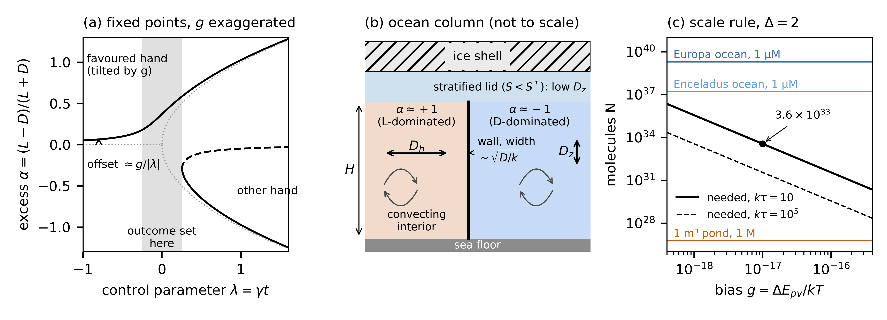
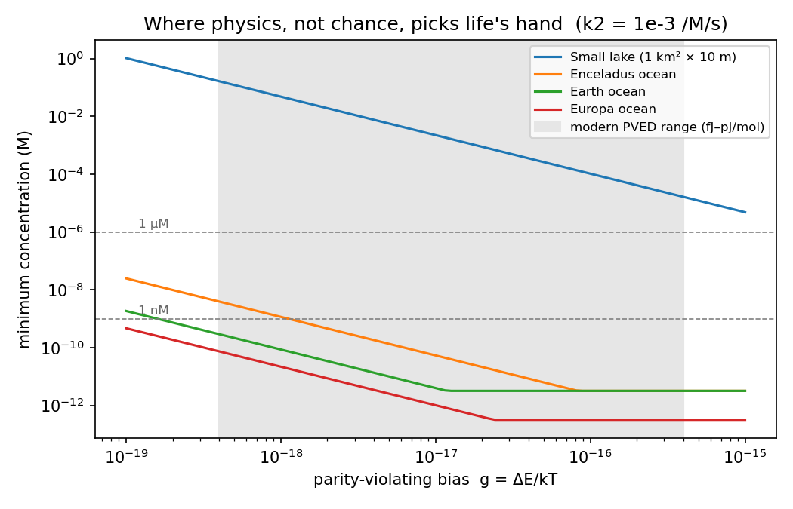
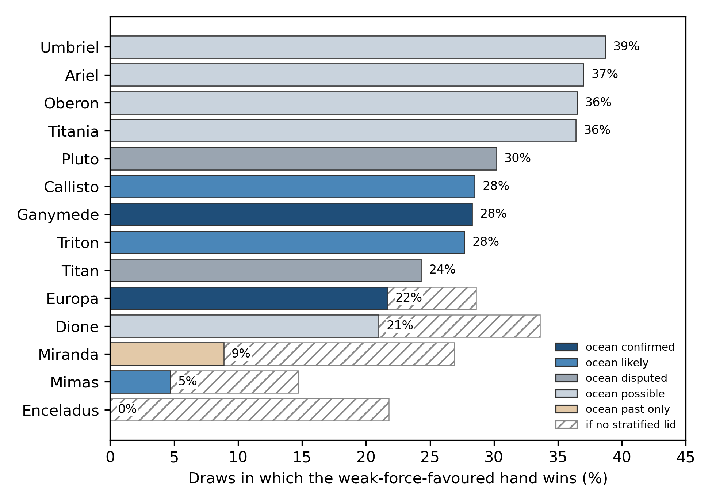

# SUBMISSION NOTES (remove before submitting)

This block is for the author only. Delete everything from this heading to the line "END OF SUBMISSION NOTES" before upload. Items marked **UNCONFIRMED** could not be checked.

## A. Target journal

- **International Journal of Astrobiology (IJA), Cambridge University Press.** ISSN 1473-5504 (print), 1475-3006 (online). It is a single-anonymous peer-reviewed, fully Gold Open Access journal.
- **Scope fits.** The Aims and Scope list includes "Cosmic prebiotic chemistry", "Origins, evolution and distribution of life" and "Life Detection in our solar system and beyond".
- **Sources.** I fetched every item below from the live Cambridge Core pages on 2026-10-11:
  - https://www.cambridge.org/core/journals/international-journal-of-astrobiology/information/author-instructions/preparing-your-materials
  - .../information/author-instructions/submitting-your-materials
  - .../information/author-instructions/fees-and-pricing
  - .../information/journal-policies/open-access-options
  - .../information/journal-policies/publishing-ethics
  - .../information/journal-policies/research-transparency
  - .../information/about-this-journal
- **Why not OLEB.** This draft replaces an earlier one aimed at *Origins of Life and Evolution of Biospheres*. That journal became Springer's *Discover Life* on 1 January 2024. Its scope is now broad life science, so it fits this paper poorly.

## B. Author guidelines and how this draft follows them

| Item | IJA guideline | This draft |
|---|---|---|
| Submission | ScholarOne, http://mc.manuscriptcentral.com/submit_ija , with a covering letter or email. Authors may suggest up to three referees. | Cover letter not written. |
| Article types | Research Articles and Review Articles. "There are no page charges or length restrictions." | **Research Article.** |
| Length | No limit. | The main text (Introduction to Conclusions, including the five figure captions, the tables and the display equations) is about 11,900 words (whitespace count, 2026-10-11). With back matter and references (this block excluded) it is about 15,100 words. |
| Title page | A concise title, author name(s), full institutional addresses, and the corresponding author's name, address, telephone number and e-mail. | Placeholders for address, phone and e-mail. **Fill these in.** |
| Abstract | One paragraph, at most 300 words, giving aims, results and conclusions for a wide audience. | One paragraph of 272 words (whitespace count). |
| Keywords | **Do not put keywords on the manuscript.** They are entered at submission. The two guideline pages disagree: "preparing your materials" says choose two from a list and optionally add a third; "submitting your materials" says a free-text box with at least three. **UNCONFIRMED which applies.** | None in the manuscript. Suggested: homochirality; parity violation; ocean worlds; icy moons; Frank model; prebiotic chemistry. |
| File format | Word (manuscript.doc, or manuscript.rtf on a Mac), or the IJA LaTeX template (manuscript.tex, figures fig1.eps ...). Equations in MathType or Equation Editor, not as images. | This is Markdown with LaTeX equations. **Convert it with the IJA LaTeX template, or to Word with live equations.** |
| Units, abbreviations | Metric and SI units. Define unfamiliar abbreviations at first use. | Done. |
| Equations and tables | Equations numbered (1), (2) ... Tables titled and numbered Table 1 ... | Done. |
| Figures | Embed figures in the manuscript for review. Each has one caption beneath it and is cited in the text in order. After acceptance, supply EPS or TIFF (1200 dpi line art, 300 dpi halftone or colour in CMYK, 600 dpi mixed; lines at least 0.5 pt). Colour is free. Refer to all illustrations as "Figures". | Five figures, each with a caption, numbered in order of first mention. Figure 1 is the new schematic (fig_schematic.png, drawn by journals/make_fig_schematic.py); Figures 2–5 are the existing sketch.png, threshold.png, coarsening.png and rnaas_fig.png. **At acceptance all five must be re-exported as EPS or TIFF** from the same scripts. |
| Accessibility | WCAG 2.1 AA. Alt-text for every figure, sent on the Accessibility Descriptions Submission Form. Machine-generated alt-text is used if none is given. | **Write the alt-text at acceptance.** Check the colour contrast of Figure 5. |
| References | Harvard (Author, date) in the text. The list is alphabetical, includes article titles, and uses unabbreviated journal titles. Example format: "Burbidge, E.M., Burbidge, G. R., Fowler, W. A., Hoyle, F. 1957, Synthesis of the Elements in Stars, Rev. Mod. Phys., 29, 547-650". Unpublished work is cited in the text only ("private communication"), unless in press. | Harvard, alphabetical, with full titles and full journal names from Crossref. DOIs are added as https://doi.org/ links (the guideline neither asks for nor forbids them). Lists with more than 10 authors are cut to the first 10 plus "et al." **UNCONFIRMED whether IJA requires every author.** |
| Acknowledgements | At the end, before References. List all funding sources. | Present. States no funding. |
| Competing interests | Required in the main file. With none: "Competing interests: The author(s) declare none." | Present, in that wording. |
| Data | Data Availability Statements are encouraged. Use repositories with permanent identifiers. | Data and code statements present. **Consider archiving a tagged release on Zenodo for a DOI.** |
| Supplementary material | Allowed. At most 10 MB per file. | None. |
| ORCID | Encouraged. | **Add one if you have it.** |

### AI policy (preparing-your-materials page, "Use of Artificial Intelligence (AI) Tools")

- AI tools cannot be authors.
- Declare any use to generate text or to analyse data. Minimal uses, such as spelling checks, need no declaration.
- Where to declare it:
  - text generation goes "in a separate acknowledgments section or in a footnote";
  - use for data collection or analysis goes in Methods;
  - use for images goes in the figure caption.
- What to include:
  - the tool's name and version;
  - the dates of use;
  - how others can access it;
  - a full description of the use;
  - citations for any third-party material in the output.
- The draft declares the code and analysis use in Methods (Section 2.8) and the writing use in Acknowledgements.
- **To fill in:** the Claude model version(s) and the date range of use. The project files do not record them, so I left placeholders.
- No figure was generated by AI. The plotting scripts were written with AI help (see Section 2.8).

## C. Fees: no free route unless a waiver is granted (live fees page, 2026-10-11)

- IJA is "a wholly open access journal". Every article is Gold OA under a Creative Commons licence.
- **APC: GBP 2610 / USD 3655** (taxes may apply). There are no page charges and no colour charges.
- Funding routes:
  - institutional OA agreements (check whether Cupertino High School has one; probably not);
  - the Cambridge Open Equity Initiative, for over 100 low- and middle-income countries (the USA is not one);
  - Research4Life;
  - **discretionary waivers.** Authors "must request a waiver at or before submission", using the waiver request form.
- Editors and reviewers play no part in funding decisions.
- **This work has no funding. File the waiver request with the submission.** Without a waiver, there is no free subscription route.

## D. Prior publication

- Per advisor review (2026-10-11): not submitting to RNAAS or any preprint server; full paper to IJA only.

## E. Number conflicts between sources (not resolved silently)

1. **Ozturk et al. 2023: two different papers.** RNAAS_DRAFT.md and limits_lit.md cite *Nat. Commun.* 14:6351 (doi:10.1038/s41467-023-42130-8, avalanche magnetization of magnetite by an RNA precursor). PAPER_DRAFT.md cites *Sci. Adv.* 9:eadg8274 (doi:10.1126/sciadv.adg8274, crystallization of an RNA precursor on a magnetic surface). Both are real, and their Crossref titles match. I cite both:
   - (2023b) *Sci. Adv.*: the enantioselective crystallization on magnetite, used for planned-experiment arm D;
   - (2023a) *Nat. Commun.*: magnetization of magnetite, as in RNAAS.
   - **Check which paper reports the ~60% excess** that PAPER §3.13 quotes. The draft cites both for that sentence.
2. **Magnetite threshold.** RNAAS gives "less than about 2–4 × 10⁻¹⁵" for Europa and Enceladus. PAPER §3.13 gives "below 1.9×10⁻¹⁵" for early Earth. These are different worlds, and each value is used only for its own world.
3. **Allen–Cahn prefactor.** PAPER §3.3 gives A = 5.48 and 5.60 (corrected 2026-09-23 from a rounded "5.5 at both"). The PAPER Fig. 2 caption and the coarsening.png legend still say "l = 5.5·√(D t)", and the sampling code uses the rounded A = 5.5 (`coarsen3d.py`, `uncertainty.py`). The text uses 5.48 and 5.60, states that the sampling uses 5.5 (Section 2.4), and the Figure 4 caption calls the dashed line the rounded fit. **The legend in the image still reads 5.5.**
4. **Coarsening shares (not a conflict).** The 99% in the Figure 4 caption is the 96³ figure run (0.989 at t = 400, coarsen_fig.log). The 93.0% in Section 2.4 is a separate 128³ run (coarsen3d.log). Each is now quoted with its grid size.
5. **Europa without a lid.** RNAAS and PAPER give 29%; ocean_worlds.log gives 28.6%. This is rounding. I use 29%, as RNAAS does.
6. **Bennu table.** PAPER §3.10 gives the step rule (15%/21%/57% and 17%/22%/55%) and the full quench curve (16%/21%/57% and 17%/23%/57%). These are two methods, not a conflict. I give the step rule and say that the quench method agrees within 2 points, as PAPER does.

7. **Vertical healing rule.** The `uncertainty.py` docstring states a vertical healing condition (H/A)²/D_z ≤ τ, but `sweep()` does not apply it. Section 2.6 explains why it is implied in case (i). No numerical effect.
8. **Column onset for Enceladus.** `aniso3d.log` gives D_z < D_h/333; the code asserts 334 within 5%. Section 2.3 uses 333.
9. **Europa S\*.** The draft and `strat_sweep.py` use 3.0 g/kg under 20 km of ice; VERIFICATION.md gives 3.2 g/kg at 24.2 MPa and 2.55 g/kg at about 25 MPa. The `strat_sweep.py` docstring says "~25 MPa, 20 km ice", while `verify_sstar.py` uses 24.2 MPa. The text keeps 3.0 and Table 2 reports the 3.2 recomputation.
10. **Ice density and gravity.** The draft uses ρ_ice = 920 kg/m³; `verify_sstar.py` uses 917 kg/m³ with g_s = 1.315 m/s². The text keeps 920 and does not state Europa's gravity. **State g_s in Section 2.5 or confirm it.**
11. **Lid cutoff.** Section 2.5 gives "about 28 MPa", `verify_sstar.py` finds no S\* above 28–29 MPa, and Section 3.5 gives "about 23 km of ice". These agree if g_s ≈ 1.3 m/s²; the text states both forms.
12. **Normal-form check tolerance.** The draft says the 4,000-run check agrees within ±0.005; `sim.py: main()` asserts agreement within 0.03. Table 2 now gives both.
13. **Bias range.** Table 1 gives g from 4×10⁻¹⁹ to 4×10⁻¹⁶; the `review.py: r1_scale` comment says "~1e-19..1e-16". The text uses Table 1.
14. **Scale-rule range.** "10³³–10³⁴ molecules" is not tied to a stated range of g and kτ. The values 3.6–6.7×10³³ come from T = 0–100 °C at g = 10⁻¹⁷ and kτ = 10 (Section 2.2.4).
15. **Equation renumbering (checked; no unmatched references).** The old Eqs. 1–4 were remapped to the new numbering 1–21: old Eq. 1 (normal form) → Eq. 6; old Eq. 2 (P = Φ(Δ)) → Eqs. 10 and 11 (Eq. 11 is the form in N); old Eq. 3 (field equation) → Eq. 14; old Eq. 4 (the display N ≥ … in Section 3.1) duplicated Eq. 13 and was removed, so Section 3.1 now cites Eq. 13. Old reference "Eq. 2" in the code table now reads "Eqs. 1 and 6–13".

## F. References: checks, drops and exclusions

- Every DOI in the list was checked on Crossref (`curl -s https://api.crossref.org/works/<doi>`, no mailto), and its title matches. The reference titles below are taken from Crossref. **60 DOIs checked: 60 OK, 0 dropped for a failed check.**
- The 37 references added with Section 1.1 were checked on Crossref on 2026-10-11 (DOI, title, volume and pages; see ija_history_section.md, verification table). The merged list has 98 entries; a script check found every in-text citation in the list and every entry cited.
- McDougall & Barker 2011 (TEOS-10 manual) has no DOI. It is written by hand, as in RNAAS.
- Buhse et al. 2021 (*Chem. Rev.*) was checked but is not cited, because the text no longer uses it.
- Nothing was taken from FRANK_1953_REVIEW.md or test_against_actual_findings.py.
- Left out on purpose:
  - **Preprints:** Kang & Zhang 2026; Higgins et al. 2026; Öberg, Magnabosco & Tosca 2026; Jannat, Shakeri & Shahbazi 2026. IJA lists only published or in-press work.
  - **Personal communications:** K. Soderlund, W. Kang and A. Brandenburg. These may be cited in the text as "private communication" if they agree. They are not used here.
  - **For length:** Cowan 2023 (*Life*), conference abstracts, and references that support only content I cut (see G).
- Dr. Chris McKay is a co-author of Steel, Dávila & McKay 2017, which is cited. Mention this when you ask him about the acknowledgement.

## G. PAPER_DRAFT.md content deliberately left out

- The novelty claim ("No one had applied this…", the 435-paper scan). No "first" claims are made.
- The candidate amplifiers RAO and Pro-Val-Val; the "three model breaking points"; and the stress-test results (129 s, 10⁻²⁰², quiescent micro-environments). PAPER labels all of these untested.
- The "Multi-Plume Handedness" prediction. It relies on SUDA, which PAPER §3.10 says cannot measure handedness.
- §3.6 (amino-acid/sugar coupling); Parts 1–2, 4 and 4b; the scorecard detail; the beta-decay bias; and the R7 run. All were cut for length.
- Script names and "Part" labels. They appear only in the code table.
- objections.log. Its results are not in PAPER or RNAAS.

## H. To do before submission

1. **[CONFIRM WITH DR. MCKAY BEFORE SUBMISSION]** Get his agreement to the acknowledgement wording.
2. Fill in the address, phone, e-mail and ORCID. Add the AI model version(s) and dates.
3. File the APC waiver request at or before submission (section C).
4. Convert to the IJA LaTeX template or to Word, and embed the figures.
5. Write the cover letter and suggest up to three referees.
6. Check that the GitHub repository is public and that `./run_all.sh` runs from a fresh clone.
7. **[CHECK FULL TEXT] items in Section 1.1.** Read the full papers and fix or remove each marked sentence. Most important first:
   - Yamagata (1966): the mechanism, and whether "accumulation" through repeated steps or amplification is his wording;
   - Kondepudi and Nelson (1983, 1984a, 1984b, 1985): their treatment of noise and their estimate of the reactor volume;
   - Ulbricht and Vester (1962): the mechanism tested (including circularly polarized bremsstrahlung) and the outcome;
   - Vester, Ulbricht and Krauch (1959): the mechanism;
   - Rein (1974) and Letokhov (1975): what each proposed;
   - Bonner (1991): conclusions on the weak force;
   - Avalos et al. (2000);
   - Wesendrup et al. (2003): method and result;
   - Cowan and Furnstahl (2022), Section 1.2: keep the sentence only after a full-text check;
   - Viedma (2005): "grinding" (flagged in the verification table, no body marker).
8. **Title changed.** Old: "How many molecules must decide together? Parity-violation selection of homochirality tested in Solar System ocean worlds". New: "How large a mixed volume does the weak force need? Parity violation and homochirality in Solar System ocean worlds" (anthropomorphic "decide" removed, per Dr. McKay).
9. **Equation remap** (see E15): old Eqs. 1, 2, 3 → Eqs. 6, 10/11, 14; old Eq. 4 removed as a duplicate of Eq. 13. Confirm the numbering survives conversion to LaTeX or Word (Eqs. 2a–2c are one numbered group).
10. The reaction-network table in Section 2.2.1 is unnumbered. Number it (it would become Table 1 and shift the others) or leave it as an inline table.
11. **Text inside images that needs a re-render** (captions in this file are already fixed; the PNGs were not edited): threshold.png title "Where physics, not chance, picks life's hand" (Figure 3); rnaas_fig.png x-axis "Draws in which the weak-force-favoured hand wins (%)" (Figure 5); coarsening.png legend "l = 5.5·√(D t)" (Figure 4, see E3).
12. Delete this notes block.

END OF SUBMISSION NOTES

---

# How large a mixed volume does the weak force need? Parity violation and homochirality in Solar System ocean worlds

**Saptarshi Ghosh**
Cupertino High School, [ADD FULL POSTAL ADDRESS], Cupertino, California, USA

**Corresponding author:** Saptarshi Ghosh, [ADD POSTAL ADDRESS], [ADD TELEPHONE], [ADD E-MAIL]. ORCID: [ADD IF AVAILABLE]

## Abstract

Life uses left-handed amino acids and right-handed sugars. The weak nuclear force makes mirror-image molecules differ very slightly in energy (the parity-violating energy difference, PVED). Proposals that this bias set life's hand date back to Ulbricht and Yamagata, soon after parity violation was discovered; this work builds directly on the Kondepudi–Nelson model in that line, in which the bias acts on a large, slow, self-amplifying reaction. I ask when this tiny bias, rather than random fluctuation, controls the outcome. I use a stochastic normal form of Frank-type self-amplification, checked against brute-force simulations and a full reaction network. About 10³³–10³⁴ molecules must react together as one well-mixed pool. That needs kilometre-scale volumes of well-mixed water. Ponds and rock pores are many orders of magnitude too small, so I use Solar System ocean worlds as test beds. Varying every uncertain input at once, the PVED-favoured hand is selected in 22% (Enceladus), 29% (Europa) and 75% (early Earth) of plausible input sets. Vertical mixing is the main unknown. Weak mixing freezes the ocean into stacked layers of opposite hand, and a stratified layer under a thin ice shell traps the boundary between hands. Across fourteen worlds, Ganymede (28%) and Europa (22–26%) score highest among confirmed oceans, and Enceladus lowest (0–18%). In a closed reversible network, an amplified excess rises and then fades, while a driven network holds it. This reconciles the model with the racemic amino acids returned from asteroid Bennu. It predicts a lasting excess in a driven ocean such as that of Enceladus. No measured prebiotic reaction yet amplifies handedness this way, so I outline a planned wet-lab search. All code is public.

## 1 Introduction

Life uses left-handed (L) amino acids in proteins and right-handed (D) sugars in DNA and RNA. Each mirror-image form is chemically identical to the other when alone. Why life uses one hand, and why this one, is still open. This section first traces the proposals that the weak nuclear force set that hand (Section 1.1), and then states what this paper does (Section 1.2).

### 1.1 Previous proposals that the weak force selected biological handedness

The idea that the weak nuclear force set the hand of life is almost as old as the discovery that the weak force violates parity (1956–1957; Quack et al., 2022). I trace it in order, because my model is a direct descendant of one branch of it. Items marked [CHECK FULL TEXT] go beyond what I could confirm from the title and abstract.

**An amplifier before a bias (1953).** Before parity violation was known, Frank (1953) had already proposed how a chemically symmetric system could end up with one hand. In his scheme, autocatalysis plus mutual inhibition lets small random fluctuations in a racemic mixture tip the system almost entirely into one enantiomer (Frank, 1953, as summarised in the abstract of Soai et al., 1995). The outcome is set by chance. What was missing was a systematic push.

**Parity violation as the push (1959–1968).** Ulbricht (1959) reviewed the new non-conservation of parity together with optical activity. In the same year, Vester, Ulbricht and Krauch (1959) connected optical activity with parity violation in beta-decay. Ulbricht and Vester (1962) then reported attempts to induce optical activity with polarized beta-radiation. The specific mechanism they tested, including the role of circularly polarized bremsstrahlung from the beta-electrons, and the outcome of their experiments are [CHECK FULL TEXT]. Yamagata (1966) put forward a hypothesis for the asymmetric appearance of biomolecules on Earth. Later work names the link between electroweak energy differences and biomolecular homochirality "the Yamagata hypothesis" (Wesendrup et al., 2003). The core of that hypothesis, that a tiny energy bias accumulates through repeated steps or through amplification until one hand dominates, is how later authors summarise it; I have not confirmed this wording against Yamagata's paper [CHECK FULL TEXT]. Garay (1968) bombarded D- and L-tyrosine with beta-particles and found that the D isomer decomposed more quickly.

**Two separate weak-force routes (1974–1982).** From here the field split into two routes. The first is the chiral radiation from beta-decay, which acts at a particular place and time. The second is the parity-violating energy difference (PVED) between enantiomers, which comes from weak neutral currents inside each molecule. Rein (1974) discussed parity-violating effects of intramolecular interactions, and Letokhov (1975) discussed the resulting difference between the energy levels of left- and right-handed molecules; what each proposed beyond this is [CHECK FULL TEXT]. Hegstrom, Rein and Sandars (1980) developed the theory of these energy shifts. Their calculations for twisted ethylene and A-nor-2-thiacholestane gave shifts appreciably smaller than earlier estimates. On the beta-decay route, Hegstrom (1982) found a mechanism by which longitudinally polarized electrons ionize a chiral molecule and its mirror image at different rates. In companion experiments, Gidley et al. (1982) used a spin-polarized positron beam and found no asymmetry in cystine or tryptophan at the 7 × 10⁻⁴ level, but a possible effect of (31 ± 7) × 10⁻⁴ in leucine.

**Ab initio PVEDs for biomolecules (1983–1985).** Mason and Tranter calculated the PVED between enantiomeric molecules (Mason and Tranter, 1983, 1984). Their ab initio results gave L-alanine in its aqueous conformation, and L-peptides in the alpha-helix and beta-sheet, a lower ground-state energy than the D forms. The difference was of order 10⁻¹⁴ J mol⁻¹. That corresponds to an excess of about 10⁶ L molecules per mole of racemate at equilibrium at ambient temperature (Mason and Tranter, 1985). Tranter (1985a) extended the calculations to alpha-amino acids. Mason (1987) summarised the position: the weak neutral current gives a constant, uniform chiral bias that lowers the energy of L-amino acids and of the parent aldotriose of the D-sugar series. He set this against classical chiral fields and beta-decay agents, which need a particular time or place on Earth. He also named two ways a molecular-scale bias could matter: as a trigger that guides an autocatalytic racemic process into one channel, or through cumulative amplification in a large homochiral aggregate (Mason, 1987). Tranter (1985b) stated the cost of the first route plainly. The energy differences are so small for simple chiral molecules that propagating homochirality would require an amplification mechanism with both large quantities of reactants and a long reaction time.

**Bias at a bifurcation: Kondepudi and Nelson (1983–1987).** This is the work my model builds on most directly. Kondepudi and Nelson (1983, 1984a) analysed chiral symmetry breaking in nonequilibrium chemical systems and the sensitivity of the symmetry-breaking states, and Kondepudi and Nelson (1984b) derived time scales for chiral selection. In model systems that spontaneously evolve to an L- or D-dominated state, they showed a simple and very sensitive mechanism. Through it, a systematic chiral interaction no stronger than the weak-neutral-current energy in amino acids can determine which enantiomer dominates over about 15,000 years (Kondepudi and Nelson, 1985). They noted that this fits Mason and Tranter's finding for L-amino acids. Kondepudi (1987) gave the general form: slow passage through the transition point makes the system sensitive to very weak but systematic chiral influences. Their treatment of random fluctuations, which act against the bias, and their estimate of the reactor volume needed, are [CHECK FULL TEXT].

**Doubts about the size and the sign (1991–2007).** Bonner (1991) reviewed the origin and amplification of biomolecular chirality [CHECK FULL TEXT for its conclusions on the weak force]. Calculations for sugars showed that the lower-energy enantiomer depends on conformation. D-sugars have the lower energy with a C2-endo furanose pucker, and L-sugars with a C3-endo pucker (Tranter et al., 1992). MacDermott (1995) reported PVEDs for a range of important biomolecules, with the natural enantiomer the more stable in nearly all cases. Bonner (1996) concluded that there was no experimental evidence that beta-decay electrons or other spin-polarized particles generate chiral molecules. He also concluded that only theory, not experiment, supported a causal link between PVEDs and homochirality. In his own crystallization tests with very efficient stereoselective autocatalysis, he found no bias. Bonner (2000) went further and concluded that nuclear-level and biopolymer-level parity violation are entirely independent. Improved electroweak quantum chemistry then changed the numbers. Berger and Quack (2000) concluded that numerous earlier claims of L-alanine stabilization were unjustified. Laerdahl, Wesendrup and Schwerdtfeger (2000) found L-alanine lower in energy for only seven of 13 gas-phase conformers, which allowed no definite conclusion. Avalos et al. (2000) revisited the chemical implications of parity violation [CHECK FULL TEXT]. Wesendrup et al. (2003) re-examined the Yamagata hypothesis itself [CHECK FULL TEXT for method and result]. Quack (2002) reviewed the field and noted that the newer methods give PVEDs one to two orders of magnitude larger than previously accepted, but still very small (femtojoule to picojoule per mole). Lente then treated the problem stochastically (Lente, 2004). He found that the chance of the more stable isomer being in excess in a racemic mixture is not significantly above 50% under normal conditions (Lente, 2006). He also found that the PVED cannot be amplified by enantioselective autocatalysis under conditions reasonable for the origin of biological chirality (Lente, 2007). The PVED has still not been detected experimentally. Current calculations put it at about 10⁻¹¹ to 10⁻¹⁰ J mol⁻¹ (Quack et al., 2022).

**Amplifiers that work in the laboratory (1995–2007).** Meanwhile, real amplifiers were found. Soai et al. (1995) showed that an autocatalytic organozinc reaction raises a 2% enantiomeric excess of a pyrimidyl alkanol. Blackmond (2004) explained this: the product catalyses its own formation and suppresses that of its enantiomer, as in Frank's model. Viedma (2005) showed that grinding-driven crystallization with recycling turns a symmetric population of D and L crystals into one of complete chiral purity. Plasson et al. (2007) classified these far-from-equilibrium mechanisms and stressed recycling and network autocatalysis. These systems supply the amplifier that the Kondepudi–Nelson argument assumes. None of them is the aqueous prebiotic reaction that the argument needs (Section 4).

**Space, planets and noise (1999–2023).** Several studies moved the question beyond a single beaker. Lunine et al. (1999) discussed the abiotic generation of homochirality on Titan; I cite this chapter only for its subject, because I have not read it. Brandenburg and Multamäki (2004) solved reaction-diffusion equations for left- and right-handed populations on Earth's surface. They found that global homochirality is set by the long global diffusion time, which turbulence and large-scale flows can shorten. They also suggested that a quiescent deep ocean could have let opposite hands coexist. Gleiser (2007) used a biased model with cross-inhibition to follow the growth of left- and right-handed domains in space. He bounded the chiral bias from constraints on the emergence of life on early Earth and discussed weak neutral currents and circularly polarized light as sources; he noted that the approach applies to any planetary setting. Gleiser and Walker (2012) argued that environmental disturbances may have set life's hand. They predicted that a representative sample of extraterrestrial stereochemistry will be racemic on average. Hochberg et al. (2022) reported that parity-violation-induced chiral selectivity is resilient to nonequilibrium temperature fluctuations in open systems. Hochberg et al. (2023) framed this as an imperfect bifurcation in which chiral selectivity holds when the bias exceeds the noise.

**Competing deterministic sources.** Two other systematic biases need mention. Circularly polarized infrared light is strong in the Orion OMC-1 star-forming region. Polarized light at shorter wavelengths could bias interstellar organics that were later delivered to Earth (Bailey et al., 1998). Spin-polarized electrons from UV-irradiated magnetite could drive enantioselective reductions through the chiral-induced spin selectivity (CISS) effect (Ozturk and Sasselov, 2022). Crystallizing an RNA precursor on magnetite gave about 60% ee, and 100% after recrystallization (Ozturk et al., 2023b). Enantiopure crystals can in turn magnetize the surface (Ozturk et al., 2023a). Both are local agents of the kind Mason (1987) contrasted with the uniform weak force. Section 4 shows how the magnetite route enters my early-Earth and icy-moon results.

**What this work adds.** I keep the structure of the Kondepudi–Nelson model: a Frank-type amplifier crosses a symmetry-breaking bifurcation, and the PVED acts as a small systematic bias against random fluctuations. Following Hochberg et al. (2023), selection holds only when the bias exceeds the noise. What I add is space. The "large quantities of reactants and a long reaction time" that Tranter (1985b) identified make sense only if all those molecules belong to one connected, well-mixed reacting system. I make that requirement explicit as a count. About 10³³ to 10³⁴ molecules must take part in one connected, well-mixed volume for the PVED to determine the outcome more often than chance does (Section 3.1). This is consistent with Lente's (2006, 2007) conclusion that the bias is lost in ordinary settings. The scale rule says how large a setting would have to be instead. I then ask whether any real body of water provides such a volume. Ponds and rock pores do not. Ocean worlds such as Enceladus, Europa and Ganymede clear the size bar. Whether they stay connected depends on vertical mixing and stratification, which can break an ocean into patches and stacked layers that evolve separately. Brandenburg and Multamäki (2004) and Gleiser (2007) studied that kind of domain growth on a single planet. The result is a ranking of named worlds, not a general argument. It does not settle the earlier objections: if the PVED is smaller than assumed, or has the opposite sign for the relevant prebiotic molecules (Berger and Quack, 2000; Laerdahl et al., 2000; Tranter et al., 1992), the scale rule and the ranking change with it.

### 1.2 This work

The PVED is about 10⁻¹⁷ kT. Whether it or chance set life's hand remains open (Quack et al., 2022). Lente (2007) found that the PVED cannot be amplified when self-copying starts from a few chiral molecules. My model instead assumes an open, fed reaction in which the whole population passes through the transition together. Cowan and Furnstahl (2022) combined the PVED with metal-catalysed self-amplifying synthesis in an early-Earth ocean [CHECK FULL TEXT]. Lunine et al. (1999) discussed homochirality on Titan; I consider liquid-water oceans only.

Here I ask two linked questions. First, how many molecules must react together for the PVED, rather than chance, to control the outcome? Second, does any real body of water meet that requirement? I use the Solar System's ocean worlds as test beds. They matter for a simple reason. All life on Earth shares one ancestor, so Earth's single hand cannot tell a physical bias from luck. A second, independent ocean could.

Section 2 gives the physical model, step by step: the bias, the amplifying chemistry and the equation it reduces to, the role of mixing, the stratified-lid test, the sampling of uncertain inputs and the checks that support each step. Section 3 gives the results: a size rule, how mixing and layering shape the outcome, the effect of a stratified layer under the ice, a ranking of fourteen worlds, and checks against meteorites and lab data. Section 4 lists the limitations. Section 5 outlines a planned experiment.

## 2 Methods

This section describes the physical effect I model, step by step: where the bias comes from and how large it is (2.1); the chemistry that amplifies it and the equation that chemistry reduces to (2.2); how many molecules take part and why mixing sets that number (2.3); what happens after the transition, when regions of opposite hand meet (2.4); the test for a stratified layer under the ice (2.5); how the uncertain inputs become the reported percentages (2.6); and which checks support each step (2.7). Section 2.8 states how AI tools were used. Figure 1 summarises the picture.

**Figure 1.** Schematic of the model. Nothing in this figure is simulated or measured data. (a) Fixed points of the noise-free normal form, λα − α³ + g = 0 (Eq. 6), against the control parameter λ. Solid lines are stable states and dashed lines unstable ones. The dotted grey lines are the symmetric pitchfork (g = 0). The bias is drawn as g = 0.05 so that it is visible; the real bias is about 10⁻¹⁷. Before the transition (λ < 0) the only stable state is offset from racemic by about g/|λ|. After it (λ > 0) the branch connected to that state leads to the PVED-favoured hand. The grey band marks, schematically, the window |λ| ≲ γ^½ in which the outcome is set (Eq. 9). (b) Cartoon of an ice-covered ocean, not to scale: ice shell, a stratified lid that forms when the salinity S is below the threshold S* (Section 2.5), and a convecting interior of depth H with horizontal and vertical eddy diffusivities D_h and D_z. A wall separates a region dominated by L (α ≈ +1) from one dominated by D (α ≈ −1); its width is of order √(D/k). (c) The scale rule, Eq. 13: the number of molecules N needed for Δ = 2 (a 97.7% probability that the PVED-favoured hand is selected) over the range of g sampled in Table 1, for kτ = 10 (solid) and kτ = 10⁵ (dashed). The dot is the reference case, g = 10⁻¹⁷ and kτ = 10, which needs 3.6×10³³ molecules. Horizontal lines are N = c·V·1000·N_A for a 1 m³ pond at 1 M and for the Enceladus (2.7×10¹⁶ m³) and Europa (3.3×10¹⁸ m³) ocean volumes of Table 1 at 1 µM, each treated as fully mixed. Drawn by `journals/make_fig_schematic.py`, which uses `review.py: n_needed()` and asserts the 3.6×10³³ and 6×10²⁶ values.

### 2.1 The bias: the parity-violating energy difference

The weak nuclear force does not conserve parity. As a result, the two mirror-image forms (enantiomers) of a chiral molecule are not exactly equal in energy. The difference is the parity-violating energy difference, ΔE_pv. It is set by the weak interaction between electrons and nuclei, and it grows steeply with nuclear charge. For molecules made of light atoms (H, C, N, O) it is of order attoelectronvolts (aeV) to femtoelectronvolts (feV); with sulfur, chlorine or bromine it can reach about 200 aeV (Quack et al., 2022). It has never been measured directly, and its sign for the amino acids in water is not settled (Quack et al., 2022).

I express the bias as the dimensionless ratio of this energy to the thermal energy:

$$ g = \frac{\Delta E_{pv}}{k_B T}. \tag{1}$$

Here k_B is Boltzmann's constant and T is the temperature. In the chemistry of Section 2.2, g enters as a fractional difference between the copying rate constants of the two hands: the L hand copies at k(1 + g) and the D hand at k(1 − g). This follows Kondepudi and Nelson (1985), who proposed that the PVED acts as a small bias on the rates of a self-amplifying reaction.

The reference value is g = 10⁻¹⁷, taken at 0 °C (T = 273 K) in `review.py: r1_scale()`, which sets ΔE_pv = 10⁻¹⁷ × R × 273 J/mol. In the uncertainty sampling (Section 2.6), g is drawn log-uniformly from 4×10⁻¹⁹ to 4×10⁻¹⁶ (`uncertainty.py: sweep()`), which is about 0.01 to 10 aeV per molecule. This range lies at or below the low end of the values given by Quack et al. (2022) for light-atom molecules, so it does not overstate the bias. Because ΔE_pv is a fixed energy, g falls as 1/T; Section 2.2.4 gives the effect of temperature on the result.

### 2.2 The chemistry and the equation it reduces to

#### 2.2.1 A Frank-type network

A bias of 10⁻¹⁷ has no effect on a single reaction. It can matter only in a reaction that copies its own product, so that a small excess grows, and in which the two hands remove each other, so that only one hand can become dominant (Frank, 1953). I use the following network in a flow reactor (`frank.py: run()`). A is an achiral feedstock (for example an amino-acid precursor), and L and D are the two hands of the product.

| Reaction | Rate (M s⁻¹) | Physical role |
|---|---|---|
| feed → A | f (a₀(t) − a) | supply of achiral feedstock A; a₀ is raised slowly |
| A → L, A → D | k₀ a each | slow, unbiased, uncatalysed production |
| A + L → 2L | k (1 + g) a L | self-copying of L, with the weak-force bias |
| A + D → 2D | k (1 − g) a D | self-copying of D |
| L + D → inactive product | k_i L D | mutual removal (cross-inhibition) |
| L → out, D → out | k_d L, k_d D | outflow |

Symbols and units: a, L and D are the concentrations of A and of the two hands (M = mol/L); a₀ is the feed concentration (M); f is the flow rate (s⁻¹); k₀ is the uncatalysed rate constant (s⁻¹); k is the self-copying rate constant (M⁻¹ s⁻¹; this is k₂ in the ocean model); k_i is the cross-inhibition rate constant (M⁻¹ s⁻¹); k_d is the outflow rate (s⁻¹); g is dimensionless (Eq. 1). The rate equations are

$$\frac{da}{dt} = f\,(a_0 - a) - 2k_0 a - k a\left[(1+g)L + (1-g)D\right], \tag{2a}$$
$$\frac{dL}{dt} = k_0 a + k(1+g)\,aL - k_i LD - k_d L, \tag{2b}$$
$$\frac{dD}{dt} = k_0 a + k(1-g)\,aD - k_i LD - k_d D. \tag{2c}$$

In the simulations each reaction also carries its own counting noise (the chemical Langevin equation): a reaction with rate r adds a random change of standard deviation √(r dt/Ω) to the concentrations it changes in a time step dt, where Ω is the number of molecules per unit concentration in the reactor (molecules per M; Ω = 1000·N_A·V for a volume V in m³). This is the term `n = sqrt(r*dt/omega)*...` in `frank.py: run()`. The simulations use dimensionless constants k = k_d = k_i = 1, k₀ = 10⁻³ and f = 1, with a₀ ramped from 0.8 to 1.6 over a time τ.

A second network (`frank2.py: run()`) adds the reverse reactions L → A, D → A (rate constant 0.2) and L + L → A + L, D + D → A + D (rate constant 0.5). I use it only as a check (Section 2.7).

#### 2.2.2 Reduction near the symmetry-breaking point

Write the sum and the difference of the two hands as s = L + D and u = L − D. Subtracting Eq. 2c from Eq. 2b gives, exactly,

$$\frac{du}{dt} = (ka - k_d)\,u + g\,k a\, s. \tag{3}$$

Cross-inhibition removes one L and one D together, so it does not appear in Eq. 3. The first term says that a difference between the hands grows when copying outpaces outflow (ka > k_d) and decays otherwise. The second term is the bias.

On the racemic branch (u = 0, g = 0), adding Eqs. 2b and 2c and setting the result to zero gives 2k₀a + (ka − k_d)s − (k_i/2)s² = 0. At the crossing point, where ka = k_d, each hand has concentration x = s/2 = √(k₀a/k_i). With the constants above this is x = √(10⁻³) ≈ 0.032, as used in `frank.py: main()`.

Because a₀ is raised slowly, a rises and the growth rate of u, λ_u = ka − k_d, passes through zero at a time t_c. Near t_c it is linear in time:

$$\lambda_u(t) \approx \gamma\,(t - t_c), \qquad \gamma = k\,\frac{da}{dt} \quad (\text{s}^{-2}). \tag{4}$$

The noise on u comes from every reaction that changes L − D by one molecule: the two uncatalysed productions, the two copying steps and the two outflows. Cross-inhibition changes L − D by zero and contributes nothing. At L = D = x the variance of u grows at the rate

$$\varepsilon_u = \frac{2k_0 a + 2x\,(ka + k_d)}{\Omega} \quad (\text{M}^2\,\text{s}^{-1}). \tag{5}$$

Near t_c, therefore, du = [γ(t − t_c)u + g_eff] dt + √ε_u dW, with g_eff = 2g·x·ka. These are the three quantities computed in `frank.py: predicted()`. For frank2.py the same bookkeeping gives λ = ka − k₀r − k_d − 2k_r x and ε = (2k₀a + 2k₀r x + 2kax + 2k_r x² + 2k_d x)/Ω (`frank2.py: mapped()`).

Once |u| is no longer small, feedstock depletion and cross-inhibition limit its growth. Because the equations are unchanged when L and D are exchanged together with g → −g, the leading saturating term in the excess is cubic. Writing α = (L − D)/(L + D), measuring time in units of 1/k and rescaling α so that the cubic coefficient is 1 gives the normal form

$$d\alpha = \left(\lambda(t)\,\alpha - \alpha^3 + g\right)dt + \sqrt{\varepsilon}\,dW, \qquad \lambda = \gamma t. \tag{6}$$

This is implemented in `sim.py: simulate()`. Its symbols are dimensionless: λ measures how far the system is past the transition; g is the bias; ε is the noise strength; γ = 1/(kτ) is the sweep rate, with k = k₂c the copying rate (k₂ in M⁻¹ s⁻¹ times the reactant concentration c in M) and τ the time over which conditions pass through the transition; W is a Wiener process. For λ < 0 the only stable state is near α = 0; for λ > 0 there are two stable states near α = +1 and α = −1 (Figure 1a). I did not derive the cubic coefficient for the network; the result below depends only on the linear stage, and Section 2.7 tests it against the full network directly.

#### 2.2.3 Which state is selected

The outcome is set while α is still small, so the cubic term can be dropped. Equation 6 becomes linear,

$$d\alpha = (\gamma t\,\alpha + g)\,dt + \sqrt{\varepsilon}\,dW, \tag{7}$$

and its solution is

$$\alpha(t) = e^{\gamma t^2/2}\left[\alpha(t_0)\,e^{-\gamma t_0^2/2} + \int_{t_0}^{t} e^{-\gamma s^2/2}\left(g\,ds + \sqrt{\varepsilon}\,dW_s\right)\right]. \tag{8}$$

The first term in the bracket vanishes when the sweep starts well before the transition (t₀ ≪ −γ^(−½)). For t ≫ γ^(−½), the prefactor grows without bound and the bracket tends to a fixed random number Z. The sign of Z sets the final state, because the cubic term only stops α at ±1 and cannot change its sign. Z is Gaussian, with

$$\langle Z\rangle = g\int_{-\infty}^{\infty} e^{-\gamma s^2/2}\,ds = g\sqrt{2\pi/\gamma}, \qquad \operatorname{Var} Z = \varepsilon\int_{-\infty}^{\infty} e^{-\gamma s^2}\,ds = \varepsilon\sqrt{\pi/\gamma}. \tag{9}$$

Both integrals are dominated by |t| ≲ γ^(−½), that is |λ| ≲ γ^½: this is the window in which the outcome is set (grey band in Figure 1a). The probability that the PVED-favoured state is selected is P = Pr(Z > 0):

$$P = \Phi(\Delta), \qquad \Delta = \frac{\langle Z\rangle}{\sqrt{\operatorname{Var} Z}} = \sqrt{2}\,\pi^{1/4}\,g\,\gamma^{-1/4}\,\varepsilon^{-1/2}, \tag{10}$$

where Φ is the standard normal cumulative distribution (`sim.py: delta()`). Δ = 2 gives P = 97.7%. Physically, Δ compares the excess that the bias builds up during the window with the excess that counting noise builds up in the same window. A slower sweep (smaller γ) widens the window, and both grow, but the bias grows faster, which is why Δ rises as γ^(−¼). Figure 2 shows the same picture as a tilted landscape.

**Figure 2.** Sketch of the landscape that the excess α moves in (Eq. 6). The weak force tilts the landscape very slightly, and molecular counting noise shakes it. Which valley α ends in is set in a short window around the transition (Eqs. 9 and 10).

#### 2.2.4 The scale rule

For a pool of N molecules that react together, the counting noise in α is ε ≈ 1/N, and with time in units of 1/k the sweep rate is γ = 1/(kτ). Equation 10 becomes

$$\Delta = \sqrt{2}\,\pi^{1/4}\,g\,(k\tau)^{1/4}\sqrt{N}, \qquad k = k_2 c. \tag{11}$$

For a body of water of volume V (m³), of which a fraction f is mixed together during the window,

$$N = c\,V f \cdot 1000 \cdot N_A, \tag{12}$$

where N_A is Avogadro's number and the factor 1000 converts m³ to litres. Equations 11 and 12 together are `ocean.py: delta_at()`.

The condition for the bias to control the outcome is Δ ≥ 2: the bias accumulated over the window must exceed twice the standard deviation of the noise accumulated over the same window. This is the balance between bias and noise that underlies the proposal of Kondepudi and Nelson (1985). Solving Eq. 11 for N step by step:

1. Square Eq. 11: Δ² = 2π^½ g² (kτ)^½ N.
2. Set Δ = 2: 4 = 2π^½ g² (kτ)^½ N.
3. Solve for N:

$$N \ge \left(\frac{2}{\sqrt{2}\,\pi^{1/4}\,g\,(k\tau)^{1/4}}\right)^2 = \frac{2}{\sqrt{\pi}\;g^2\,(k\tau)^{1/2}}. \tag{13}$$

This is `review.py: n_needed()`. The reaction must also run to completion within the available time, which I require as kτ = k₂cτ ≥ 10 (`ocean.py: c_time()`). With g = 10⁻¹⁷ and kτ = 10, Eq. 13 gives N ≥ 3.6×10³³ molecules, or 6×10⁹ mol (`review.py: r1_scale()`). At 1 µM that is a well-mixed cube of water 18 km on a side; at 1 mM, 1.8 km; at 0.1 M, 0.4 km. A 1 m³ pond at 1 M holds 6×10²⁶ molecules, about 7 orders of magnitude too few. The rule depends weakly on everything except g: N scales as g⁻², so as T² for a fixed ΔE_pv (3.6×10³³ at 0 °C, 4.3×10³³ at 27 °C, 6.7×10³³ at 100 °C), and as (kτ)^(−½), so a sweep 10,000 times slower lowers N by 100 times.

The full network adds noise that the simple count ε = 1/N leaves out: uncatalysed production and outflow change L − D as much as copying does (Eq. 5). Dividing Eq. 10 for the network by Eq. 11 for the same molecules gives Δ_network = F·Δ, with F = √(x/(k₀ + 2x)) = 0.70 at the constants of `frank.py` (`frank.py: main()`); the reversible network gives F = 0.71 (`frank2.py: mapped()`). Since Δ ∝ c^(3/4) at fixed V (Eqs. 11, 12), the required concentration rises by F^(−4/3) = 1.60. The uncertainty sampling draws F from U(0.3, 0.7) (Table 1), whose upper end matches these values and whose lower end allows for chemistry with more wasted turnover.

### 2.3 Why mixing sets the number of molecules

N in Eq. 11 is not the number of molecules in a body of water. It is the number whose counting noise is averaged together while the outcome is set. Two regions that do not exchange molecules during the window each have their own noise, their own Z in Eq. 9, and so they can end in opposite states. The relevant N is therefore the number of molecules in a volume that is connected and mixed on the time scale of the reaction.

To describe this I let α vary in space. Mixing by ocean eddies acts on large scales like diffusion, with a horizontal eddy diffusivity D_h and a vertical one D_z (both m² s⁻¹). Equation 6 becomes the field equation

$$\partial_t \alpha = \lambda\alpha - \alpha^3 + g + D_h\nabla_h^2\alpha + D_z\,\partial_z^2\alpha + \text{noise}, \tag{14}$$

implemented in 1D in `domains.py: sweep()`, in 3D with one D in `domains3d.py: sweep3d()` and `coarsen3d.py: step()`, with separate D_h and D_z in `aniso3d.py: run()`, and on a spherical shell in `sphere_layers.py`.

Ocean mixing is strongly anisotropic: D_z is many orders of magnitude smaller than D_h (Table 1). Changing the vertical coordinate to z' = z·√(D_h/D_z) turns D_z ∂_z² into D_h ∂_{z'}², so Eq. 14 becomes the equal-mixing equation in a box whose depth is stretched from H to

$$H' = H\sqrt{D_h/D_z}. \tag{15}$$

Weak vertical mixing therefore acts like a deep, narrow ocean. I take the ocean depth as H = V/(4πR²) with R = L/π, and the horizontal size as half the circumference, L = πR (`uncertainty.py: depth()`). Comparing H' with L sorts every input set into one of two cases:

- H' ≤ L (the stretched ocean is wider than it is deep). After the transition the ocean forms a patchwork of regions of each hand that heals into one hand (Section 2.4). The whole volume counts: f = 1 in Eq. 12.
- H' > L (the stretched ocean is a tall column). The patchwork freezes into stacked horizontal layers of opposite hand (Section 2.4). On a sphere the top layer later takes over the whole depth, so the outcome is set by the molecules of the top layer alone. I assume that this layer has a thickness of about L in stretched units, so it holds a share f = L/H' of the molecules. This share is an assumption, based on the 3–5 layers seen in `aniso3d.py`; two `sphere_layers.py` runs gave top-layer shares of 0.52 and 0.07 against L/H' = 0.25, which neither supports nor rules it out (`uncertainty.py` docstring).

The column case begins when D_z < D_h·(H/L)², which is D_z < D_h/333 for Enceladus and D_z < D_h/1386 for Europa (`aniso3d.log`).

### 2.4 Walls, coarsening and why walls stop

**What a wall is.** After the transition (λ > 0), each region of the ocean sits near α = +1 or α = −1. Where two such regions meet, α passes from one value to the other across a thin layer: a wall, or domain boundary. Its width is set by the balance between the reaction, which pushes α towards ±1, and mixing, which smooths it; it is of order √(D/k). Because Eq. 14 (with g = 0) is a gradient flow, a wall carries an energy per unit area σ, which scales as σ ∝ √D (`two_zone.py` docstring).

**Why walls move.** In this kind of gradient flow, a wall moves along its normal at a speed equal to the diffusivity times its mean curvature (Allen and Cahn, 1979):

$$v_n = D\,\kappa, \tag{16}$$

where κ is the sum of the two principal curvatures. A closed patch therefore shrinks and disappears, and the typical patch size grows as

$$l = A\sqrt{D\,t}. \tag{17}$$

In 3D runs from a random start I measured exponents of 0.45 and 0.49 (0.5 expected) and A = 5.48 and 5.60; the sampling uses A = 5.5 (`coarsen3d.py: coarsen()`, `coarsen3d.log`). Because the dynamics do not conserve the amount of either hand, the hand that fills more of the volume takes over: in a 3D run starting with 55% of the volume in one hand, that hand filled 93.0% by t = 400 (128³ grid; `coarsen3d.log`). A patchwork of horizontal size L therefore heals into one hand in a time (L/A)²/D_h. In the 1D runs, the patch size just after the transition follows l ∝ √D·γ^(−¼) (`domains.py: main()`, check A), but in 3D this law fails (31% spread, `domains3d.log`) because curved walls keep moving after the transition; I therefore use Eq. 17 instead.

The bias also moves a flat wall: in 1D the region of the PVED-favoured hand advances at

$$v = \frac{3}{\sqrt{2}}\,g\sqrt{D} \tag{18}$$

(`domains.py: wall_speed()`, matched within 10% in two runs). For g ≈ 10⁻¹⁷ this speed is negligible against curvature-driven motion, so I neglect it in the ocean model.

**Why walls stop.** Equation 16 gives zero speed for a flat wall. In a flat box, the horizontal walls between stacked layers therefore do not move, and the layers persist (`aniso3d.py`: 7 of 8 column runs froze into 3–5 layers, while a cube healed in 4 of 4 runs from 55%). On a sphere, a wall at constant depth is itself a sphere of radius r, with κ = 2/r, and its normal is vertical, so only vertical mixing moves it:

$$v = \frac{2D_z}{r}. \tag{19}$$

I measured 0.991, 0.991 and 0.984 times 2D_z/r, with 0.0% change when D_h was raised four times (`sphere_layers.py: wall_speed()`, `sphere_layers.log`). Each layer wall sinks, the top layer grows, and it takes over the full depth in about H·R/(2D_z), with R = L/π. At D_z = 10⁻¹⁰ m² s⁻¹ this is 1.5×10¹² yr for Enceladus and 2.8×10¹³ yr for Europa, far longer than the age of either ocean; at larger D_z it is short.

A wall also stops where the mixing changes with depth. Its energy E = 4πr² σ(r) must fall as it moves. Sinking shrinks its area, which lowers E, but sinking into faster-mixing water raises σ, which raises E. The wall can pass only if

$$\left|\frac{d\ln\sigma}{dr}\right| < \frac{2}{r}. \tag{20}$$

In radial runs (`two_zone.py: run()`) with a slow-mixing layer on top or in the middle, the wall stopped about 0.08 depth units above the lower edge of the slow layer and did not move again, for mixing ratios of 10 and 100, run to 3 times the expected time. The pinning begins at a mixing ratio between 1.02 (the wall passed, 1.378 times slower than without the layer) and 1.05 (it stopped). A bias can push the wall through, but it needs h ≈ 0.20 in model units (`polar_gap.py`, Section 3.4), while g ≤ 4×10⁻¹⁶, about 15 orders of magnitude too weak. With the slow layer at the bottom the wall passed, 0.67–0.71 times the predicted time (`two_zone.log`).

### 2.5 The stratified-lid test

Seawater near its freezing point normally becomes denser as it cools, so cooling at the top drives convection. Below a threshold salinity S*, the thermal expansion coefficient at the freezing point changes sign: cooled water becomes lighter, and the ocean stacks a stratified upper layer on a convecting interior (Zeng and Jansen, 2021, 2024). Such a layer has a much smaller D_z than the water below it, so by Eq. 20 it traps the wall between the top layer and the interior, and the ocean keeps two hands.

I define S* as the salinity at which the thermal expansion coefficient at the freezing temperature is zero,

$$\alpha_T\!\left(S^*,\; T_f(S^*, p),\; p\right) = 0, \qquad p = \rho_{ice}\, g_s\, h_{ice}, \tag{21}$$

computed from the TEOS-10 equation of state (McDougall and Barker, 2011) at the pressure p at the top of the ocean, where h_ice is the ice thickness, g_s the surface gravity and ρ_ice = 920 kg/m³ (`verify_sstar.py: sstar()` recomputes it independently). S* is 22.5 g/kg at the top of the Enceladus ocean (18.0 at its floor), and 3.0 g/kg under 20 km of ice on Europa (19.5 under 4 km). The sampling uses S* = 20 g/kg for Enceladus and 3.0 g/kg for Europa (`strat_sweep.py: SALT`).

There is a pressure cutoff. Under more than about 28 MPa of ice, water at its freezing point sinks as it cools at any salinity, so no lid can form (`verify_sstar.py` finds no S* above 28–29 MPa). On Europa this corresponds to an ice shell of about 23 km.

Each input set is given a salinity drawn log-uniformly (Enceladus 5–20 g/kg, the measured range of Postberg et al. (2009); Europa 1–100 g/kg, an assumed prior). A set with S < S* is counted as pinned, and pinned sets are not counted as successes (`strat_sweep.py: main()`). Salinity is drawn independently of all other inputs. Worlds other than Enceladus and Europa that have no measured salinity get the same log-uniform prior of 1–100 g/kg. I report the lid results beside the lid-free results, not in place of them.

To test whether such a lid traps a wall, I ran a radial gradient-flow model (`two_zone.py`) and axisymmetric hemisphere runs. In these runs the lid cuts vertical mixing only. Separate runs added a polar gap in the lid, or a single overturning current (Section 3.4). I wrote a prediction before every run and kept the wrong ones.

### 2.6 From the equations to the reported percentages

Every input to Eqs. 11–21 is uncertain, most by orders of magnitude (Table 1). For each world I draw 200,000 input sets, log-uniformly over each range unless noted, with a fixed random seed of 0 (`uncertainty.py: logu()`, `sweep()`).

**Table 1.** Input ranges for the three reference oceans.

| Input | Enceladus | Europa | Early Earth ocean |
|---|---|---|---|
| bias g = PVED/kT | 4×10⁻¹⁹ – 4×10⁻¹⁶ | same | same |
| rate k₂ (M⁻¹ s⁻¹) | 10⁻⁶ – 1 | same | same |
| concentration c (M) | 10⁻¹² – 10⁻⁴ | 10⁻¹² – 10⁻⁴ | 10⁻⁷ – 3×10⁻⁴ |
| horizontal D_h (m² s⁻¹) | 10⁻² – 10² | 10⁻² – 10² | 10² – 10⁴ |
| vertical D_z (m² s⁻¹) | 10⁻¹⁰ – 10⁻³ | 10⁻¹⁰ – 10⁻³ | 10⁻⁶ – 10⁻⁴ |
| time τ (yr) | 10⁶ – 10⁹ | 10⁸ – 4×10⁹ | 10⁷ – 5×10⁸ |
| volume V (m³) | 2.7×10¹⁶, ×U(0.7, 1.3) | 3.3×10¹⁸, ×U(0.7, 1.3) | 1.332×10¹⁸, ×U(0.7, 1.3) |
| length L = π·R (R in km) | R = 232 | R = 1460 | R = 6371 |
| chemistry factor F | U(0.3, 0.7) | same | same |
| salinity (g/kg), S\* | 5–20, S\* = 20 | 1–100, S\* = 3.0 | no lid |

The vertical range is the one modelled for icy-moon oceans by Zeng and Jansen (2021). The Enceladus volume is derived from ice-shell and core geometry (Čadek et al., 2016). All quantities are in SI units. An input set is counted as a success, meaning that the PVED-favoured hand is selected across the whole ocean with probability of at least 97.7%, only if all the conditions below hold:

1. the reaction finishes: k₂cτ ≥ 10;
2. either (i) H' ≤ L, the patchwork heals horizontally in time, (L/5.5)²/D_h ≤ τ, and F·Δ(f = 1) ≥ 2;
   or (ii) H' > L, (L/5.5)²/D_h ≤ τ, the layers merge in time, H·(L/π)/(2D_z) ≤ τ, and F·Δ(f = min(1, L/H')) ≥ 2;
3. for the lid test only: S ≥ S*.

In case (i), vertical healing, (H/5.5)²/D_z ≤ τ, follows from H' ≤ L and does not need a separate test. The reported percentage, which I call the success share, is the share of input sets that meet all the conditions. It is not the probability that the bias set life's hand. It is the share of plausible conditions under which the bias, rather than chance, controls the outcome.

Without the lid test, the shares are 22% for Enceladus, 29% for Europa and 75% for early Earth's open ocean (`uncertainty.log`). If layers never merged (the flat-box bound), they would be 3%, 7% and 40%. With the lid test, Enceladus falls from 21.8% to 0.0% (every set pinned) and Europa from 28.6% to 21.7% (23.9% pinned) (`strat_sweep.log`). Splitting each input range in half shows which input matters most: the share in the lower and upper halves of the D_z range is 0% and 43% for Enceladus, 0% and 57% for Europa, and 52% and 97% for early Earth (`uncertainty.py: sweep()`).

Eleven more worlds use Europa's ranges for c, D_h, D_z, g, k₂ and F. Only five properties change between worlds: body size, ocean depth, ice thickness, age and salinity. This is an assumption, because no measurement tells the worlds apart on chemistry or mixing. Ocean depths come from published interior models: Ganymede (Saur et al., 2015), Callisto (Vance et al., 2018), Titan (Sohl et al., 2014), Triton (Hansen et al., 2021), Pluto (Johnson et al., 2016), the Uranian moons (Castillo-Rogez et al., 2023), Dione (Beuthe et al., 2016), Mimas (Lainey et al., 2024) and Miranda (Strom et al., 2024). Each world except Enceladus and Europa uses V = 4πR²H (times the same U(0.7, 1.3) factor) and L = πR, with age log-uniform. I also rerun each world at the shallow and deep ends of its published depth range.

### 2.7 Why the results should be believed, and what is assumed

Each step above has been tested separately. Table 2 lists the checks; VERIFICATION.md in the code repository gives the commands.

**Table 2.** Checks that support each step.

| Step | Check | Result |
|---|---|---|
| Eq. 10 (normal form, linear analysis) | 4,000 brute-force stochastic runs of Eq. 6 per point (`sim.py: simulate()`) | agree within ±0.005; the script's assertion tolerance is 0.03 |
| Eqs. 3–5 (reduction from chemistry) | full Frank network with chemical Langevin noise (`frank.py`), 2,000 runs per point | predicted/simulated P: 0.500/0.485, 0.737/0.733, 0.858/0.854, 0.999/0.974, 0.909/0.898 for slow sweeps (τ ≥ 800); a fast sweep (τ = 200) gave 0.628/0.680, so the formula is conservative there |
| Same, second chemistry | reversible network (`frank2.py`) | 0.500/0.493, 0.802/0.785, 0.967/0.952, 0.951/0.948; F = 0.71, within 1.7 points |
| Selected state stays selected | reaction held at saturation for 100 times longer than the selection window | share on the favoured hand stayed at 0.730; the flip rate matches Kramers' escape rate (√2/2π)·e^(−1/(2ε)) within 5% (Kramers, 1940) |
| Eq. 17 (coarsening) | 3D runs (`coarsen3d.py`) | A = 5.48 and 5.60; halving the grid spacing changed patch sizes by < 5% |
| Eq. 19 (layer walls on a sphere) | `sphere_layers.py` | 0.991, 0.991, 0.984 × 2D_z/r; independent of D_h |
| Eq. 20 (pinning) | `two_zone.py`, predictions written before the runs | no-layer control at 1.043 times the predicted time (1.023 at half the time step); pinning between ratios 1.02 and 1.05 |
| Eq. 21 (S*) | independent TEOS-10 recomputation (`verify_sstar.py`, gsw 3.6.23) | matches to the rounding of the ice pressure (Europa 3.2 vs 3.0 g/kg at 24.2 MPa; Dione 5.75 vs 5.6) |
| Sampling (Section 2.6) | seeds 1–5 (`verify_seeds.py`); two blind rebuilds from the paper text alone | every world within 0.3 points of seed 0; rebuilds within 0.4 points |
| Counting rule at lab scale | reanalysis of published amplifiers (`soai_check.py`, `crystal_check.py`, `viedma_check.py`) | Soai 46 of 91 and crystal 37 of 73 split as chance predicts; 12 of 25 Soai pairs opposite (P = 0.018); stirred NaClO₃ behaves as n_eff ≈ 1.0–1.1 pools, unstirred about 17 |

The numerical scheme for all spatial runs is explicit Euler–Maruyama time stepping with second-order centred differences (the 7-point Laplacian). Boundaries are periodic sideways, and the top and bottom are closed. Units are 1/k for time and √(D/k) for length, with grid spacing 1 and a time step of 0.05 (dt = min(0.05, 0.1/D) in `domains3d.py: sweep3d()` and `coarsen3d.py: coarsen()`), which meets the 3D stability limit D·dt/dx² ≤ 1/6. Thirteen predictions written before the runs in `breakeven.py`, `assumed_rules.py` and `earth_breakeven.py` all held (VERIFICATION.md in the code repository).

The lab checks support the counting rule (a bias controls the outcome only when it exceeds the chance excess of about 1/√N) at scales of 10⁶-10¹² units. They do not test the weak force, the 10³³-molecule threshold or any ocean.

**Main assumptions.**

1. *An amplifying chemistry exists.* No measured prebiotic reaction is known to amplify handedness in this way. The model asks what such a reaction would need, not whether it exists.
2. *The bias is the PVED, as a rate bias.* Eq. 1 identifies the fractional rate bias with ΔE_pv/kT. How the energy difference of the molecules enters the rate constants is not derived here; a factor of order 1 in this identification is small against the three orders of magnitude sampled. The sign for amino acids is unsettled.
3. *Mixing is diffusive.* Eddies are represented by D_h and D_z. Currents that carry a wall are not in the main model; separate runs with an overturning current are reported in Section 3.4.
4. *The top layer has thickness about L in stretched units* (Section 2.3, case ii). The two rules that are assumed rather than measured move a moon's share by at most 2.2 points (`assumed_rules.py`).
5. *Uniform priors in log space.* The percentages depend on the input ranges. The input ranges and the reason for each are given in Table 1; the vertical range is the one modelled for icy-moon oceans by Zeng and Jansen (2021).
6. *Salinity and lid are independent of the other inputs,* and a pinned set never counts as a success.

### 2.8 Use of AI tools

An AI assistant (Claude, Anthropic; [ADD MODEL VERSION(S)]; used [ADD DATE RANGE]; available at https://claude.ai) helped write the simulation, analysis and plotting code. I directed the work, chose the questions, models and inputs, and checked all results and numbers myself. Every script checks its own results with assertions. All figures are drawn by these scripts. The use of the assistant for writing the text is declared in the Acknowledgements. The AI assistant is not an author.

## 3 Results

### 3.1 How many molecules must react together?

Setting Δ = 2 in Eq. 11 gives the number of molecules that must react as one well-mixed pool, Eq. 13. For g = 10⁻¹⁷ (the middle of the modern PVED range) and a reaction that only just finishes (kτ = 10), N ≥ 3.6×10³³ molecules, or 6×10⁹ mol. At 1 µM that is a well-mixed cube of water 18 km on a side; at 1 mM, 1.8 km; at 0.1 M, 0.4 km. A 1 m³ pond at 1 M holds only 6×10²⁶ molecules, about 7 orders of magnitude too few.

The PVED is a fixed energy, so g = ΔE/kT is larger in the cold. By Eq. 13 the needed N scales as T²: 3.6×10³³ at 0 °C, 4.3×10³³ at 27 °C and 6.7×10³³ at 100 °C. Cold helps only by a factor of about 2. Time helps only weakly, as (kτ)^¼: a sweep 10,000× slower lowers N by 100×. Concentration alone cannot make a small setting large enough. Only ocean-scale water that is mixed within the selection window can pool enough molecules (Figure 3).

The same rule applies to connected compartments, such as the pores of a hydrothermal mound. I simulated 16 compartments, each with 1/16 of the molecules, exchanging material at rate q (normal form, Eq. 6, with g = 10⁻³, γ = 0.01). The probability that the majority ended on the favoured hand was 0.675 when they were isolated, 0.686 when q times the length of the selection window was 0.1, 0.724 at 1 and 0.714 at 10. A single pool holding all the molecules gives 0.724, and one isolated compartment gives 0.559. Compartments that exchange material within the selection window act as one pool. In a vent mound (k₂ = 10⁻³ M⁻¹ s⁻¹, c = 1 mM, 10⁵ yr), the selection window lasts about 56 years. In that time diffusion links only about a 2 m³ pond, which gives P = 0.500, a coin flip. If fluid flow connects a 100 m mound (10⁶ m³), P = 0.73. A flow-connected cubic kilometre gives P = 1.000. Compartments help only in proportion to the volume that flow links within the selection window.

**Figure 3.** Minimum reactant concentration for the PVED-favoured hand to be selected, against the bias g = ΔE/kT, at k₂ = 10⁻³ M⁻¹ s⁻¹. The lines are for a small lake (1 km² × 10 m) and for the Enceladus, early-Earth and Europa oceans, each treated as fully mixed. The grey band is the modern PVED range. Sloped parts are set by the size condition; flat parts are set by the time condition (k₂cτ ≥ 10). Mixing and layering (Sections 3.2–3.4) are not included.

### 3.2 Selection proceeds in patches, then in layers

Real oceans mix slowly, so selection happens in many patches at once. In 3D, curved walls straighten, small patches shrink, and patch size grows as l = A√(Dt) (Eq. 17). I measured exponents of 0.45 and 0.49 (theory 0.5) and A = 5.48 and 5.60 at two mixing strengths. From a 55% majority, a cube heals to one hand (Figure 4, top).

Weak vertical mixing changes this. After stretching (Eq. 15), the ocean is deeper than it is wide for 92–96% of the plausible range. In such tall boxes the patchwork froze into 3–5 stacked layers in 7 of 8 runs, unchanged from t = 500 to 1000. A cube healed to one hand in 4 of 4 runs from a 55% start. Figure 4 (bottom) shows layers that do not change from t = 400 to t = 5000.

On a sphere, the layers must merge by sinking. Measured sink speeds were 0.991, 0.991 and 0.984 times 2·D_z/r (Eq. 19), and they did not change when D_h was quadrupled. At D_z = 10⁻¹⁰ m² s⁻¹, takeover would take up to 1.5×10¹² yr (Enceladus) or 2.8×10¹³ yr (Europa). The merge-in-time condition holds in 33% (Enceladus) and 34% (Europa) of draws. Vertical mixing is therefore the key unknown for icy moons.

**Figure 4.** Coarsening of regions of opposite hand (blue, favoured hand; red, the other). Top: horizontal slices of a 96³ cube with equal mixing, starting from a 55% majority. Patches round off and shrink, and the favoured hand reaches 99% by t = 400. Bottom: side view of a tall box, which is equivalent to weak vertical mixing. The patchwork freezes into flat layers of opposite hand, unchanged to t = 5000. Right: patch size in a 128³ cube grows as √(Dt). The dashed line is a rounded fit (5.5); the fitted prefactors are 5.48 and 5.60 at two mixing strengths (Section 3.2). Time is in reaction units.

### 3.3 Success shares for Enceladus, Europa and early Earth

Varying every input of Table 1 at once (Section 2.6), the PVED-favoured hand is selected in 22% of plausible cases for Enceladus, 29% for Europa and 75% for early Earth's open ocean. If layers never merged, the moons would fall to 3% and 7%.

Vertical mixing is the input with the largest effect. The success share is 0%, 0% and 52% (Enceladus, Europa, Earth) in the low half of its range, against 43%, 57% and 97% in the high half. Concentration comes next (+21 and +10 points for the moons), then time (+15 and +11; +32 for Earth), then the bias g (+8 and +4) and the rate k₂ (+5). Faster sideways mixing lowers the share slightly (−2 to −9 points). F and volume each move the moons by 2 points or less.

**What would the unknowns have to be?** With every other input still drawn over its range, a moon passes 50% only through vertical mixing: D_z ≥ 2.7×10⁻⁵ m² s⁻¹ for Enceladus and ≥ 6.1×10⁻⁶ m² s⁻¹ for Europa. No slice of any other input's range takes either moon above 38%. Even in the fastest tenth of vertical mixing the moons level off at 66% and 86%. Early Earth stays above 50% unless D_z < 2.9×10⁻⁶ m² s⁻¹ or the time is under 1.4×10⁷ yr. Its success share is 87% near the measured thermocline value of 1.1×10⁻⁵ m² s⁻¹ (Ledwell et al., 1993).

**Assumed rules and the bias.** Two rules were assumed rather than measured: the share of molecules in the top layer that sets the outcome (f = L/H', Section 2.3), and the bar Δ ≥ 2. Changing them (scaling the share by 0.1, 0.28 or 2.1, counting the whole ocean (f = 1), or moving the bar to Δ ≥ 1 or Δ ≥ 3) changes a moon by at most 2.2 points and never changes the order. The bias range used (≈0.01–10 aeV) lies at or below the low end of current calculations (Quack et al., 2022). A bias 10× or 100× larger raises Enceladus to 25.7% and 27.8% and Europa to 30.7% and 31.2%. Even an unlimited bias stops at 28.6% and 31.2%, because the reaction must still finish and the layers must still merge in time. Earth is 74.7% in every case.

**Slowly swinging conditions.** Tides, orbital cycles and climate make the drive swing while it ramps. A swing only weakens the effective bias. Mild, plausible and harsh swings give 21%/28%/75%, 20%/26%/75% and 17%/24%/75% (Enceladus/Europa/Earth). Swinging costs the moons at most 5 points and leaves Earth unchanged.

### 3.4 A stratified lid traps the wall between hands

In the radial model, a wall can pass a change in mixing only if |d ln σ/dr| < 2/r (Eq. 20), where σ is the wall's energy per area. With the slow layer at the bottom, or with no slow layer, the wall sinks to the floor and one hand takes over. With the slow layer on top or in the middle, the wall stops just above the layer's lower edge and never moves again. Pinning starts at a mixing ratio between 1.02 and 1.05, so any real stratification is far past it. A bias can push the wall through, but it needs h ≈ 0.20 in model units. The weak-force bias is g ≤ 4×10⁻¹⁶, about 15 orders of magnitude too weak.

S\* (Eq. 21) is 22.5 g/kg at the top of the Enceladus ocean (18.0 at its floor) and 3.0 g/kg under 20 km of ice on Europa (19.5 under 4 km). The measured Enceladus salinity, 5–20 g/kg (Postberg et al., 2009), lies below S\*. Even its poles are stratified under a steady ice shell (Ames et al., 2025). Counting draws with a stratified top as failures (Section 2.5):

- Enceladus drops from 22% to 0% (stratified in 100% of draws), and stays at 0–8% across the alternative inputs tested.
- Europa drops from 29% to 22% (stratified in 24% of draws), and ranges over 10–29% across the alternative inputs tested.

**Holes and currents.** A gap in the lid frees the wall only if it is wider than tan θ_c = (h/R)·√(D_side/D_lid). I measured θ_c between 25° and 30° for a 10× slower lid and between 55° and 70° for a 100× slower one. Real polar gaps are far narrower than this. A current crossing the lid can free the wall. For lids 10× and 30× slower, the wall is freed at a Péclet number Pe ≳ 1, where Pe compares the current across the lid with mixing across it. A lid 100× slower stayed pinned up to Pe 80, the strongest current the grid resolves. Early Earth's thermocline gives Pe ~5–10 (Ledwell et al., 1993; Munk, 1966). In a closed-lid run with a fast-mixed surface layer, that is not enough. But Earth's thermocline reaches the surface near the poles, where deep water sinks. With a 20° polar opening and a current sinking at the pole, the wall was freed at Pe 1.2. Earth's 75% therefore holds because its overturning sinks where its thermocline opens. The Enceladus lid sits over a convecting interior with a mixing contrast of at least 1000×, so its result stands.

### 3.5 Ranking fourteen ocean worlds

Figure 5 and Table 3 show the result for every world thought to have, or to have had, a liquid-water ocean.

**Table 3.** Success share: the share of draws in which the PVED-favoured hand is selected. The Europa and Enceladus rows assume the salinities of Section 3.4 and 20 km of ice for Europa.

| World | Ocean status | Lid | Success share | Across ocean depths |
|---|---|---|---|---|
| Ganymede | confirmed | none (~200 MPa of ice) | 28% | 22–33% (50–300 km) |
| Europa | confirmed | 24% of draws | 22% | — |
| Enceladus | confirmed | 100% of draws | 0% | — |
| Callisto | likely | none | 28.5% | 22–38% (20–300 km) |
| Triton | likely | none | 28% | 26–36% (30–200 km) |
| Mimas | likely, < 25 Myr old | 68% of draws | 5% | 4–5% (35–55 km) |
| Titan | disputed (Petricca et al., 2025) | none | 24% | 20–33% (50–400 km) |
| Pluto | disputed | none | 30% | 27–33% (50–200 km) |
| Umbriel, Ariel, Oberon, Titania | possible (Castillo-Rogez et al., 2023) | none | 36–39% | 34–44% (5–50 km) |
| Dione | possible (Beuthe et al., 2016) | 38% of draws | 21% | 20–23% (30–100 km) |
| Miranda | past only (Strom et al., 2024) | 67% of draws | 9% | 8–9% (100–150 km) |

Two factors set the number. Under a thin ice shell, mildly salty water forms a lid, which pins the wall (Europa, Enceladus, Dione, Mimas, Miranda). Without a lid, the layers must merge, and thinner oceans merge faster. Every lid-free world scores between 24% and 39%. Depth uncertainty moves each value by up to about ten points. The shallower ocean always gives the higher number.

**Newer measurements.** Juno's microwave radiometer measured Europa's ice shell at 29 ± 10 km (Levin et al., 2025). No lid can form under more than about 23 km of ice. With the shell drawn from that measurement, Europa has a lid in 9% of draws and scores 26%. This lies inside Ganymede's own depth spread (22–33%), so the two tie. Higher Enceladus salinity estimates (Kang et al., 2022) give 4–6% (7–30 g/kg) and 15–18% (17–40 g/kg). Enceladus stays last among confirmed oceans under every estimate (0–18%). Silica nanoparticles suggest that the Enceladus ocean mixes within years (Hsu et al., 2015), which may rule out a stratified top. If so, its salinity is high and it scores near the upper end of this range.

Of the three confirmed oceans, Ganymede (28%) and Europa (22–26%) are the most favourable. The Uranian moons score highest of all, but their oceans are model predictions, and the models disagree on present-day thickness (Castillo-Rogez et al., 2023). No percentage here includes the chance that the ocean exists.

**Figure 5.** Percentage of 200,000 plausible input draws in which the hand favoured by the weak force is selected, for each world. Solid bars include the lid test. Hatched bars show the value if no lid formed. Colour shows the ocean status. Europa is shown with 20 km of ice; with Juno's measured shell it scores 26% (Section 3.5).

### 3.6 Closed rocks fade; driven oceans hold

Samples returned from asteroid Bennu, plausibly a fragment of a wet parent body, carry racemic or nearly racemic chiral amino acids (Glavin et al., 2025). This tests the model, because the model assumes that some amplifying chemistry exists. With assumed but literature-bracketed inputs (Glavin et al., 2025; Glavin and Dworkin, 2009), c·τ on Bennu's parent body was 3×10⁸ to 9×10¹¹ M·s. Every draw in the original k₂ range would have finished there. If an amplified excess lasted forever, Bennu would rule out that whole range. With k₂ extended down to 10⁻¹² M⁻¹ s⁻¹, the PVED-favoured hand would be selected in only 2% (Enceladus), 4% (Europa) and 15% (early Earth) of the draws that keep Bennu racemic.

But amplification is a non-equilibrium process. At equilibrium a closed system must end racemic. In a closed, reversible Frank network the excess can rise for a while and then fall back (Blanco et al., 2011; Stich et al., 2016), and a recent prebiotic network behaves the same way (Higgs and Blackmond, 2025). A lasting excess needs a constant supply of free energy (Blackmond, 2004; Plasson et al., 2007). I reproduced this with my own network. I made its production steps reversible, with rates that obey detailed balance, and ran it closed from a 0.1% seed:

- With each reverse rate half its forward rate (s = 1), the excess peaks at 70% and falls below a tenth of its peak after about 7×10³ reaction times.
- With reverse steps 100× slower (s = 0.01), it peaks at 100% and fades after about 2×10⁶.
- The same network kept open (fed and flushed) holds 99.8% for as long as it is driven.

Bennu's parent body was closed, and its water lasted only while short-lived radioactive heat did. If the excess rose and then faded, Bennu stays racemic without ruling out the amplifier. Counting this, the success shares (Enceladus/Europa/Earth) are:

- 22%/29%/75% (s = 1) and 23%/30%/75% (s = 0.01) in the original k₂ range;
- 15%/21%/57% and 17%/22%/55% in the extended range.

Reading the excess off the full closed-network curve at the moment the water left, instead of using this step rule, agrees within 2 points. That method also shows that a racemic Bennu is the likely outcome mainly when reverse steps are fast: 97% and 73% of Bennu-like draws freeze racemic with s = 1, against 64% and 43% with s = 0.01. Measured reverse rates would therefore determine how much Bennu counts against the model.

This relies on two assumptions. First, an icy-moon ocean must be driven continuously. Molecular hydrogen in the Enceladus plume points to ongoing water–rock reactions (Waite et al., 2017), and tidal heating can keep hydrothermal activity going for tens of Myr to Gyr (Choblet et al., 2017). Second, the chemical drive on Bennu's parent body must have stopped while liquid water remained. If the drive and the water ended together, any excess would have frozen in, and the conflict returns. I therefore report both the 22%/29%/75% and the 2%/4%/15% results as possible. One point stays open: Bennu's isovaline cannot racemize, so the fade rule does not explain why it is racemic.

**A testable prediction.** Without an amplifier, the Enceladus ocean is expected to be racemic, because racemization outpaces production (Steel et al., 2017). A lasting enantiomeric excess in plume amino acids would therefore be a clean sign that something amplifies it. A racemic plume would count against the idea. Capillary-electrophoresis instruments built for ocean worlds can separate enantiomers in salty samples (Mora et al., 2022). Europa Clipper's Surface Dust Analyser (SUDA), a time-of-flight mass spectrometer (Kempf et al., 2025), cannot make this measurement, because mirror-image molecules have the same mass.

### 3.7 Checks against published laboratory amplifiers

I checked the counting rule of Section 3.1 against three real amplifiers. These are reanalyses of published numbers, not pre-registered tests.

- With no added bias, outcomes split as chance predicts: 46 of 91 spontaneous Soai-reaction runs (Singleton and Vo, 2003; Soai et al., 2003; Soai, 2019) and 37 of 73 crystal-deracemization runs (Miyagawa et al., 2019) gave one hand, both consistent with 50/50.
- Of 25 side-by-side identical Soai pairs, 12 gave opposite hands. This rejects a shared bias within each pair strong enough to steer (P = 0.018).
- A 5% crystal excess over more than 10⁶ crystals always set the outcome (Viedma, 2005).
- In stirred sodium chlorate crystallization, the whole beaker behaves as about one independent pool (n_eff ≈ 1.0–1.1) when the stirrer breaks crystals, and about 17 when unstirred (Kondepudi et al., 1990; Martin et al., 1996).

So both a self-copying step and transport are needed, as the model assumes. These checks support the counting rule at lab scale. They do not test the weak force, the 10³³-molecule threshold or any ocean. Lab tests of the Soai reaction also need biases far larger than the PVED to set the outcome (Hawbaker and Blackmond, 2019), as expected for flask-sized volumes.

### 3.8 Stability of the selected hand

A pool that has passed the transition does not drift. With the reaction held at saturation for 100× longer than the selection window, the share of runs on the favoured hand stayed at 0.730 throughout. A pool flips only by a rare noise-driven jump. The measured flip rate matches Kramers' escape rate (Kramers, 1940) within 5%, so it falls as e^(−N/2). A droplet of about 600 molecules can flip; a pond or an ocean never does. Halving the grid spacing changed the coarsening patch sizes by less than 5% at every time.

## 4 Discussion and limitations

The model turns an old qualitative idea into a size rule that any proposed setting can be checked against. About 10³³–10³⁴ molecules must react together as one pool. Ponds, pores and diffusion-linked vent mounds fall short. Oceans clear the size bar, and then the question becomes how they mix. For origin-of-life chemistry this means that a PVED-selected hand needs a large, slow, continuously driven reactor. A flask, a pond or a closed rock will not do.

A local bias that only Earth has does not strengthen the effect of the PVED. Magnetite magnetized by a planetary field can give an RNA precursor a large excess (Ozturk et al., 2023a, 2023b). But the field points opposite ways in the two hemispheres, and its polarity at any time is random. In my early-Earth runs it makes the outcome a coin flip (L 35%, D 35%, no single hand 31%) unless fewer than about 2 in 10¹⁵ of the molecules that set the outcome form on magnetized magnetite (below 1.9×10⁻¹⁵). For Europa and Enceladus, the PVED remains the controlling bias only if less than about 2–4×10⁻¹⁵ of the chemistry in the selection window occurs on such surfaces.

The main limitations are as follows.

- **All results are order-of-magnitude estimates.** The factor F ≈ 0.7 is checked for only two reaction schemes. Another scheme could give a smaller F.
- **Mixing is the key unknown.** Vertical mixing in icy-moon oceans is a model input, uncertain across 10⁻¹⁰–10⁻³ m² s⁻¹ (Zeng and Jansen, 2021, 2024; Kang et al., 2022). Sideways eddy mixing (Zhang et al., 2024) never limits healing. The share of molecules in the top layer is an estimate. The mixing model is simple eddy diffusion, with one idealized overturning cell, not a full circulation model.
- **The time τ is set to the ocean's age.** This is the most favourable case.
- **Not modelled:** salt layers deep in large oceans (the "club sandwich" of Vance et al. (2014); if they pinned Ganymede half the time, it would drop to 14%); ammonia, which is likely in outer-Solar-System oceans but missing from TEOS-10; and temperature differences between settings.
- **The bias itself is uncertain.** Its sign for amino acids in water is unsettled, and the sugar PVED may point the "wrong" way (Quack et al., 2022).
- **Bennu** depends on its parent body behaving as a closed system and on unmeasured reverse rates (Section 3.6).
- **No measured prebiotic reaction does this yet.** The Soai reaction amplifies but is not prebiotic. The closest prebiotic candidates are peptide ligations that amplify an excess (Deng et al., 2024) and a network that combines them with amino-acid synthesis and breaks symmetry on its own (Higgs and Blackmond, 2025). Its rates are given as ratios, so k₂ is still a swept assumption. The nearest lab-studied step is a peptide-catalysed transamination that makes enantioenriched alanine (Yu et al., 2024). A rough rate from it lies inside the swept range of k₂.

The testable result is a ranking, not an absolute probability. A deep ocean with no lid (Ganymede) or a thick-shelled Europa is a better place than Enceladus to look for a hand selected by the weak force.

## 5 Planned experiment

No known prebiotic reaction meets all the needs of the model: self-copying, mutual suppression, prebiotic plausibility and a biologically relevant product. I have therefore pre-registered a wet-lab search for one. It has **not yet been run**. The hypothesis is that at least one prebiotic, water-based, peptide-forming system will show seed-following growth of enantiomeric excess (ee).

The smallest detectable rate is k₂,min = ln(1 + 3√2 σ/e₀)/(cT). Here σ is the ee noise per sample, e₀ the seed excess, c the concentration and T the run length. At realistic concentrations, the rate needed for a pond is 3×10⁻⁶ M⁻¹ s⁻¹ (1 mM, 100 yr), and for an ocean 3×10⁻⁹ (1 µM, 10⁸ yr). No lab run can reach the ocean value at natural concentration. The design therefore has two arms.

1. **Realistic arm:** 1 mM, a 20% seed, 3 years, and 9 independent vials per condition at 2.6% ee error per vial (Glavin and Dworkin, 2009). This reaches 1.8×10⁻⁶ M⁻¹ s⁻¹, below the pond value. With only 3 vials it would reach 2.9×10⁻⁶.
2. **Accelerated arm:** 0.01 M and 0.1 M, stated plainly as not natural. It looks for any amplifier and measures how the rate of ee growth scales with concentration.

Five chemistries are tested:

- (A) amino acids with carbonyl sulfide (Leman et al., 2004);
- (B) amino acids with hydroxy acids under wet–dry cycling (Forsythe et al., 2015);
- (C) cysteine peptides that catalyse their own ligation (Foden et al., 2020);
- (D) an RNA precursor on magnetite (Ozturk et al., 2023b);
- (E) peptide-catalysed transamination coupled to ligation, run fed rather than closed (Yu et al., 2024; Deng et al., 2024; Higgs and Blackmond, 2025).

Arms E and C are the priority. A Viedma grinding positive control (Viedma, 2005) checks that the pipeline can detect real amplification. Each arm gets +L, +D (mirror control) and racemic seeds, plus negative controls (no activator, sterile-filtered, seed alone). Analysts are blinded. An arm counts as an amplifier only if all of the following hold:

- both seeded sets rise by more than the detection threshold;
- the L- and D-seeded sets change by equal and opposite amounts;
- the racemic vials stay at zero;
- the controls stay flat.

The D-seeded mirror arm is the main guard against contamination by biological L-amino acids.

## 6 Conclusions

- For the PVED, rather than chance, to control the outcome, about 10³³–10³⁴ molecules must react together as one well-mixed pool. Ponds and rock pores fall short by many orders of magnitude. If the weak force set life's hand, it did so in an ocean.
- Across plausible inputs, the PVED-favoured hand is selected in 75% of early-Earth cases and 22% (Enceladus) and 29% (Europa) before the lid test. Vertical mixing is the main unknown.
- A stratified lid under thin ice traps the wall between hands. Among confirmed oceans, Ganymede (28%) and Europa (22–26%) score highest and Enceladus lowest (0–18%).
- An amplified excess fades in a closed rock and holds in a driven ocean. This reconciles the model with racemic Bennu, with one open point (Bennu's isovaline), and predicts a lasting excess in a driven ocean such as that of Enceladus.
- The missing piece is a prebiotic amplifier. A bench-top search sized for realistic concentrations is planned.

## Data availability

No new experimental data were generated. All model outputs can be regenerated from the code below. Literature values used as inputs are cited in the text.

## Code availability

All code is public at https://github.com/helloamonkey742-code/chirality-project under the MIT licence. It needs Python with numpy, scipy and matplotlib. `./run_all.sh` runs a fast subset (4–7 minutes), and `./run_all.sh --full` adds the slow 3D and network runs. Every script asserts its own checks. The table maps each section to its scripts.

| Section | Scripts |
|---|---|
| 2.1, 2.2 Bias, normal form, Eqs. 1 and 6–13 | `sim.py`, `review.py` |
| 2.2 Frank network, Eqs. 2–5 | `frank.py`, `frank2.py` |
| 2.3, 2.6, 3.3 Ocean sweep | `ocean.py`, `scenarios.py`, `uncertainty.py`, `breakeven.py`, `assumed_rules.py`, `wobble.py`, `wobble_sweep.py` |
| 2.4, 3.2 Patches and layers | `domains.py`, `domains3d.py`, `coarsen3d.py`, `k3.py`, `shell3d.py`, `aniso3d.py`, `sphere_layers.py` |
| 2.5, 3.4 Stratified lid | `verify_sstar.py`, `two_zone.py`, `strat_sweep.py`, `polar_gap.py`, `currents.py`, `realistic.py` |
| 3.1 Size rule and compartments | `review.py` |
| 3.5 World ranking | `jupiter_moons.py`, `ocean_worlds.py`, `robust_ranking.py` |
| 3.6 Bennu, closed vs open | `review.py`, `quench.py` |
| 3.7 Lab checks | `crystal_check.py`, `soai_check.py`, `viedma_check.py` |
| 3.8 Stability and grid | `review.py`, `shell_res.py` |
| 4 Magnetic field | `earth.py`, `field_walls.py`, `field_flips.py`, `earth_breakeven.py` |
| 5 Experiment sizing | `design.py`, `review.py` |
| 2.7 Seed check | `verify_seeds.py` |
| Figure 1 | `journals/make_fig_schematic.py` |
| Figures 2–5 | `sketch.py`, `ocean.py`, `coarsen_fig.py`, `make_rnaas_fig.py` |

## Author contributions

Saptarshi Ghosh is the sole author. He designed the study, ran the simulations, analysed the results and wrote the manuscript.

## Competing interests

Competing interests: The author declares none.

## Acknowledgements

I thank Dr. Chris McKay (NASA Ames Research Center) for discussion. [CONFIRM WITH DR. MCKAY BEFORE SUBMISSION]

An AI assistant (Claude, Anthropic; [ADD MODEL VERSION(S)]; used [ADD DATE RANGE]; available at https://claude.ai) helped write the code and text. I directed the work and checked all results and references. Its use for the code is described in Section 2.8.

This work received no funding.

## References

Allen, S.M., Cahn, J.W. 1979, A microscopic theory for antiphase boundary motion and its application to antiphase domain coarsening, Acta Metallurgica, 27, 1085–1095. https://doi.org/10.1016/0001-6160(79)90196-2

Ames, F., Ferreira, D., Czaja, A., Masters, A. 2025, Ocean stratification impedes particulate transport to the plumes of Enceladus, Communications Earth & Environment, 6, 63. https://doi.org/10.1038/s43247-025-02036-3

Avalos, M., Babiano, R., Cintas, P., Jiménez, J.L., Palacios, J.C. 2000, From parity to chirality: chemical implications revisited, Tetrahedron: Asymmetry, 11, 2845–2874. https://doi.org/10.1016/s0957-4166(00)00265-2

Bailey, J., Chrysostomou, A., Hough, J.H., Gledhill, T.M., McCall, A., Clark, S., Ménard, F., Tamura, M. 1998, Circular Polarization in Star- Formation Regions: Implications for Biomolecular Homochirality, Science, 281, 672–674. https://doi.org/10.1126/science.281.5377.672

Berger, R., Quack, M. 2000, Electroweak Quantum Chemistry of Alanine: Parity Violation in Gas and Condensed Phases, ChemPhysChem, 1, 57–60. https://doi.org/10.1002/1439-7641(20000804)1:1<57::aid-cphc57>3.0.co;2-j

Beuthe, M., Rivoldini, A., Trinh, A. 2016, Enceladus's and Dione's floating ice shells supported by minimum stress isostasy, Geophysical Research Letters, 43. https://doi.org/10.1002/2016GL070650

Blackmond, D.G. 2004, Asymmetric autocatalysis and its implications for the origin of homochirality, Proceedings of the National Academy of Sciences, 101, 5732–5736. https://doi.org/10.1073/pnas.0308363101

Blanco, C., Stich, M., Hochberg, D. 2011, Temporary mirror symmetry breaking and chiral excursions in open and closed systems, Chemical Physics Letters, 505, 140–147. https://doi.org/10.1016/j.cplett.2011.02.032

Bonner, W.A. 1991, The origin and amplification of biomolecular chirality, Origins of life and evolution of the biosphere, 21, 59–111. https://doi.org/10.1007/bf01809580

Bonner, W.A. 1996, Enantioselective autocatalysis. IV. Implications for parity violation effects, Origins of life and evolution of the biosphere, 26, 27–45. https://doi.org/10.1007/bf01808158

Bonner, W.A. 2000, Parity violation and the evolution of biomolecular homochirality, Chirality, 12, 114–126. https://doi.org/10.1002/(sici)1520-636x(2000)12:3<114::aid-chir3>3.0.co;2-n

Brandenburg, A., Multamäki, T. 2004, How long can left and right handed life forms coexist?, International Journal of Astrobiology, 3, 209–219. https://doi.org/10.1017/s1473550404001983

Čadek, O., Tobie, G., Van Hoolst, T., Massé, M., Choblet, G., Lefèvre, A., Mitri, G., Baland, R.M., Běhounková, M., Bourgeois, O., et al. 2016, Enceladus's internal ocean and ice shell constrained from Cassini gravity, shape, and libration data, Geophysical Research Letters, 43, 5653–5660. https://doi.org/10.1002/2016GL068634

Castillo-Rogez, J., Weiss, B., Beddingfield, C., Biersteker, J., Cartwright, R., Goode, A., Melwani Daswani, M., Neveu, M. 2023, Compositions and Interior Structures of the Large Moons of Uranus and Implications for Future Spacecraft Observations, Journal of Geophysical Research: Planets, 128, e2022JE007432. https://doi.org/10.1029/2022JE007432

Choblet, G., Tobie, G., Sotin, C., Běhounková, M., Čadek, O., Postberg, F., Souček, O. 2017, Powering prolonged hydrothermal activity inside Enceladus, Nature Astronomy, 1, 841–847. https://doi.org/10.1038/s41550-017-0289-8

Cowan, J.A., Furnstahl, R.J. 2022, Origin of Chirality in the Molecules of Life, ACS Earth and Space Chemistry, 6, 2575–2581. https://doi.org/10.1021/acsearthspacechem.2c00032

Deng, M., Yu, J., Blackmond, D.G. 2024, Symmetry breaking and chiral amplification in prebiotic ligation reactions, Nature, 626, 1019–1024. https://doi.org/10.1038/s41586-024-07059-y

Foden, C.S., Islam, S., Fernández-García, C., Maugeri, L., Sheppard, T.D., Powner, M.W. 2020, Prebiotic synthesis of cysteine peptides that catalyze peptide ligation in neutral water, Science, 370, 865–869. https://doi.org/10.1126/science.abd5680

Forsythe, J.G., Yu, S.S., Mamajanov, I., Grover, M.A., Krishnamurthy, R., Fernández, F.M., Hud, N.V. 2015, Ester-Mediated Amide Bond Formation Driven by Wet–Dry Cycles: A Possible Path to Polypeptides on the Prebiotic Earth, Angewandte Chemie International Edition, 54, 9871–9875. https://doi.org/10.1002/anie.201503792

Frank, F.C. 1953, On spontaneous asymmetric synthesis, Biochimica et Biophysica Acta, 11, 459–463. https://doi.org/10.1016/0006-3002(53)90082-1

Garay, A.S. 1968, Origin and Role of Optical Isomery in Life, Nature, 219, 338–340. https://doi.org/10.1038/219338a0

Gidley, D.W., Rich, A., Van House, J., Zitzewitz, P.W. 1982, β Decay and the origins of biological chirality: experimental results, Nature, 297, 639–643. https://doi.org/10.1038/297639a0

Glavin, D.P., Dworkin, J.P. 2009, Enrichment of the amino acid l -isovaline by aqueous alteration on CI and CM meteorite parent bodies, Proceedings of the National Academy of Sciences, 106, 5487–5492. https://doi.org/10.1073/pnas.0811618106

Glavin, D.P., Dworkin, J.P., Alexander, C.M.O., Aponte, J.C., Baczynski, A.A., Barnes, J.J., Bechtel, H.A., Berger, E.L., Burton, A.S., Caselli, P., et al. 2025, Abundant ammonia and nitrogen-rich soluble organic matter in samples from asteroid (101955) Bennu, Nature Astronomy, 9, 199–210. https://doi.org/10.1038/s41550-024-02472-9

Gleiser, M. 2007, Asymmetric Spatiotemporal Evolution of Prebiotic Homochirality, Origins of Life and Evolution of Biospheres, 37, 235–251. https://doi.org/10.1007/s11084-006-9058-x

Gleiser, M., Walker, S.I. 2012, Life's chirality from prebiotic environments, International Journal of Astrobiology, 11, 287–296. https://doi.org/10.1017/s1473550412000377

Hansen, C.J., Castillo-Rogez, J., Grundy, W., Hofgartner, J.D., Martin, E.S., Mitchell, K., Nimmo, F., Nordheim, T.A., Paty, C., Quick, L.C., et al. 2021, Triton: Fascinating Moon, Likely Ocean World, Compelling Destination!, The Planetary Science Journal, 2, 137. https://doi.org/10.3847/PSJ/abffd2

Hawbaker, N.A., Blackmond, D.G. 2019, Energy threshold for chiral symmetry breaking in molecular self-replication, Nature Chemistry, 11, 957–962. https://doi.org/10.1038/s41557-019-0321-y

Hegstrom, R.A. 1982, β Decay and the origins of biological chirality: theoretical results, Nature, 297, 643–647. https://doi.org/10.1038/297643a0

Hegstrom, R.A., Rein, D.W., Sandars, P.G.H. 1980, Calculation of the parity nonconserving energy difference between mirror-image molecules, The Journal of Chemical Physics, 73, 2329–2341. https://doi.org/10.1063/1.440383

Higgs, P.G., Blackmond, D.G. 2025, Autocatalytic symmetry breaking and chiral amplification in a feedback network combining amino acid synthesis and ligation, Proceedings of the National Academy of Sciences, 122, e2423683122. https://doi.org/10.1073/pnas.2423683122

Hochberg, D., Buhse, T., Micheau, J.C., Ribó, J.M. 2022, Resilience of parity-violation-induced chiral selectivity to nonequilibrium temperature fluctuations in open systems, Physical Review Research, 4, 033183. https://doi.org/10.1103/PhysRevResearch.4.033183

Hochberg, D., Buhse, T., Micheau, J.C., Ribó, J.M. 2023, Chiral selectivity vs. noise in spontaneous mirror symmetry breaking, Physical Chemistry Chemical Physics, 25, 31583–31595. https://doi.org/10.1039/d3cp03311b

Hsu, H.W., Postberg, F., Sekine, Y., Shibuya, T., Kempf, S., Horányi, M., Juhász, A., Altobelli, N., Suzuki, K., Masaki, Y., et al. 2015, Ongoing hydrothermal activities within Enceladus, Nature, 519, 207–210. https://doi.org/10.1038/nature14262

Johnson, B.C., Bowling, T.J., Trowbridge, A.J., Freed, A.M. 2016, Formation of the Sputnik Planum basin and the thickness of Pluto's subsurface ocean, Geophysical Research Letters, 43. https://doi.org/10.1002/2016GL070694

Kang, W., Mittal, T., Bire, S., Campin, J.M., Marshall, J. 2022, How does salinity shape ocean circulation and ice geometry on Enceladus and other icy satellites?, Science Advances, 8, eabm4665. https://doi.org/10.1126/sciadv.abm4665

Kempf, S., Tucker, S., Altobelli, N., Briois, C., Cable, M.L., Grün, E., Gudipati, M.S., Henderson, B.L., Hsu, H.W., Hand, K., et al. 2025, SUDA: A SUrface Dust Analyser for Compositional Mapping of the Galilean Moon Europa, Space Science Reviews, 221, 10. https://doi.org/10.1007/s11214-025-01134-0

Kondepudi, D.K. 1987, Selection of molecular chirality by extremely weak chiral interactions under far-from-equilibrium conditions, Biosystems, 20, 75–83. https://doi.org/10.1016/0303-2647(87)90022-0

Kondepudi, D.K., Nelson, G.W. 1983, Chiral Symmetry Breaking in Nonequilibrium Systems, Physical Review Letters, 50, 1023–1026. https://doi.org/10.1103/physrevlett.50.1023

Kondepudi, D.K., Nelson, G.W. 1984a, Chiral-symmetry-breaking states and their sensitivity in nonequilibrium chemical systems, Physica A: Statistical Mechanics and its Applications, 125, 465–496. https://doi.org/10.1016/0378-4371(84)90065-7

Kondepudi, D.K., Nelson, G.W. 1984b, Chiral symmetry breaking in nonequilibrium chemical systems: Time scales for chiral selection, Physics Letters A, 106, 203–206. https://doi.org/10.1016/0375-9601(84)90320-7

Kondepudi, D.K., Nelson, G.W. 1985, Weak neutral currents and the origin of biomolecular chirality, Nature, 314, 438–441. https://doi.org/10.1038/314438a0

Kondepudi, D.K., Kaufman, R.J., Singh, N. 1990, Chiral Symmetry Breaking in Sodium Chlorate Crystallization, Science, 250, 975–976. https://doi.org/10.1126/science.250.4983.975

Kramers, H.A. 1940, Brownian motion in a field of force and the diffusion model of chemical reactions, Physica, 7, 284–304. https://doi.org/10.1016/S0031-8914(40)90098-2

Laerdahl, J.K., Wesendrup, R., Schwerdtfeger, P. 2000, D- or L-Alanine: That Is the Question, ChemPhysChem, 1, 60–62. https://doi.org/10.1002/1439-7641(20000804)1:1<60::aid-cphc60>3.0.co;2-m

Lainey, V., Rambaux, N., Tobie, G., Cooper, N., Zhang, Q., Noyelles, B., Baillié, K. 2024, A recently formed ocean inside Saturn’s moon Mimas, Nature, 626, 280–282. https://doi.org/10.1038/s41586-023-06975-9

Ledwell, J.R., Watson, A.J., Law, C.S. 1993, Evidence for slow mixing across the pycnocline from an open-ocean tracer-release experiment, Nature, 364, 701–703. https://doi.org/10.1038/364701a0

Leman, L., Orgel, L., Ghadiri, M.R. 2004, Carbonyl Sulfide-Mediated Prebiotic Formation of Peptides, Science, 306, 283–286. https://doi.org/10.1126/science.1102722

Lente, G. 2004, Homogeneous Chiral Autocatalysis: A Simple, Purely Stochastic Kinetic Model, The Journal of Physical Chemistry A, 108, 9475–9478. https://doi.org/10.1021/jp046413u

Lente, G. 2006, Stochastic Analysis of the Parity-Violating Energy Differences between Enantiomers and Its Implications for the Origin of Biological Chirality, The Journal of Physical Chemistry A, 110, 12711–12713. https://doi.org/10.1021/jp0658344

Lente, G. 2007, The effect of parity violation on kinetic models of enantioselective autocatalysis, Physical Chemistry Chemical Physics, 9, 6134. https://doi.org/10.1039/b711546f

Letokhov, V.S. 1975, On difference of energy levels of left and right molecules due to weak interactions, Physics Letters A, 53, 275–276. https://doi.org/10.1016/0375-9601(75)90064-x

Levin, S.M., Zhang, Z., Bolton, S.J., Brown, S., Ermakov, A.I., Feng, J., Hand, K., Misra, S., Siegler, M., Stevenson, D., et al. 2025, Europa’s ice thickness and subsurface structure characterized by the Juno microwave radiometer, Nature Astronomy, 10, 84–91. https://doi.org/10.1038/s41550-025-02718-0

Lunine, J.I., Beauchamp, J., Smith, M.A., Nikolaev, E. 1999, The Abiotic Generation of Homochirality on Saturn’s Moon Titan, in Advances in BioChirality, Elsevier, pp. 257–270. https://doi.org/10.1016/B978-008043404-9/50017-6

MacDermott, A.J. 1995, Electro weak enantioselection and the origin of life, Origins of Life and Evolution of the Biosphere, 25, 191–199. https://doi.org/10.1007/bf01581582

Martin, B., Tharrington, A., Wu, X.l. 1996, Chiral Symmetry Breaking in Crystal Growth: Is Hydrodynamic Convection Relevant?, Physical Review Letters, 77, 2826–2829. https://doi.org/10.1103/PhysRevLett.77.2826

Mason, S.F. 1987, Universal dissymmetry and the origin of biomolecular chirality, Biosystems, 20, 27–35. https://doi.org/10.1016/0303-2647(87)90017-7

Mason, S.F., Tranter, G.E. 1983, The parity-violating energy difference between enantiomeric molecules, Chemical Physics Letters, 94, 34–37. https://doi.org/10.1016/0009-2614(83)87205-4

Mason, S.F., Tranter, G.E. 1984, The parity-violating energy difference between enantiomeric molecules, Molecular Physics, 53, 1091–1111. https://doi.org/10.1080/00268978400102881

Mason, S.F., Tranter, G.E. 1985, The electroweak origin of biomolecular handedness, Proceedings of the Royal Society of London. A. Mathematical and Physical Sciences, 397, 45–65. https://doi.org/10.1098/rspa.1985.0003

McDougall, T.J., Barker, P.M. 2011, Getting started with TEOS-10 and the Gibbs Seawater (GSW) Oceanographic Toolbox, SCOR/IAPSO WG127.

Miyagawa, S., Aiba, S., Kawamoto, H., Tokunaga, Y., Kawasaki, T. 2019, Absolute asymmetric Strecker synthesis in a mixed aqueous medium: reliable access to enantioenriched α-aminonitrile, Organic & Biomolecular Chemistry, 17, 1238–1244. https://doi.org/10.1039/c8ob03092h

Mora, M.F., Kok, M.G.M., Noell, A., Willis, P.A. 2022, Detection of Biosignatures by Capillary Electrophoresis Mass Spectrometry in the Presence of Salts Relevant to Ocean Worlds Missions, Astrobiology, 22, 914–925. https://doi.org/10.1089/ast.2021.0091

Munk, W.H. 1966, Abyssal recipes, Deep Sea Research and Oceanographic Abstracts, 13, 707–730. https://doi.org/10.1016/0011-7471(66)90602-4

Ozturk, S.F., Sasselov, D.D. 2022, On the origins of life's homochirality: Inducing enantiomeric excess with spin-polarized electrons, Proceedings of the National Academy of Sciences, 119, e2204765119. https://doi.org/10.1073/pnas.2204765119

Ozturk, S.F., Bhowmick, D.K., Kapon, Y., Sang, Y., Kumar, A., Paltiel, Y., Naaman, R., Sasselov, D.D. 2023a, Chirality-induced avalanche magnetization of magnetite by an RNA precursor, Nature Communications, 14, 6351. https://doi.org/10.1038/s41467-023-42130-8

Ozturk, S.F., Liu, Z., Sutherland, J.D., Sasselov, D.D. 2023b, Origin of biological homochirality by crystallization of an RNA precursor on a magnetic surface, Science Advances, 9, eadg8274. https://doi.org/10.1126/sciadv.adg8274

Petricca, F., Vance, S.D., Parisi, M., Buccino, D., Cascioli, G., Castillo-Rogez, J., Downey, B.G., Nimmo, F., Tobie, G., Journaux, B., et al. 2025, Titan’s strong tidal dissipation precludes a subsurface ocean, Nature, 648, 556–561. https://doi.org/10.1038/s41586-025-09818-x

Plasson, R., Kondepudi, D.K., Bersini, H., Commeyras, A., Asakura, K. 2007, Emergence of homochirality in far-from-equilibrium systems: Mechanisms and role in prebiotic chemistry, Chirality, 19, 589–600. https://doi.org/10.1002/chir.20440

Postberg, F., Kempf, S., Schmidt, J., Brilliantov, N., Beinsen, A., Abel, B., Buck, U., Srama, R. 2009, Sodium salts in E-ring ice grains from an ocean below the surface of Enceladus, Nature, 459, 1098–1101. https://doi.org/10.1038/nature08046

Quack, M. 2002, How Important is Parity Violation for Molecular and Biomolecular Chirality?, Angewandte Chemie International Edition, 41, 4618–4630. https://doi.org/10.1002/anie.200290005

Quack, M., Seyfang, G., Wichmann, G. 2022, Perspectives on parity violation in chiral molecules: theory, spectroscopic experiment and biomolecular homochirality, Chemical Science, 13, 10598–10643. https://doi.org/10.1039/d2sc01323a

Rein, D.W. 1974, Some remarks on parity violating effects of intramolecular interactions, Journal of Molecular Evolution, 4, 15–22. https://doi.org/10.1007/bf01732768

Saur, J., Duling, S., Roth, L., Jia, X., Strobel, D.F., Feldman, P.D., Christensen, U.R., Retherford, K.D., McGrath, M.A., Musacchio, F., et al. 2015, The search for a subsurface ocean in Ganymede with Hubble Space Telescope observations of its auroral ovals, Journal of Geophysical Research: Space Physics, 120, 1715–1737. https://doi.org/10.1002/2014JA020778

Singleton, D.A., Vo, L.K. 2003, A Few Molecules Can Control the Enantiomeric Outcome. Evidence Supporting Absolute Asymmetric Synthesis Using the Soai Asymmetric Autocatalysis, Organic Letters, 5, 4337–4339. https://doi.org/10.1021/ol035605p

Soai, K. 2019, Asymmetric autocatalysis. Chiral symmetry breaking and the origins of homochirality of organic molecules, Proceedings of the Japan Academy, Series B, 95, 89–110. https://doi.org/10.2183/pjab.95.009

Soai, K., Shibata, T., Morioka, H., Choji, K. 1995, Asymmetric autocatalysis and amplification of enantiomeric excess of a chiral molecule, Nature, 378, 767–768. https://doi.org/10.1038/378767a0

Soai, K., Sato, I., Shibata, T., Komiya, S., Hayashi, M., Matsueda, Y., Imamura, H., Hayase, T., Morioka, H., Tabira, H., et al. 2003, Asymmetric synthesis of pyrimidyl alkanol without adding chiral substances by the addition of diisopropylzinc to pyrimidine-5-carbaldehyde in conjunction with asymmetric autocatalysis, Tetrahedron: Asymmetry, 14, 185–188. https://doi.org/10.1016/S0957-4166(02)00791-7

Sohl, F., Solomonidou, A., Wagner, F.W., Coustenis, A., Hussmann, H., Schulze-Makuch, D. 2014, Structural and tidal models of Titan and inferences on cryovolcanism, Journal of Geophysical Research: Planets, 119, 1013–1036. https://doi.org/10.1002/2013JE004512

Steel, E.L., Davila, A., McKay, C.P. 2017, Abiotic and Biotic Formation of Amino Acids in the Enceladus Ocean, Astrobiology, 17, 862–875. https://doi.org/10.1089/ast.2017.1673

Stich, M., Ribó, J.M., Blackmond, D.G., Hochberg, D. 2016, Necessary conditions for the emergence of homochirality via autocatalytic self-replication, The Journal of Chemical Physics, 145, 074111. https://doi.org/10.1063/1.4961021

Strom, C., Nordheim, T.A., Patthoff, D.A., Fieber-Beyer, S.K. 2024, Constraining Ocean and Ice Shell Thickness on Miranda from Surface Geological Structures and Stress Modeling, The Planetary Science Journal, 5, 226. https://doi.org/10.3847/PSJ/ad77d7

Tranter, G.E. 1985a, The parity-violating energy differences between the enantiomers of α-amino acids, Chemical Physics Letters, 120, 93–96. https://doi.org/10.1016/0009-2614(85)87019-6

Tranter, G.E. 1985b, Parity-violating energy differences of chiral minerals and the origin of biomolecular homochirality, Nature, 318, 172–173. https://doi.org/10.1038/318172a0

Tranter, G.E., MacDermott, A.J., Overill, R.E., Speers, P.J. 1992, Computational studies of the electroweak origin of biomolecular handedness in natural sugars, Proceedings of the Royal Society of London. Series A: Mathematical and Physical Sciences, 436, 603–615. https://doi.org/10.1098/rspa.1992.0037

Ulbricht, T.L.V. 1959, Asymmetry: the non-conservation of parity and optical activity, Quarterly Reviews, Chemical Society, 13, 48. https://doi.org/10.1039/qr9591300048

Ulbricht, T.L.V., Vester, F. 1962, Attempts to induce optical activity with polarized β-radiation, Tetrahedron, 18, 629–637. https://doi.org/10.1016/s0040-4020(01)92714-0

Vance, S., Bouffard, M., Choukroun, M., Sotin, C. 2014, Ganymede’s internal structure including thermodynamics of magnesium sulfate oceans in contact with ice, Planetary and Space Science, 96, 62–70. https://doi.org/10.1016/j.pss.2014.03.011

Vance, S.D., Panning, M.P., Stähler, S., Cammarano, F., Bills, B.G., Tobie, G., Kamata, S., Kedar, S., Sotin, C., Pike, W.T., et al. 2018, Geophysical Investigations of Habitability in Ice-Covered Ocean Worlds, Journal of Geophysical Research: Planets, 123, 180–205. https://doi.org/10.1002/2017JE005341

Vester, F., Ulbricht, T.L.V., Krauch, H. 1959, Optische Aktivität und die Paritätsverletzung im β-Zerfall, Die Naturwissenschaften, 46, 68. https://doi.org/10.1007/bf00599091

Viedma, C. 2005, Chiral Symmetry Breaking During Crystallization: Complete Chiral Purity Induced by Nonlinear Autocatalysis and Recycling, Physical Review Letters, 94, 065504. https://doi.org/10.1103/PhysRevLett.94.065504

Waite, J.H., Glein, C.R., Perryman, R.S., Teolis, B.D., Magee, B.A., Miller, G., Grimes, J., Perry, M.E., Miller, K.E., Bouquet, A., et al. 2017, Cassini finds molecular hydrogen in the Enceladus plume: Evidence for hydrothermal processes, Science, 356, 155–159. https://doi.org/10.1126/science.aai8703

Wesendrup, R., Laerdahl, J.K., Compton, R.N., Schwerdtfeger, P. 2003, Biomolecular Homochirality and Electroweak Interactions. I. The Yamagata Hypothesis, The Journal of Physical Chemistry A, 107, 6668–6673. https://doi.org/10.1021/jp022568v

Yamagata, Y. 1966, A hypothesis for the asymmetric appearance of biomolecules on earth, Journal of Theoretical Biology, 11, 495–498. https://doi.org/10.1016/0022-5193(66)90110-x

Yu, J., Darú, A., Deng, M., Blackmond, D.G. 2024, Prebiotic access to enantioenriched amino acids via peptide-mediated transamination reactions, Proceedings of the National Academy of Sciences, 121, e2315447121. https://doi.org/10.1073/pnas.2315447121

Zeng, Y., Jansen, M.F. 2021, Ocean Circulation on Enceladus with a High- versus Low-salinity Ocean, The Planetary Science Journal, 2, 151. https://doi.org/10.3847/PSJ/ac1114

Zeng, Y., Jansen, M.F. 2024, The Effect of Salinity on Ocean Circulation and Ice–Ocean Interaction on Enceladus, The Planetary Science Journal, 5, 13. https://doi.org/10.3847/psj/ad0cba

Zhang, Y., Kang, W., Marshall, J. 2024, Ocean weather systems on icy moons, with application to Enceladus, Science Advances, 10, eadn6857. https://doi.org/10.1126/sciadv.adn6857
